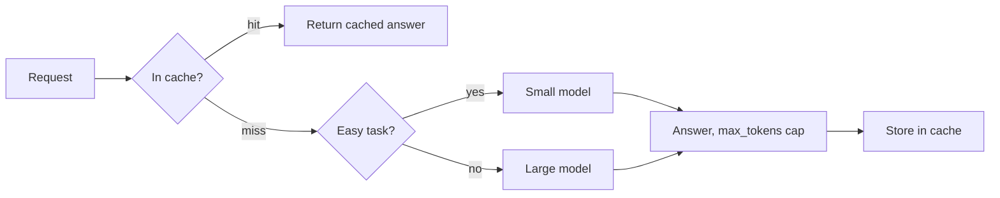

# Cost Optimization
> **Level:** Intermediate · **Reading time:** 10 min · **Phase:** 7 — Production AI

**In one line:** Cost optimization means sending fewer tokens, to cheaper models, fewer times, without dropping below your quality bar.

## Explain it like I'm new
Think of a taxi. You pay by distance. You save money by not taking a taxi when you can walk (cache), taking a cheap ride for a short trip (small model), and not driving around the block first (shorter prompts).

LLM APIs usually charge per **token** for input (your prompt plus retrieved context) and for output (the answer). Output tokens often cost more than input tokens. So cost grows with prompt size, answer size and request count.

The main levers:
- **Caching:** store answers for repeated questions (topic 4). A cache hit costs almost nothing.
- **Smaller models for easy tasks:** route simple requests (classification, short lookups) to a cheaper model. Keep the big model for hard ones.
- **Prompt trimming:** remove unused instructions, long examples and duplicate context.
- **Top-k tuning:** in RAG, **top-k** is how many chunks you retrieve. Fewer chunks means fewer input tokens. Find the smallest k that keeps quality.
- **`max_tokens`:** a cap on output length. It limits worst-case cost and latency.
- **Batching:** group many non-urgent jobs (for example nightly document processing) into one batch. Some providers offer cheaper batch endpoints. Check current docs.

## How it works
1. **Measure first** (topic 13). Find which route or step costs most.
2. Pick the biggest lever for that cost.
3. Change one thing at a time and re-run your golden set (topic 10) to check quality.
4. Track cost per request after each change.



### Worked example (ILLUSTRATIVE prices, not real)
Assume made-up prices. **Large model:** $0.001 per 1,000 input tokens, $0.003 per 1,000 output tokens. **Small model:** one tenth of that.

**Baseline.** Prompt = 200 (system) + 100 (question) + 8 chunks × 300 = 2,700 input tokens. Answer = 300 tokens.

```text
input : 2.7 * 0.001 = 0.0027
output: 0.3 * 0.003 = 0.0009
cost per request = 0.0036   ->  100,000 requests = $360
```

**Changes:**
1. Top-k 8 → 4: input = 200 + 100 + 4 × 300 = 1,500 tokens.
2. `max_tokens` cap lowers average answer to 200 tokens.

```text
large model: 1.5 * 0.001 + 0.2 * 0.003 = 0.0015 + 0.0006 = 0.0021
```
3. Route 50% of requests to the small model (one tenth price): 0.00021.
```text
blend = 0.5 * 0.0021 + 0.5 * 0.00021 = 0.001155
```
4. 30% cache hits (cost about 0), so 70% pay:
```text
0.7 * 0.001155 = 0.0008085  ->  100,000 requests = $80.85
```
From $360 to about $81 in this made-up case. Your numbers will differ. Always measure quality after each step.

## Code example
A stdlib sketch of caching plus cost tracking, using [`prod_cache_ratelimit.py`](../code/prod_cache_ratelimit.py):

```python
import sys
sys.path.insert(0, "07-production-ai/code")
from prod_cache_ratelimit import TTLCache

PRICE_IN, PRICE_OUT = 0.001, 0.003      # ILLUSTRATIVE, per 1,000 tokens
cache = TTLCache(ttl=3600, max_items=1000)

def fake_llm(prompt, max_tokens=200):
    return "answer", len(prompt.split()), 50   # text, in tokens, out tokens

def ask(question, prompt_version="v1"):
    key = f"{prompt_version}:{question.strip().lower()}"
    hit = cache.get(key)
    if hit is not None:
        return hit, 0.0
    text, tin, tout = fake_llm(question)
    cost = tin / 1000 * PRICE_IN + tout / 1000 * PRICE_OUT
    cache.set(key, text)
    return text, cost

print(ask("What is RAG?"))   # pays
print(ask("what is rag? ")) # cache hit, cost 0.0
print(cache.hit_rate)
```

### In real projects
Most provider SDKs let you set `max_tokens` (or an equivalent name) on each call, and some providers offer prompt caching and batch APIs with their own rules and discounts. Read your provider's current pricing and docs, and cache in Redis for multiple servers.

## When to use it / when not to
- Optimize when cost per request or monthly spend matters, and after you can measure it.
- Do not cut top-k or switch to a small model blindly. Quality drops show up on your golden set, not in the invoice.
- Caching suits repeated questions. Skip it for personalised or fast-changing answers, or key by user and data version.

## Common mistakes
- Optimizing before measuring.
- Caching without the prompt version or user scope in the key, so people get wrong or private answers.
- Setting `max_tokens` so low that answers are cut mid-sentence.
- Routing to a small model with no quality check.
- Forgetting that retries and agent loops multiply cost.

## Interview questions
**1. Name four ways to cut LLM cost.**
<details><summary>Answer</summary>Cache repeated requests, route easy tasks to smaller models, trim prompts and retrieved context (lower top-k), cap output with max_tokens, and batch offline work.</details>

**2. Why can lowering top-k hurt answers?**
<details><summary>Answer</summary>With fewer chunks the right passage may be missing. Tune k with a golden set and keep the smallest value that holds quality.</details>

**3. How do you know a cost change was safe?**
<details><summary>Answer</summary>Run the golden set before and after, and compare quality plus cost per request in your traces.</details>

## Go deeper
- [FastAPI documentation](https://fastapi.tiangolo.com/)
- [Redis documentation](https://redis.io/docs/)

**Prev:** [13-observability.md](13-observability.md) · **Next:** [15-deploy-a-production-ai-application.md](15-deploy-a-production-ai-application.md) · **Back to phase:** [Phase 7](../README.md)
