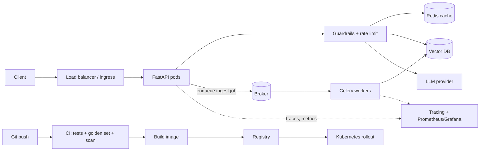

# Deploy a Production AI Application
> **Level:** Advanced · **Reading time:** 12 min · **Phase:** 7 — Production AI

**In one line:** Deploying a production AI app means packaging an API, its cache, queue, data stores and monitoring so they run reliably, are safe, and can be updated without breaking users.

## Explain it like I'm new
A demo is a food stall you run yourself. A production app is a restaurant: a front desk (API), a pantry (cache and vector database), a back kitchen for slow jobs (workers), health inspections (guardrails and security), and a log of every order (observability).

This topic ties the whole phase together. Each part solves one problem:
- **API** (topic 1): accepts requests and validates them.
- **Container** (topic 2) and **Kubernetes** (topic 3): package the app and run several copies.
- **Redis** (topic 4): cache and rate-limit state.
- **Celery** (topic 5) with **RabbitMQ or Redis** as broker (topic 6): run slow work, like ingesting documents, outside the request.
- **Vector database:** stores embeddings for retrieval (phase 1).
- **Monitoring, tracing** (topics 7, 8, 9, 13): show what is happening.
- **Prompt versions** (10), **security** (11), **guardrails** (12), **cost controls** (14).
- **CI/CD** (continuous integration and delivery): an automatic pipeline that tests and ships every change.

## How it works


### Step-by-step checklist
1. **Build the API.** FastAPI with Pydantic request and response models, `/health` and `/ready` routes, timeouts on every external call. (01)
2. **Add guardrails.** Input length, injection scan, PII redaction, output schema check. (11, 12)
3. **Add a cache and rate limit** in Redis, keyed by prompt version and user scope. (04, 14)
4. **Move slow work to a queue.** Document ingestion goes to Celery workers. Make tasks idempotent and retryable. (05, 06)
5. **Set up the vector database** with a clear re-index process and access-control metadata, filtered before retrieval. (11)
6. **Add observability.** Request ID, spans, tokens, latency, cost, error rate, cache hit rate. Add alerts. (07, 13)
7. **Version prompts.** Store in Git, log version and hash per request, roll out by canary. (10)
8. **Track experiments and evals** in LangSmith or MLflow if used. (08, 09)
9. **Containerize.** Small image, non-root user, no secrets baked in. (02)
10. **Configure secrets** through a secret manager or environment variables. Never commit them. (11)
11. **Deploy to Kubernetes** with resource limits, health probes, several replicas, and autoscaling. (03)
12. **Add CI/CD.** On every push: lint, unit tests, golden-set eval, secret scan, image build. Deploy with a rolling or canary release and a one-command rollback.
13. **Set cost guards.** `max_tokens`, daily spend alert, step caps for agents. (14)
14. **Run a load test** and a failure drill: kill the cache, slow the LLM, and check the fallback works.
15. **Write a runbook:** who is on call, how to roll back, where the dashboards are.

## Code example
A minimal FastAPI endpoint that combines guardrails, cache and tracing from this phase's code:

```python
# app.py  (run with: uvicorn app:app)
import sys
sys.path.insert(0, "07-production-ai/code")

from fastapi import FastAPI, HTTPException
from pydantic import BaseModel
from prod_guardrails import check_input
from prod_cache_ratelimit import TTLCache, TokenBucket
from prod_observability import Tracer

app = FastAPI()
cache = TTLCache(ttl=600)
limiter = TokenBucket(rate=5, capacity=10)
tracer = Tracer()

class Ask(BaseModel):
    question: str

def call_llm(prompt: str) -> str:
    return "stub answer"          # replace with your provider's SDK call

@app.get("/health")
def health():
    return {"status": "ok"}

@app.post("/ask")
def ask(body: Ask):
    if not limiter.allow():
        raise HTTPException(429, "rate limited")
    check = check_input(body.question)
    if not check["ok"]:
        raise HTTPException(400, check["reasons"])
    key = "v1:" + check["clean_text"].lower()
    cached = cache.get(key)
    if cached is not None:
        return {"answer": cached, "cached": True}
    with tracer.span("llm_call", prompt_version="v1") as s:
        answer = call_llm(check["clean_text"])
        s.record_usage(100, 50)
    cache.set(key, answer)
    return {"answer": answer, "cached": False}
```
This needs `pip install fastapi uvicorn`. In production, the in-memory cache and bucket are replaced by Redis so all replicas share state.

### In real projects
A GitHub Actions workflow is a YAML file in `.github/workflows/`. A minimal CI job checks out code, installs dependencies, runs `pytest`, then builds the Docker image. See the [GitHub Actions docs](https://docs.github.com/en/actions) for current syntax.

## When to use it / when not to
- Use the full stack when you have real users, uptime needs, or sensitive data.
- Start smaller if you are early: one container, a managed vector database and hosted tracing can be enough. Add Kubernetes and Celery when load or job length requires it.
- Each added component is something that can fail and must be monitored.

## Common mistakes
- Doing document ingestion inside the HTTP request, so it times out.
- No `/health` route or resource limits, so Kubernetes cannot manage the pods.
- Shipping prompt or model changes without running the golden set in CI.
- Secrets baked into the image or checked into Git.
- No rollback plan.

## Interview questions
**1. Why run ingestion in Celery instead of the API?**
<details><summary>Answer</summary>Ingestion is slow and can fail. A queue lets the API reply fast, retries failed jobs, and scales workers separately.</details>

**2. What belongs in a CI pipeline for an AI app?**
<details><summary>Answer</summary>Lint, unit tests, a golden-set evaluation of prompts and retrieval, a secret scan and the image build.</details>

**3. How do you release a new prompt or model safely?**
<details><summary>Answer</summary>Version it, run the golden set, release a canary share of traffic, compare quality, cost and latency, then promote or roll back.</details>

## Go deeper
- [FastAPI deployment docs](https://fastapi.tiangolo.com/deployment/)
- [Kubernetes documentation](https://kubernetes.io/docs/home/)

**Prev:** [14-cost-optimization.md](14-cost-optimization.md) · **Next:** [Phase 8 — Interview Prep](../../08-interview-prep/README.md) · **Back to phase:** [Phase 7](../README.md)
