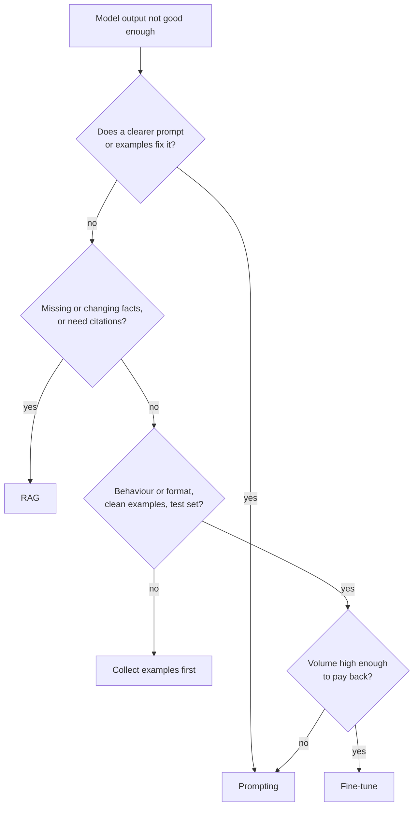

# Prompting vs RAG vs Fine-Tuning
> **Level:** Beginner · **Reading time:** 9 min · **Phase:** 8 · Fine-tuning

**In one line:** Prompting changes what you ask, RAG changes what the model can see, and fine-tuning changes how the model behaves, so you pick the cheapest one that fixes your actual problem and you do the sums before you train.

**Before you start:** [Fine-Tuning (the overview)](../../03-llm-concepts/topics/15-fine-tuning.md) for the basic idea, and [Prompt Engineering](../../03-llm-concepts/topics/14-prompt-engineering.md).

**Words to know:**
- **Few-shot prompt:** a prompt that includes a handful of worked examples of the answer you want.
- **RAG:** retrieval-augmented generation. Look up relevant documents at question time and paste them into the prompt.
- **Fine-tuning:** training an existing model a little more on your own examples so a behaviour becomes habit.
- **Break-even:** the point where a one-off cost has been paid back by what it saves each month.
- **Token:** a small chunk of text. Providers bill per token, both for what you send and what comes back.

## Explain it like I'm new
You hire a new assistant who is smart but knows nothing about your business. You have three levers.
- **Prompting** is a sticky note on their desk: "Reply in two sentences, friendly tone." Free to change, instant to test.
- **RAG** is a filing cabinet they can open before every answer. If the price list changes, you swap one page.
- **Fine-tuning** is a month of on-the-job training until your house style is second nature. It costs time and money, and what they learned stays fixed until you train them again.

Most teams jump to the third lever because it sounds serious. Usually the first or second is enough. The skill is diagnosing which kind of problem you have: a **knowledge** problem (the model does not know it), an **instruction** problem (it knows, but you asked badly), or a **behaviour** problem (it knows and you asked well, but it will not reliably respond in the shape you need).

<!-- anim:ft-decision -->
## Watch it


*It plays on a loop. Read the caption in the box, one step at a time. Want to go at your own pace? [Step through it with Previous and Next](https://techsaurabh-394.github.io/ai-engineer-roadmap/#ft-decision).*

## How it works
### Step 1: diagnose the failure
Look at ten real failures and sort them.

| What you see | Kind of problem | First fix |
|---|---|---|
| Wrong or missing facts, out-of-date prices, no source | Knowledge | [RAG](../../01-rag-foundations/README.md) |
| Ignores a rule you never stated clearly | Instruction | Rewrite the prompt, add examples |
| Right facts, but format or tone drifts on 1 in 10 calls | Behaviour | Few-shot, [structured outputs](../../03-llm-concepts/topics/17-structured-outputs.md), then maybe fine-tuning |
| Big model works, but is too slow or costly at your volume | Cost or latency | Smaller model, tuned on the big model's outputs |

The rule of thumb: **fine-tuning is for behaviour, RAG is for knowledge.** Training can nudge a model toward facts, but it does so unreliably, cannot cite a source, and goes stale the day your data changes. Lesson 2 explains why.

### Step 2: climb the ladder one rung at a time
Each rung costs more than the one before, so move up only when the rung below demonstrably failed on a test set.
1. **Better prompt.** Clear role, constraints, output format, a few examples.
2. **Structured outputs or constrained decoding** if the shape of the output is the problem.
3. **RAG** if the missing piece is information.
4. **Fine-tuning** if the missing piece is a consistent behaviour, or if you want a small cheap model to do one narrow job as well as a large one.
5. **Combine them.** A tuned model for tone and format, with RAG for facts, is common and sensible.

### Step 3: do the break-even sum
One honest reason to fine-tune is money. A long prompt (instructions plus examples) is sent on **every** request. A tuned model has absorbed those instructions, so the prompt shrinks. At high volume, shorter prompts save more per month than the project costs.

```text
monthly cost  = requests x (prompt_tokens x price_in + output_tokens x price_out) / 1,000,000
saving        = cost_before - (cost_after + upkeep)
break-even    = (training cost + data cost) / monthly saving     (in months)
```

The prices in the demo are **made-up illustrative units**, not any vendor's price. Replace them with your provider's current list. The shape of the answer is what matters.

### Worked example
From [`ft_decision.py`](../code/ft_decision.py): 200,000 requests a month. The prompt is 1,200 tokens before tuning (long instructions plus examples) and 150 after. Output is 150 tokens either way. Price: 3.00 units per million input tokens and 15.00 per million output tokens. A tuned model costs 1.5x per token, upkeep is 50 a month, and the one-off cost is 400 for training plus 2,000 for collecting and cleaning data.

1. Tokens before: 200,000 x 1,200 = 240,000,000 in and 30,000,000 out. Cost: 240 x 3.00 + 30 x 15.00 = 720 + 450 = **1,170.00** a month.
2. Tokens after: 30,000,000 in and 30,000,000 out. Cost: 1.5 x (30 x 3.00 + 30 x 15.00) = 1.5 x 540 = 810, plus upkeep 50 = **860.00**.
3. Saving: 1,170 - 860 = **310.00** a month.
4. One-off cost: 400 + 2,000 = 2,400. Break-even: 2,400 / 310 = **7.74 months**.

Now change one thing. At 10,000 requests a month the long prompt costs 58.50 and the tuned model costs 90.50, because the fixed upkeep and the 1.5x multiplier outweigh the saving: it **never** breaks even. The demo's search finds that you need about **138,889 requests a month** to pay back within 12 months. And if your prompt was already short (200 tokens down to 150), there is no saving to find at all.



## Code example
From [`ft_decision.py`](../code/ft_decision.py) (run `python 10-fine-tuning/code/ft_decision.py`):

```python
from dataclasses import replace
from ft_decision import Scenario, costs, months_to_break_even, break_even_requests

s = Scenario()                       # the illustrative scenario above
before, after = costs(s)
print(before, after)                 # -> 1170.0 860.0
print(round(months_to_break_even(s), 2))   # -> 7.74
print(months_to_break_even(replace(s, requests_per_month=10_000)))   # -> None (never pays back)
print(break_even_requests(s, 12))    # -> 138889
```

The full demo also prints a small rule table, `recommend(...)`, that mirrors the flowchart: prompting if a prompt fix works, RAG for facts or citations, fine-tuning only with clean examples and high volume. The tests in [`test_ft_decision.py`](../code/test_ft_decision.py) check the arithmetic by hand and that the break-even volume is a true threshold: one request fewer and it no longer pays back within 12 months.

**In real projects** every number comes from your own traffic logs and your provider's current price list, and you add the cost of the people who will keep the dataset and evaluation alive.

## When to use it / when not to
| Situation | Fine-tune? |
|---|---|
| Format or tone drifts even with good prompts and examples | Yes, if you have clean examples and a test set |
| A 1,000-token prompt is sent millions of times a month | Likely yes: shorter prompts pay for the project |
| A small tuned model could replace a large model on one narrow task | Yes, after measuring quality on held-out data |
| The model lacks facts, or your facts change weekly | **No.** Use RAG |
| You need to show where an answer came from | **No.** Use RAG |
| You have 20 messy examples and no test set | Not yet. Fix the data first |
| A prompt change you have not tried yet might fix it | **No.** Try it first, it takes minutes |

## Common mistakes
- Fine-tuning to add knowledge, then being surprised when answers are confidently wrong and cannot cite anything.
- Skipping the baseline: never measuring the best prompt on a test set, so you cannot tell whether tuning helped.
- Ignoring the hidden costs: data collection, labelling, evaluation, retraining when the base model changes.
- Forgetting that per-token prices for tuned models can differ, and that low volume never repays a fixed project cost.
- Treating the three tools as rivals. They stack: tune for behaviour, retrieve for facts, prompt for the task.

## Recap
If you remember only three things:
- Diagnose first: knowledge problems go to RAG, instruction problems to prompts, behaviour problems may justify fine-tuning.
- Climb the ladder one rung at a time, and move up only when a test set shows the lower rung failed.
- Compute break-even: in the demo it is 7.74 months at 200,000 requests, and never at 10,000.

## Interview questions
**1. A client wants to fine-tune a model so it knows their weekly-changing price list. What do you recommend?**
<details><summary>Answer</summary>
RAG. Prices change faster than you can retrain, and fine-tuning teaches behaviour rather than reliable facts, and cannot cite a source. Retrieve the current price list at question time. Fine-tuning might still help later with tone or output format.
</details>

**2. How would you decide whether fine-tuning pays for itself?**
<details><summary>Answer</summary>
Measure the monthly cost with the best prompt, estimate the cost after tuning (shorter prompt, any per-token price change, upkeep), and divide the one-off cost of data, training and evaluation by the monthly saving. In the demo that is 2,400 / 310 = 7.74 months. If the saving is zero or negative, it never pays back on cost alone and you would need a quality reason.
</details>

**3. Give two situations where you would use fine-tuning and RAG together.**
<details><summary>Answer</summary>
A support bot that must always answer in a strict house style and JSON shape (learned by tuning) using facts that change (retrieved). Or a small cheap model tuned to follow your citation format, fed with retrieved passages for the content.
</details>

## Go deeper
- [Training language models to follow instructions with human feedback (InstructGPT, Ouyang et al., 2022)](https://arxiv.org/abs/2203.02155)
- [Hugging Face PEFT docs](https://huggingface.co/docs/peft)

**Prev:** [Phase 7 · Production AI](../../07-production-ai/README.md) · **Next:** [Supervised and Instruction Tuning](02-supervised-and-instruction-tuning.md) · **Back to phase:** [Phase 8](../README.md)
