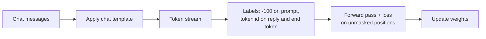

# Supervised and Instruction Tuning
> **Level:** Intermediate · **Reading time:** 10 min · **Phase:** 8 · Fine-tuning

**In one line:** Supervised fine-tuning (SFT) shows a model finished conversations and trains it to predict the assistant's tokens, with the loss switched off on everything else, so it learns a format and a way of behaving rather than new facts.

**Before you start:** [How LLMs Are Trained](../../03-llm-concepts/topics/24-how-llms-are-trained.md) (loss and next-token prediction) and [Prompting vs RAG vs Fine-Tuning](01-prompting-vs-rag-vs-fine-tuning.md).

**Words to know:**
- **SFT (supervised fine-tuning):** continuing training on pairs of "input, the answer I wanted".
- **Instruction tuning:** SFT on many different tasks written as instructions, so the model learns to follow instructions in general.
- **Chat template:** the exact text layout (role markers and end tokens) a model expects for a conversation.
- **Loss mask:** a switch per token that says "count this token in the loss" or "ignore it".
- **Ignore index (-100):** the label value that most training libraries skip when computing the loss.

## Explain it like I'm new
Imagine teaching a trainee by handing them transcripts of ideal phone calls. You do not quiz them on what the customer said, because the customer's lines are just the prompt. You grade them only on the agent's lines: did they answer in the right tone, in the right shape, and stop at the right moment?

That is SFT. The model already knows language from pretraining. Now you show it thousands of complete chats and it adjusts so that, given the user's part, it produces the assistant's part. Two consequences follow:
- It learns **how to answer** (format, tone, when to stop, which tool call to write). That is why a few hundred good examples can change behaviour a lot.
- It does **not** reliably learn **what is true**. A model trained on "The refund window is 30 days" may repeat it, but it has no lookup, no source and no way to update it, which is the same reason [RAG](../../01-rag-foundations/README.md) is better for facts.

The famous instruction-tuning results (FLAN, InstructGPT) were about this: the same base model, trained to follow instructions, became far more useful on tasks it was never explicitly trained on.

<!-- anim:ft-sft-masking -->
## Watch it


*It plays on a loop. Read the caption in the box, one step at a time. Want to go at your own pace? [Step through it with Previous and Next](https://techsaurabh-394.github.io/ai-engineer-roadmap/#ft-sft-masking).*

## How it works
### 1. The data is chats
One training record is a list of messages, each with a role:

```text
{"messages": [
  {"role": "system",    "content": "You are a concise support assistant."},
  {"role": "user",      "content": "Can I cancel my order?"},
  {"role": "assistant", "content": "Yes, before it ships."}
]}
```

### 2. The chat template turns messages into one token stream
A model never sees roles as JSON. A **chat template** flattens the messages into one string with special marker tokens. Each model family has its own markers, and you must use the template of the model you are tuning: tune with one layout and serve with another and quality quietly drops. In this phase's demo we use a simple made-up template, `<|role|> words <|end|>`:

```text
<|user|> hi there <|end|> <|assistant|> hello friend <|end|>
```

The `<|end|>` after the assistant's words matters: it is what teaches the model to **stop**. Without it, a tuned model can keep generating forever.

### 3. The loss only counts assistant tokens
Pretraining computes next-token loss on every token. In SFT we usually compute it **only on the assistant's tokens**. Why?
- The user's words are *input*, not behaviour we want to produce. Training on them wastes capacity and can teach the model to write user messages.
- Users paste long documents. Grading the model on reproducing them would drown out the signal from the short answer.

Implementation: build a **labels** list the same length as the tokens. Where the mask is 1 the label is the token; where the mask is 0 the label is `-100`, and the loss function skips those positions.

```text
loss = (1 / |A|) * sum over assistant positions t in A of  -log p(token_t | tokens before t)
```

### Worked example
From [`ft_dataset_prep.py`](../code/ft_dataset_prep.py): the chat "hi there" / "hello friend" becomes 8 tokens.

```text
tokens: <|user|> hi there <|end|> <|assistant|> hello friend <|end|>
mask  : 0        0  0     0       0             1     1      1
labels: -100 -100 -100 -100 -100 hello friend <|end|>
```

Only 3 of 8 positions are trained. The `<|assistant|>` header is masked out too: at inference time we write that header ourselves, so the model never has to predict it. Now suppose the eight per-token losses are `4.0, 3.5, 3.0, 2.5, 2.0, 1.0, 3.0, 2.0`.
1. Averaged over all 8 tokens: 21.0 / 8 = **2.625**.
2. Averaged over the 3 assistant tokens only: (1.0 + 3.0 + 2.0) / 3 = **2.000**.

The unmasked number is higher and mostly measures how badly the model predicts the *user's* words, which you never wanted it to optimise. (These per-token losses are made up for the demo; the point is the arithmetic.)



### Why SFT teaches behaviour, not facts
The loss rewards matching the *style and structure* of the reply. If your 500 examples contain 40 different facts, each appears once or twice; the model sees far too few repetitions to store them reliably, and it may blend them with what pretraining taught it. What *does* appear 500 times is the format, the tone, the refusal pattern, the JSON shape. That is what gets learned. Training on facts also creates a worse failure: the model learns to *sound* certain without having a source, so wrong answers look confident (see [Hallucination](../../03-llm-concepts/topics/13-hallucination.md)).

### How many examples?
There is no magic number. A narrow format task can improve with a few hundred high-quality examples; a broad behaviour needs thousands. Quality dominates: lesson 3 covers cleaning. The practical method is to train on a small slice, evaluate on held-out data (lesson 7), and add data where the failures are.

### Instruction tuning vs task SFT
- **Instruction tuning** mixes many tasks phrased as instructions, so the model gets better at following *new* instructions. It is how base models become assistants.
- **Task SFT** is your narrow case: one behaviour for one product. Most readers do this, usually with [LoRA](04-lora-in-depth.md) on top of an already instruction-tuned model.

## Code example
From [`ft_dataset_prep.py`](../code/ft_dataset_prep.py) (run `python 10-fine-tuning/code/ft_dataset_prep.py`):

```python
from ft_dataset_prep import render_chat, build_labels, masked_mean_loss

msgs = [{"role": "user", "content": "hi there"},
        {"role": "assistant", "content": "hello friend"}]
tokens, mask = render_chat(msgs)
labels = build_labels(tokens, mask)
print(mask)      # -> [0, 0, 0, 0, 0, 1, 1, 1]
print(labels)    # -> [-100, -100, -100, -100, -100, 'hello', 'friend', '<|end|>']

losses = [4.0, 3.5, 3.0, 2.5, 2.0, 1.0, 3.0, 2.0]
print(masked_mean_loss(losses, labels))   # -> 2.0 (all-token mean would be 2.625)
```

The tests in [`test_ft_dataset_prep.py`](../code/test_ft_dataset_prep.py) check the template output, that the mask covers exactly the reply and its end token, that mismatched lengths raise an error, and that masked positions never affect the average. `build_labels` is also in [`ft_lora_params.py`](../code/ft_lora_params.py) in its plain integer form. For the same idea inside the training code, see `loss_mask` in [`llm_training.py`](../../03-llm-concepts/code/llm_training.py).

**In real projects** use your trainer's data collator or chat-template helpers (for example in [Hugging Face TRL](https://huggingface.co/docs/trl)) rather than writing the template by hand, and verify on a few examples that the masked positions are what you expect. APIs change, so check the current docs.

## When to use it / when not to
| Situation | SFT? |
|---|---|
| You need a consistent format, tone or tool-call style | Yes |
| You have a few hundred to a few thousand clean examples of ideal replies | Yes |
| The base model never produces the right answer even once | Be careful: SFT amplifies what the model can already do |
| You want the model to know new, changing facts | No. Use RAG |
| You only have preference rankings, no ideal answers | Look at preference tuning (lesson 7) |

## Common mistakes
- Training on the whole sequence, including long user prompts, so the loss is dominated by text you never need to generate.
- Using a different chat template for training than for serving.
- Forgetting the end-of-turn token in the labels, so the tuned model never learns to stop.
- Putting facts in the data and expecting reliable recall.
- Examples that disagree with each other (one says "30 days", another "14 days"), which teaches the model to guess.

## Recap
If you remember only three things:
- SFT trains on finished chats, with the loss on the assistant's tokens only (labels -100 elsewhere).
- Use the model's own chat template, and include the end token so it learns to stop.
- SFT teaches format and behaviour well, and facts poorly; use RAG for facts.

## Interview questions
**1. Why mask the prompt tokens when doing SFT?**
<details><summary>Answer</summary>
Prompt tokens are input, not the behaviour you want the model to produce. Including them spends capacity on imitating users and lets long prompts dominate the loss. Setting their labels to -100 makes the loss average only over the assistant's tokens.
</details>

**2. Why is the end-of-turn token part of the trained labels?**
<details><summary>Answer</summary>
It is how the model learns when to stop. If it is masked out or missing, the tuned model may keep generating after the answer is complete.
</details>

**3. A model tuned on your FAQ still gets prices wrong. Why, and what do you do?**
<details><summary>Answer</summary>
SFT mostly teaches how to respond, and each fact appears too few times to be stored reliably, and the model cannot cite or update it. Put the prices in a retrieval step (RAG) and keep fine-tuning for tone and format.
</details>

## Go deeper
- [Finetuned Language Models Are Zero-Shot Learners (FLAN, Wei et al., 2021)](https://arxiv.org/abs/2109.01652)
- [Training language models to follow instructions with human feedback (InstructGPT, Ouyang et al., 2022)](https://arxiv.org/abs/2203.02155)
- [Hugging Face TRL docs](https://huggingface.co/docs/trl)

**Prev:** [Prompting vs RAG vs Fine-Tuning](01-prompting-vs-rag-vs-fine-tuning.md) · **Next:** [Dataset Preparation](03-dataset-preparation.md) · **Back to phase:** [Phase 8](../README.md)
