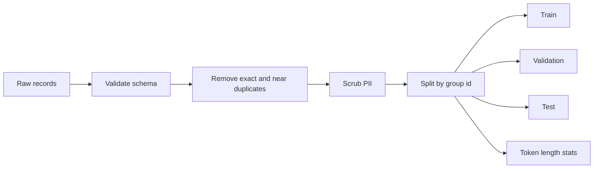

# Dataset Preparation
> **Level:** Intermediate · **Reading time:** 10 min · **Phase:** 8 · Fine-tuning

**In one line:** A small, clean, correctly split dataset beats a large messy one, so you validate every record, remove duplicates, scrub personal data, split by group so nothing leaks into the test set, and look at the length statistics before you spend a cent on training.

**Before you start:** [Supervised and Instruction Tuning](02-supervised-and-instruction-tuning.md) and the data-cleaning demo in [Fine-Tuning (the overview)](../../03-llm-concepts/topics/15-fine-tuning.md), which this lesson goes deeper than.

**Words to know:**
- **Schema:** the agreed shape of a record (which fields, which types, which roles).
- **Near-duplicate:** two records that differ by a word or punctuation but mean the same thing.
- **Jaccard similarity:** the size of the overlap of two word sets divided by the size of their union. 1.0 is identical, 0.0 shares nothing.
- **Data leakage:** information from the test set sneaking into training, which inflates your score.
- **PII:** personally identifiable information, such as emails, phone numbers and names.

## Explain it like I'm new
Teaching with a textbook full of typos, repeated pages and one student's private diary pasted in is a bad idea. A model copies what it sees. If 30 of your examples contain the same wrong answer, it learns that answer. If the exam questions were also in the textbook, a perfect exam score tells you nothing about what the student understands.

Dataset preparation is the dull, high-value work of fixing those problems *before* training. Most failed fine-tuning projects are data failures, not model failures. The order of the steps matters too: validate, then de-duplicate, then scrub, then split. If you split first and de-duplicate later, copies can already sit on both sides of the split.

<!-- anim:ft-dataset-prep -->
## Watch it


*It plays on a loop. Read the caption in the box, one step at a time. Want to go at your own pace? [Step through it with Previous and Next](https://techsaurabh-394.github.io/ai-engineer-roadmap/#ft-dataset-prep).*

## How it works
### 1. Quality over quantity
Every example is a vote on how the model should behave. Ten thousand sloppy votes lose to five hundred careful ones. Good examples are correct, consistent with each other, written in exactly the voice you want, and cover the real range of inputs (including awkward ones such as typos, angry users and out-of-scope questions, with the reply you want in those cases).

### 2. Validate the schema
Write down the shape of a record and reject anything else. In the demo a record is `{"id", "group", "messages": [...]}` and valid means: every role is `system`, `user` or `assistant`; an optional system message comes first; user and assistant alternate; the last message is from the assistant; no content is empty. A record with a role called `bot` or an empty reply would otherwise be silently trained on.

### 3. Remove duplicates, exact and near
Duplicates over-weight some examples and, worse, put the same text into both train and test.
- **Exact:** normalise (lowercase, drop punctuation, collapse spaces) and compare strings.
- **Near:** compare word sets with Jaccard similarity and drop one of a pair above a threshold such as 0.8.

```text
jaccard(A, B) = |words(A) and words(B)| / |words(A) or words(B)|
```

The demo's near-duplicate check compares every pair, which is fine for thousands of rows. For millions you would use an approximate method (MinHash with locality-sensitive hashing).

### 4. Scrub personal data
Training data can be memorised and later repeated. Replace emails and phone numbers with placeholders such as `[EMAIL]` and `[PHONE]` before training. A regular expression catches the obvious formats and misses names, addresses and anything unusual, so treat it as a first pass: for real customer data also check your legal obligations and consider a dedicated scrubber and human spot checks.

### 5. Split without leakage
Hold out a **validation** set (to tune settings) and a **test** set (to report the final score), and never train on them. The subtle trap is that *records are not independent*: several chats from one customer, several questions about one document, or paraphrases of one question all share facts and wording. If they straddle the split, the model can pass the test by remembering, not generalising. Split by a **group id** so every group lands wholly in one split.

### 6. Look at the lengths
Count tokens per example and look at the minimum, median, 90th percentile and maximum. Anything above your training sequence length is truncated, which can cut off the very answer you wanted learned. Very short outliers are often junk. The demo uses a whitespace tokenizer for a rough count; a real tokenizer (BPE) produces more tokens than words, roughly 1.3 per English word, so use your model's own tokenizer for real limits.

### Worked example
The demo's built-in sample has 30 chat records in 15 groups. Running the pipeline:

1. **Validate:** 28 pass, 2 fail. `r27` has an empty assistant reply, and `r28` has a role called `bot` and does not end with the assistant.
2. **De-duplicate:** `r04` is an exact copy of `r03` after normalising ("Can I cancel my order?!" vs "...order?"), and `r06` is a near-copy of `r05` (Jaccard 0.882 against a threshold of 0.8). 26 records are kept.
3. **Scrub:** 2 emails and 2 phone numbers are replaced. `r09` becomes "Done. We sent the invoice to [EMAIL]."
4. **Split by group:** 18 train, 4 validation, 4 test. Group overlap between any two splits is empty, and no normalised text appears in both train and test.
5. **Lengths:** across the 26 kept records, in whitespace tokens: min 12, mean 16.96, median 17.0, 90th percentile 20, max 23.
6. **Contrast:** a plain random shuffle-split of the same data leaves **4** groups shared between train and test. Those are four places where the test score would be flattered.



## Code example
From [`ft_dataset_prep.py`](../code/ft_dataset_prep.py) (run `python 10-fine-tuning/code/ft_dataset_prep.py`):

```python
from ft_dataset_prep import SAMPLE, run_pipeline, group_overlap, length_stats

out = run_pipeline(SAMPLE)
print(len(out["invalid"]), len(out["dropped"]))      # -> 2 2
print(out["pii"])                                    # -> {'email': 2, 'phone': 2}
print(len(out["train"]), len(out["val"]), len(out["test"]))   # -> 18 4 4
print(group_overlap(out["train"], out["test"]))      # -> []
print(length_stats(out["kept"]))
# -> {'n': 26, 'min': 12, 'mean': 16.96, 'median': 17.0, 'p90': 20, 'max': 23}
```

The tests in [`test_ft_dataset_prep.py`](../code/test_ft_dataset_prep.py) check the validation rules one by one, the exact and near-duplicate decisions, the PII placeholders (including that "Order 1001" and "3 to 5 days" are left alone), that no group or text crosses the split, that the split is deterministic for a seed and different for another, and that nothing is lost.

**In real projects** keep the raw data untouched, write the cleaned data as JSONL, record the seed and the counts at each step, and read a random sample by eye. Twenty minutes of reading examples finds problems that no script does.

## When to use it / when not to
| Situation | Do this |
|---|---|
| Any fine-tuning project | Validate, dedupe, scrub and split first. Always |
| Examples come in clusters (same user, document or ticket) | Split by group id, not by row |
| Millions of rows | Use approximate dedup (MinHash) and a streaming pipeline |
| Data contains customer details | Scrub, minimise, and check the rules for it before training |
| Fewer than a few dozen clean examples | Collect more before training |

## Common mistakes
- Splitting randomly by row when rows come in related groups, then trusting an inflated test score.
- De-duplicating after the split, so copies sit on both sides.
- Trusting a regex to find all personal data.
- Using whitespace word counts as if they were model tokens when checking length limits.
- Letting the test set influence choices (prompt, rank, epochs), which turns it into a second validation set.
- Generating synthetic examples with a model and never reading them.

## Recap
If you remember only three things:
- Validate, then dedupe, then scrub, then split. The order matters.
- Split by group id so related examples never straddle train and test.
- In the demo, 30 records become 26 clean ones split 18/4/4 with zero overlap, while a plain random split leaks 4 groups.

## Interview questions
**1. Why can a random row-level split give a misleadingly high test score?**
<details><summary>Answer</summary>
Related rows (same customer, document, or paraphrases) share facts and wording. If some are in training and some in test, the model can score well by remembering them. Splitting by group id keeps every related set on one side.
</details>

**2. How do you find near-duplicates, and why do they matter?**
<details><summary>Answer</summary>
Normalise the text and compare word sets with Jaccard similarity (or use MinHash at large scale), dropping one of any pair above a threshold. They over-weight some examples and leak between train and test.
</details>

**3. What are the limits of a regex PII scrub?**
<details><summary>Answer</summary>
It catches fixed formats such as emails and some phone numbers, but misses names, addresses, IDs and unusual formats, and can wrongly hit harmless numbers. Use it as a first pass, then spot-check and follow your data-protection rules.
</details>

## Go deeper
- [Hugging Face TRL docs](https://huggingface.co/docs/trl) (dataset formats the trainers expect)
- [Finetuned Language Models Are Zero-Shot Learners (FLAN, Wei et al., 2021)](https://arxiv.org/abs/2109.01652)

**Prev:** [Supervised and Instruction Tuning](02-supervised-and-instruction-tuning.md) · **Next:** [LoRA in Depth](04-lora-in-depth.md) · **Back to phase:** [Phase 8](../README.md)
