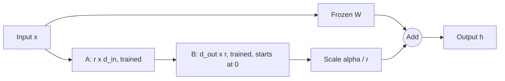

# LoRA in Depth
> **Level:** Intermediate · **Reading time:** 11 min · **Phase:** 8 · Fine-tuning

**In one line:** LoRA freezes a weight matrix W and learns two thin matrices B and A whose scaled product is added to it, W' = W + (alpha/r) B A, so you train a fraction of a percent of the parameters, can merge the result back for free, and choose rank, alpha and target layers to trade capacity for cost.

**Before you start:** [LoRA and PEFT](../../03-llm-concepts/topics/19-lora-and-peft.md) (the short version, with a 4x4 example) and [Supervised and Instruction Tuning](02-supervised-and-instruction-tuning.md). This lesson goes deeper: rectangular matrices, whole-model counts, a rank proof, and how to choose settings.

**Words to know:**
- **Rank (r):** the inner size of the two thin matrices. The update can carry at most r independent directions.
- **Alpha:** a scaling constant. The update is multiplied by alpha / r.
- **Target modules:** which weight matrices of the model get an adapter (for example the attention projections q, k, v, o).
- **Adapter:** the small trained add-on (all the B and A matrices), saved as a separate file.
- **Merge:** adding B A into W so the model is one set of weights again.

## Explain it like I'm new
A huge printed atlas is too expensive to reprint, so you stick a thin transparent overlay on certain pages with your corrections. The overlay is small, cheap to make, can be peeled off, and you can keep a different overlay per customer. Once you are happy, you can print the corrections into the page permanently (merging).

The reason a thin overlay can work is an empirical observation from the LoRA paper: the *change* needed to adapt a pretrained model to a new task tends to have low "intrinsic rank". You do not need to move every weight independently; a handful of directions of change capture most of what matters. LoRA hard-wires that assumption: instead of learning a full d_out by d_in change, it learns it as a product of a tall thin matrix and a short wide one.

<!-- anim:ft-lora-in-depth -->
## Watch it


*It plays on a loop. Read the caption in the box, one step at a time. Want to go at your own pace? [Step through it with Previous and Next](https://techsaurabh-394.github.io/ai-engineer-roadmap/#ft-lora-in-depth).*

## How it works
### The formula
For a frozen weight W of shape d_out by d_in, LoRA adds two trainable matrices: A (r by d_in) and B (d_out by r). The layer computes:

```text
h  =  W x  +  (alpha / r) * B (A x)
W' =  W    +  (alpha / r) * B A          (the merged weight)
```

A is initialised with small random numbers and **B starts at zero**, so at step 0 the update is exactly zero and the model behaves like the base model. Training then moves only A and B.

### Counting parameters
Full fine-tuning of one matrix trains d_out x d_in numbers. LoRA trains r x (d_in + d_out):

```text
full  = d_in * d_out
LoRA  = r * (d_in + d_out)
```

From [`ft_lora_params.py`](../code/ft_lora_params.py):
- A square 4096 x 4096 matrix: full 16,777,216 versus LoRA at r = 8 of 65,536, which is **0.3906%**. (The same figure as in the [short version](../../03-llm-concepts/topics/19-lora-and-peft.md).)
- A rectangular feed-forward matrix 4096 x 11008: full 45,088,768 versus LoRA r = 8 of 120,832.

For a whole model we use a toy 7B-class layout: 32 layers, d_model 4096, feed-forward width 11008 with three matrices (gate, up, down), 32,000-word vocabulary. That totals **6,738,149,376** parameters. Trainable parameters by choice of layers and rank:

| Target modules | Rank | Trainable | Share of the model |
|---|---|---|---|
| q, v | 8 | 4,194,304 | 0.062% |
| q, v | 16 | 8,388,608 | 0.124% |
| q, k, v, o | 16 | 16,777,216 | 0.249% |
| all seven linear layers | 16 | 39,976,960 | 0.593% |

Trainable count is linear in rank: doubling r from 8 to 16 exactly doubles it. (The earlier lesson's 4,194,304 appears again here as the q, v, r = 8 row; the earlier lesson quotes a rounded 7B total, so its memory figure differs slightly from ours.)

### Why the update has rank at most r
B A is a (d_out by r) times (r by d_in) product, so every column of B A is a combination of the r columns of B. It cannot have more than r independent directions. The demo checks this with a pure-Python rank function (Gaussian elimination with partial pivoting) on random Gaussian matrices with d = 12:

```text
r=1: rank(BA) = 1      r=2: rank(BA) = 2
r=4: rank(BA) = 4      r=8: rank(BA) = 8
a random 12x12 matrix: rank 12
```

So the update is a rank-r correction to a (usually) full-rank W. It is a strong restriction, and that is both LoRA's saving and its limit.

### Choosing rank and alpha
- **Rank:** common starting values are 8 to 64. Raise it if the tuned model underfits (training loss stays high) on a hard task; lower it if you overfit or want a tiny file. Returns diminish quickly: the LoRA paper reported that very small ranks already did well on the tasks it tested.
- **Alpha:** the scale is alpha / r. A frequent convention is alpha = r or alpha = 2r. What matters is the *ratio*: changing r while keeping alpha fixed changes how loud the update is. Tune the learning rate and alpha / r together, not in isolation.
- **Dropout on the adapter** (a small value such as 0.05) is a common regulariser.

These are starting points, not laws. Treat them as hyperparameters and compare on a validation set (lesson 6).

### Which layers?
The original paper adapted only the attention query and value projections. Many practitioners now adapt **all linear layers** (attention and feed-forward), which costs more parameters (0.593% above versus 0.062%) but often fits harder tasks better; the QLoRA paper found that adapting all linear layers mattered for matching full fine-tuning quality. Embeddings and norm layers are usually left alone. Try attention-only first for a narrow style task, and widen if validation loss stalls.

### Merging, and not merging
Because the update is linear, `W x + s B (A x)` equals `(W + s B A) x` where s = alpha / r. The demo verifies this on random matrices with d = 16, r = 4, alpha = 8: the largest difference between the two outputs is **3.55e-15**, which is rounding noise.

- **Merge** for a single deployment: inference then costs exactly what the base model costs, with no extra layers.
- **Keep separate** to serve many customers or tasks from one base: load a different small file per request.
- Careful: merging into a **quantized** base rounds the result and can lose quality; merge into 16-bit weights, then re-quantize, and test afterwards. An adapter belongs to the exact base version it was trained on.

### Worked example
Take d = 4096 for q and v in all 32 layers at r = 8.
1. One matrix: 8 x (4096 + 4096) = 65,536 trainable numbers.
2. Two matrices per layer, 32 layers: 64 matrices x 65,536 = 4,194,304.
3. Against 6,738,149,376 total: 4,194,304 / 6,738,149,376 = 0.062%.
4. Gradients and optimizer state exist only for those 4.19 million numbers, which is why memory drops so much (next lesson counts it).
5. Raise the rank to 16 and the count doubles to 8,388,608, still only 0.124%.



## Code example
From [`ft_lora_params.py`](../code/ft_lora_params.py) (run `python 10-fine-tuning/code/ft_lora_params.py`):

```python
import random
import ft_lora_params as lp

print(lp.lora_params(4096, 4096, 8))                       # -> 65536
m = lp.ToyTransformer()
print(m.total_params())                                    # -> 6738149376
print(m.lora_trainable(["q", "v"], 8))                     # -> 4194304

rng = random.Random(0)
BA = lp.matmul(lp.random_matrix(12, 4, rng), lp.random_matrix(4, 12, rng))
print(lp.rank(BA))                                         # -> 4
```

The tests in [`test_ft_lora_params.py`](../code/test_ft_lora_params.py) check every count above, that the rank of B A equals r for r in 1, 2, 4 and 8, that merge equals the separate adapter to 1e-9, that a zero B leaves the weights unchanged, and that doubling the rank doubles the trainable count.

**In real projects** use the Hugging Face [PEFT](https://huggingface.co/docs/peft) library, which exposes rank, alpha, dropout and target modules as configuration, and can merge adapters. Its API changes, so read the current docs. The method is in the [LoRA paper (Hu et al., 2021)](https://arxiv.org/abs/2106.09685).

## When to use it / when not to
| Situation | LoRA? |
|---|---|
| Full fine-tuning does not fit in memory | Yes |
| Many tasks or customers on one base model | Yes, one small adapter each |
| Narrow style or format change | Yes, start with r = 8 to 16 on attention layers |
| A task far from the base model's abilities, or needing broad new skills | Maybe not. Try a higher rank, all linear layers, or a different base |
| You need new reliable facts | No. RAG |

## Common mistakes
- Changing r without noticing alpha / r changed, then blaming the data for the instability.
- Setting rank very high "to be safe": more parameters, more memory, more overfitting, little gain.
- Merging into a quantized model without re-testing.
- Using an adapter with a different base-model version than it was trained on.
- Only measuring training loss and never comparing against the base model on held-out data.

## Recap
If you remember only three things:
- W' = W + (alpha/r) B A, with B starting at zero; trainable parameters are r x (d_in + d_out) per matrix.
- On a 6.74B-parameter toy layout, q and v at r = 8 train 4,194,304 parameters, 0.062% of the model, and B A has rank at most r.
- The adapter can be merged exactly (error about 1e-15) or kept as a swappable file.

## Interview questions
**1. Derive the number of trainable parameters for a LoRA adapter on a d_out x d_in matrix.**
<details><summary>Answer</summary>
A is r x d_in and B is d_out x r, so r x d_in + d_out x r = r x (d_in + d_out). For 4096 x 4096 at r = 8 that is 8 x 8192 = 65,536, against 16,777,216 for the full matrix.
</details>

**2. Why does B start at zero, and why does it matter?**
<details><summary>Answer</summary>
With B = 0 the product B A is zero, so the adapted model equals the base model at step 0. Training starts from known-good behaviour and moves away gradually, instead of starting from a random perturbation of the weights.
</details>

**3. How do alpha and r interact, and when is merging a bad idea?**
<details><summary>Answer</summary>
The update is scaled by alpha / r, so changing r with alpha fixed changes the update's strength; tune them together with the learning rate. Merging is exact in full precision, but merging into a quantized base re-rounds the weights and can lose quality, so merge in 16-bit, re-quantize and re-test, or keep the adapter separate.
</details>

## Go deeper
- [LoRA: Low-Rank Adaptation of Large Language Models (Hu et al., 2021)](https://arxiv.org/abs/2106.09685)
- [QLoRA (Dettmers et al., 2023)](https://arxiv.org/abs/2305.14314)
- [Hugging Face PEFT docs](https://huggingface.co/docs/peft)

**Prev:** [Dataset Preparation](03-dataset-preparation.md) · **Next:** [QLoRA and Quantized Training](05-qlora-and-quantized-training.md) · **Back to phase:** [Phase 8](../README.md)
