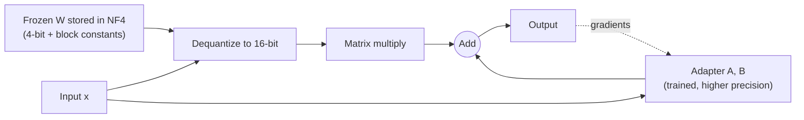

# QLoRA and Quantized Training
> **Level:** Advanced · **Reading time:** 10 min · **Phase:** 8 · Fine-tuning

**In one line:** QLoRA keeps the base model frozen in 4-bit NormalFloat (NF4) to shrink its memory, trains ordinary LoRA adapters in higher precision on top, and uses two more tricks named in the paper, double quantization and paged optimizers, so a large model can be tuned on one GPU.

**Before you start:** [LoRA in Depth](04-lora-in-depth.md) and [Quantization](../../03-llm-concepts/topics/18-quantization.md) (scales, rounding, outliers).

**Words to know:**
- **NF4 (4-bit NormalFloat):** a 4-bit number format whose 16 levels are placed to suit weights that are roughly bell-shaped.
- **Block-wise quantization:** splitting weights into small blocks, each with its own scale (a "quantization constant").
- **Double quantization:** quantizing those per-block constants too, to save a little more memory.
- **Paged optimizer:** an optimizer whose memory can move between GPU and CPU memory when the GPU runs short.
- **Dequantize:** convert 4-bit stored values back to a higher-precision number just before using them in a calculation.

## Explain it like I'm new
You need to edit a huge book but your desk is tiny. LoRA says: do not rewrite the book, write sticky notes. QLoRA adds: the book itself is kept in a compressed travel edition (4-bit) that you never change. When you need a page, you unfold it just for that moment, read it, and fold it away. Your sticky notes stay in good handwriting (higher precision) because they are the only thing you are actually writing.

The key idea is the **split of roles**. The base weights are frozen, so they only have to be *readable*, and a rounded 4-bit copy is good enough for that. The adapters are trained, so they must be precise, and they are tiny, so keeping them in 16-bit costs almost nothing. Gradients flow *through* the dequantized base into the adapters; nothing updates the 4-bit numbers.

<!-- anim:ft-qlora -->
## Watch it


*It plays on a loop. Read the caption in the box, one step at a time. Want to go at your own pace? [Step through it with Previous and Next](https://techsaurabh-394.github.io/ai-engineer-roadmap/#ft-qlora).*

## How it works
### The four ingredients
The [QLoRA paper (Dettmers et al., 2023)](https://arxiv.org/abs/2305.14314) combines:
1. **4-bit NormalFloat (NF4).** A data type designed for weights that are roughly normally distributed, so its 16 levels are spaced to waste fewer of them than evenly spaced integers would. The paper reports it as better than plain 4-bit integers and floats in their experiments.
2. **Double quantization.** Block-wise quantization stores a scale for each small block (the paper uses blocks of 64 weights, with a 32-bit constant per block). Double quantization quantizes *those constants* as well, using 8-bit values in blocks of 256. The paper describes this as cutting the constant overhead from 0.5 bits to about 0.127 bits per parameter.
3. **Paged optimizers.** Training memory can spike (for example on a long batch), and a spike can crash the run. Paged optimizers use unified memory so the optimizer state can be paged out to CPU memory and back automatically, avoiding out-of-memory failures.
4. **LoRA adapters.** Ordinary [LoRA](04-lora-in-depth.md) matrices, kept in higher precision (the paper computes in 16-bit BrainFloat), attached to the linear layers. The paper reports that placing adapters on all linear layers was important for matching full 16-bit fine-tuning quality.

### The forward pass
For each frozen layer: dequantize the 4-bit block to 16-bit, multiply by the input as usual, add the adapter's contribution, and carry on. Backward flows through the same path to compute gradients for A and B only. The 4-bit weights are never changed.

```text
h = dequant(W_4bit) x + (alpha / r) * B (A x)       # only A and B receive gradients
```

### Memory arithmetic
We count weights, gradients and optimizer state. We do **not** count activations, which depend on batch size and sequence length and can be large (gradient checkpointing reduces them). From [`ft_lora_params.py`](../code/ft_lora_params.py), for the 6,738,149,376-parameter toy layout with LoRA on q and v at r = 8 (4,194,304 trainable):

| Setup | Memory | How it adds up |
|---|---|---|
| Full fine-tuning | 80.9 GB | 12 bytes per parameter: 2 (weight) + 2 (gradient) + 8 (two 32-bit Adam states) |
| LoRA, 16-bit base | 13.54 GB | base 2 bytes x 6.74B = 13.48 GB, plus 14 bytes x 4.19M trainable = 0.06 GB |
| QLoRA, NF4 + double quantization | 3.53 GB | base 4.127 bits per parameter = 3.48 GB, plus the same 0.06 GB |

The 14 bytes per trainable parameter are: gradient 2 + Adam states 8 + a 32-bit copy of the adapter 4 (a modelling choice for the demo; real trainers vary).

Where does 4.127 bits come from? Plain NF4 with a 32-bit constant per 64 weights is 4 + 32/64 = **4.500** bits per parameter. With double quantization the constant costs 8/64 + 32/(64 x 256) = 0.127 bits, so **4.127**. Double quantization alone saves 0.373 bits per parameter, about 0.31 GB on this 6.74B model, consistent with the paper's claim of roughly 0.37 bits per parameter saved.

The headline: a model whose full fine-tune needs about 81 GB of weights, gradients and optimizer state needs about 3.5 GB for those same things under QLoRA. Real runs need more once activations, the CUDA context and framework overhead are added, so treat the table as a lower bound for planning.

### What you give up
- **Speed.** Dequantizing on every forward pass makes each step slower than 16-bit LoRA.
- **A little quality, maybe.** The paper reports QLoRA matching 16-bit fine-tuning on the benchmarks it tested; your task and model may differ, so measure.
- **Merging is delicate.** Folding a 16-bit adapter into a 4-bit base means re-rounding. Evaluate the merged model, or serve the adapter separately.

### Worked example
Plan a QLoRA run for the toy 6.74B model.
1. Base weights at 4.127 bits: 6,738,149,376 x 4.127 / 8 = about 3.48 GB.
2. Adapters on q and v at r = 8: 4,194,304 parameters x 14 bytes = 0.059 GB.
3. Total for weights, gradients and optimizer state: **3.53 GB**.
4. Compare with 80.9 GB for full fine-tuning, a ratio of about 23 to 1.
5. Add generous room for activations (long sequences, big batches), so choose a GPU with several times the table's figure and lower the batch size or turn on gradient checkpointing if you run out.



## Code example
From [`ft_lora_params.py`](../code/ft_lora_params.py):

```python
import ft_lora_params as lp

m = lp.ToyTransformer()
t = m.lora_trainable(["q", "v"], 8)
print(round(lp.full_ft_gb(m.total_params()), 1))   # -> 80.9
print(round(lp.lora_gb(m.total_params(), t), 2))   # -> 13.54
print(round(lp.qlora_gb(m.total_params(), t), 2))  # -> 3.53
print(lp.nf4_bits_per_param())                     # -> 4.5
print(round(lp.nf4_bits_per_param(double_quant=True), 3))   # -> 4.127
```

The tests in [`test_ft_lora_params.py`](../code/test_ft_lora_params.py) check these numbers, that double quantization overhead is about 0.127 bits (the paper's figure), and that the three setups are strictly ordered by memory. The demo does not implement NF4 itself: for how rounding to few levels works, see [`llm_quantize.py`](../../03-llm-concepts/code/llm_quantize.py).

**In real projects** the usual stack is Hugging Face [PEFT](https://huggingface.co/docs/peft) plus [TRL](https://huggingface.co/docs/trl) with a 4-bit loading option from the bitsandbytes library. Option names change between versions, so copy from the current docs rather than from old blog posts.

## When to use it / when not to
| Situation | QLoRA? |
|---|---|
| The model will not fit for LoRA in 16-bit on your GPU | Yes |
| Experimenting cheaply before a bigger run | Yes |
| You have ample GPU memory and want the fastest training | Plain 16-bit LoRA is simpler and faster |
| You must serve a merged model in 16-bit | Train with QLoRA, but evaluate the merged result carefully |
| A hosted provider tunes the model for you | Not your concern: the provider decides |

## Common mistakes
- Believing the 4-bit weights are being trained. They are frozen; only adapters learn.
- Quoting memory without activations and being surprised by out-of-memory errors.
- Merging into the 4-bit base and shipping it without a quality check.
- Comparing QLoRA to 16-bit LoRA only on training loss, not on a held-out task.
- Mixing up the stored format (NF4) with the compute format (16-bit): each matmul happens after dequantizing.

## Recap
If you remember only three things:
- QLoRA = frozen 4-bit NF4 base + trainable higher-precision LoRA adapters, with gradients flowing through the dequantized weights.
- Double quantization trims the per-block constants (0.5 to about 0.127 bits per parameter), and paged optimizers avoid out-of-memory spikes.
- On the toy 6.74B model that is about 3.5 GB for weights, gradients and optimizer state, against 80.9 GB for full tuning, before activations.

## Interview questions
**1. Which parts of a QLoRA model are trained, and in what precision?**
<details><summary>Answer</summary>
Only the LoRA adapter matrices are trained, in higher precision (16-bit compute in the paper). The base weights stay frozen in 4-bit NF4 and are dequantized on the fly for each forward pass; gradients flow through them to the adapters.
</details>

**2. What are double quantization and paged optimizers?**
<details><summary>Answer</summary>
Double quantization quantizes the per-block quantization constants themselves, reducing their overhead (the paper cites 0.5 to about 0.127 bits per parameter). Paged optimizers use unified memory so optimizer state can move between GPU and CPU memory automatically when memory spikes, avoiding crashes.
</details>

**3. Estimate the memory for QLoRA on a 7B model versus full fine-tuning.**
<details><summary>Answer</summary>
Full fine-tuning at about 12 bytes per parameter is roughly 84 GB (80.9 GB for our 6.74B toy). QLoRA stores the base at about 4.1 bits per parameter (about 3.5 GB) plus a small adapter, optimizer and gradient share (about 0.06 GB), so roughly 3.5 GB before activations and overhead.
</details>

## Go deeper
- [QLoRA: Efficient Finetuning of Quantized LLMs (Dettmers et al., 2023)](https://arxiv.org/abs/2305.14314)
- [LoRA (Hu et al., 2021)](https://arxiv.org/abs/2106.09685)
- [Hugging Face PEFT docs](https://huggingface.co/docs/peft)
- [Hugging Face TRL docs](https://huggingface.co/docs/trl)

**Prev:** [LoRA in Depth](04-lora-in-depth.md) · **Next:** [Training Pipelines and Hyperparameters](06-training-pipelines-and-hyperparameters.md) · **Back to phase:** [Phase 8](../README.md)
