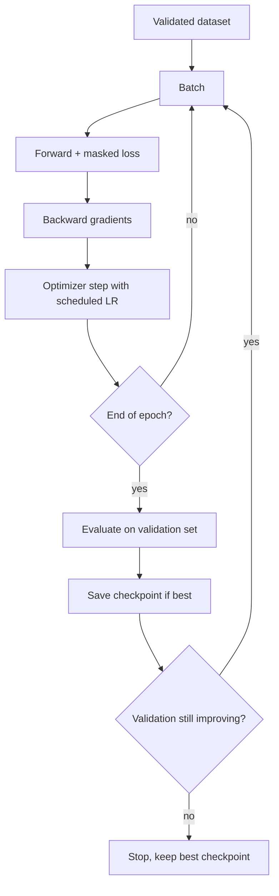

# Training Pipelines and Hyperparameters
> **Level:** Intermediate · **Reading time:** 10 min · **Phase:** 8 · Fine-tuning

**In one line:** A fine-tuning run is a loop with a handful of dials (learning rate, epochs, batch size, accumulation, warmup), and you steer it by reading the training and validation loss curves, saving checkpoints, and fixing every random seed so you can repeat a good run.

**Before you start:** [LoRA in Depth](04-lora-in-depth.md) and [Loss and Gradient Descent](../../00-ml-foundations/topics/02-loss-and-gradient-descent.md) (what a learning rate does).

**Words to know:**
- **Learning rate (LR):** how big a step each update takes. Too big overshoots, too small crawls.
- **Epoch:** one full pass over the training set.
- **Micro-batch:** the examples processed at once on the GPU. **Effective batch** is what one weight update averages over.
- **Gradient accumulation:** add up gradients from several micro-batches before updating, to imitate a bigger batch in less memory.
- **Warmup:** raising the LR gradually from near zero at the start.
- **Checkpoint:** a saved copy of the weights (or adapter) and optimizer state at some step.
- **Overfitting:** the model gets better on training data and worse on data it has not seen.

## Explain it like I'm new
Learning to throw darts. The learning rate is how hard you correct after each miss: correct too hard and you swing wildly; too softly and you never improve. An epoch is going through all your practice throws once. Batch size is how many throws you judge before adjusting your aim: judge one and you chase noise; judge thirty-two and your adjustment is steadier.

Overfitting is memorising the practice board instead of learning to aim. You catch it the only way you can: by throwing at a *different* board (the validation set) and checking whether you are still improving. When the practice score keeps rising but the new-board score turns around, stop and keep the best version.

<!-- anim:ft-training-loop -->
## Watch it


*It plays on a loop. Read the caption in the box, one step at a time. Want to go at your own pace? [Step through it with Previous and Next](https://techsaurabh-394.github.io/ai-engineer-roadmap/#ft-training-loop).*

## How it works
### The loop
Every step: take a batch, run it forward, compute the loss on the unmasked tokens (see [lesson 2](02-supervised-and-instruction-tuning.md)), run backward for gradients, let the optimizer update the trainable weights, then move to the next batch. After each epoch (or every N steps) evaluate on the validation set.

### The dials
- **Learning rate.** The single most important setting. Full fine-tuning typically uses small values (around 1e-5 to 5e-5); LoRA adapters tolerate larger ones (commonly 1e-4 to 3e-4). These are folklore starting points, not guarantees: try a few values on a short run. Too high: loss spikes or goes to NaN, or the model forgets what it knew. Too low: loss barely moves.
- **Warmup.** The first updates are the noisiest, because the optimizer's statistics are not settled. Ramp the LR up over the first few percent of steps.
- **Schedule.** After the peak, decay the LR (cosine or linear) so the end of training is gentle.
- **Epochs.** Small datasets usually need a few epochs (1 to 3 is common); more than that risks memorising. Large datasets may need only one.
- **Batch size and accumulation.** Effective batch = micro-batch x accumulation steps x number of devices. Larger batches give steadier gradients but fewer updates per epoch. If memory limits the micro-batch, accumulate.

```text
effective_batch = micro_batch * accumulation_steps * devices
steps_per_epoch = ceil(examples / effective_batch)
lr(step) = peak * (step + 1) / warmup                         for step < warmup
lr(step) = floor + (peak - floor) * 0.5 * (1 + cos(pi * p))   afterwards, p = progress in [0, 1]
```

### Worked example (batch and schedule)
From [`ft_lora_params.py`](../code/ft_lora_params.py). Micro-batch 4, accumulation 8, one device:
1. Effective batch = 4 x 8 x 1 = **32**.
2. 1,000 examples: ceil(1000 / 32) = **32 steps per epoch**. Three epochs = **96 steps**.
3. Peak LR 2e-4, warmup 10 steps, cosine decay down to 10% of peak (2e-5):

| Step | 0 | 4 | 9 | 10 | 50 | 95 |
|---|---|---|---|---|---|---|
| LR | 2e-05 | 0.0001 | 0.0002 | 0.0002 | 0.00012 | 2e-05 |

It ramps to the peak by step 9, then glides down to about 2e-5 at the last step (2.006e-05 before rounding).

### Reading the loss curves
You track two numbers per epoch: **training loss** and **validation loss**. The demo includes an illustrative, made-up pair of curves (a seeded simulation, **not** a real training run) to practise reading:

| Epoch | Train | Validation | Gap (val minus train) |
|---|---|---|---|
| 1 | 2.114 | 2.360 | +0.247 |
| 2 | 1.372 | 1.616 | +0.244 |
| 3 | 0.914 | 1.159 | +0.246 |
| 4 | 0.630 | 0.861 | +0.231 |
| 5 | 0.430 | 0.729 | +0.299 |
| 6 | 0.327 | 0.741 | +0.414 |
| 7 | 0.226 | 0.900 | +0.674 |
| 8 | 0.190 | 1.146 | +0.955 |

What it tells you:
- **Epochs 1 to 4:** both fall together, a healthy fit.
- **Epoch 5:** validation hits its minimum (0.729). This is the checkpoint you want.
- **Epochs 6 to 8:** training keeps falling while validation climbs and the gap widens from 0.299 to 0.955. That is **overfitting**: the model is memorising your examples.
- A simple **early-stopping** rule with patience 2 (stop after 2 epochs without a new best) fires at epoch 7 in this example, and you restore the epoch-5 checkpoint.

Other signs: training loss flat from the start (LR too low, or labels all masked by mistake), loss jumping up and down (LR or batch too noisy), NaN (LR too high or bad data). Validation loss is not the whole story: also run the task metrics from [lesson 7](07-evaluating-fine-tuned-models.md), because lower loss does not always mean better answers.

### Checkpoints
Save the adapter (or weights) at regular intervals and **keep the one with the best validation result**, not simply the last. Save optimizer state too if you may need to resume. For LoRA the adapter file is small, so saving often is cheap.

### Reproducibility
Fix the random seed for data shuffling, dropout and initialisation, and record: the base model name and version, the dataset hash and counts, the split seed, all hyperparameters, library versions, and the code commit. Even then, GPU runs can differ slightly run to run, so judge improvements against that noise: two runs with different seeds show you how much "same settings" actually varies. This demo's own data splits and simulations are seeded, so its numbers are identical on every run.

### Worked example (a first run)
1. Start from a validated dataset (lesson 3) and an evaluation set that training never sees.
2. Choose LoRA r = 16 on attention layers, LR 2e-4, warmup 10 steps, cosine decay, effective batch 32, 3 epochs.
3. Train a short run and plot both curves. If validation turns up after epoch 2, cut epochs or lower the LR.
4. Keep the best-validation checkpoint, then run the real evaluation: held-out metrics against the base model.
5. Change one dial at a time and record the result. Two changes at once teach you nothing.



## Code example
From [`ft_lora_params.py`](../code/ft_lora_params.py):

```python
import ft_lora_params as lp

eb = lp.effective_batch(4, 8, 1)               # -> 32
spe = lp.steps_per_epoch(1000, eb)             # -> 32
print(eb, spe, 3 * spe)                        # -> 32 32 96

print([round(lp.lr_at(s, 96, 2e-4, 10), 6) for s in (0, 9, 50, 95)])
# -> [2e-05, 0.0002, 0.00012, 2e-05]

train, val = lp.simulate_curves(8, seed=0)     # illustrative, made-up curves
print(lp.best_epoch(val) + 1)                  # -> 5
print(lp.early_stop_epoch(val, patience=2) + 1)  # -> 7
```

The tests in [`test_ft_lora_params.py`](../code/test_ft_lora_params.py) check the batch and step arithmetic, the schedule's warmup, peak and floor, that the simulated curves are deterministic for a seed, and that early stopping fires where the validation minimum is already behind us.

**In real projects** a trainer library (for example [TRL](https://huggingface.co/docs/trl) with [PEFT](https://huggingface.co/docs/peft)) runs this loop, logs the curves and saves checkpoints for you. Option names change, so use the current docs, and log to a tool you can look at.

## When to use it / when not to
| Situation | Do this |
|---|---|
| Small dataset (hundreds of examples) | 1 to 3 epochs, watch validation loss closely |
| Memory limits the batch | Gradient accumulation to keep the effective batch steady |
| Loss spikes or NaN | Lower the LR, check for bad or empty-label examples |
| Validation turns up while training falls | Stop, restore the best checkpoint, add data or lower capacity |
| Comparing two settings | Same seed policy, one change at a time, same held-out set |

## Common mistakes
- Judging by training loss alone. It nearly always falls.
- Keeping only the last checkpoint after the model began to overfit.
- Changing several hyperparameters at once and not knowing which mattered.
- Forgetting that effective batch changes when you change accumulation or devices, which shifts the best LR.
- Using the test set to choose epochs. Use validation for decisions and test once for the report.
- No seeds and no record of settings, so a good run cannot be repeated.

## Recap
If you remember only three things:
- Effective batch = micro-batch x accumulation x devices; warm up the LR, then decay it. The demo's 4 x 8 gives 32 per update and 96 steps for 3 epochs of 1,000 examples.
- Read training and validation loss together: when validation turns up while training falls, you are overfitting, so keep the best checkpoint.
- Seed everything and record settings so a good run can be reproduced and compared.

## Interview questions
**1. Training loss keeps falling but validation loss started rising. What is happening and what do you do?**
<details><summary>Answer</summary>
Overfitting: the model is memorising the training set. Stop, restore the checkpoint with the best validation result, and then reduce epochs or learning rate, add or diversify data, lower the adapter rank, or add dropout.
</details>

**2. What is gradient accumulation and why use it?**
<details><summary>Answer</summary>
It sums gradients over several micro-batches before one weight update, giving the effect of a larger batch without needing the memory for it. Effective batch = micro-batch x accumulation steps x devices.
</details>

**3. Why warm up the learning rate?**
<details><summary>Answer</summary>
Early updates are the noisiest because the optimizer's statistics have not settled, and a big step then can damage the pretrained weights. Starting from a tiny LR and ramping to the peak makes the start stable; decay afterwards makes the end gentle.
</details>

## Go deeper
- [LoRA (Hu et al., 2021)](https://arxiv.org/abs/2106.09685)
- [Hugging Face TRL docs](https://huggingface.co/docs/trl)
- [Hugging Face PEFT docs](https://huggingface.co/docs/peft)

**Prev:** [QLoRA and Quantized Training](05-qlora-and-quantized-training.md) · **Next:** [Evaluating Fine-Tuned Models](07-evaluating-fine-tuned-models.md) · **Back to phase:** [Phase 8](../README.md)
