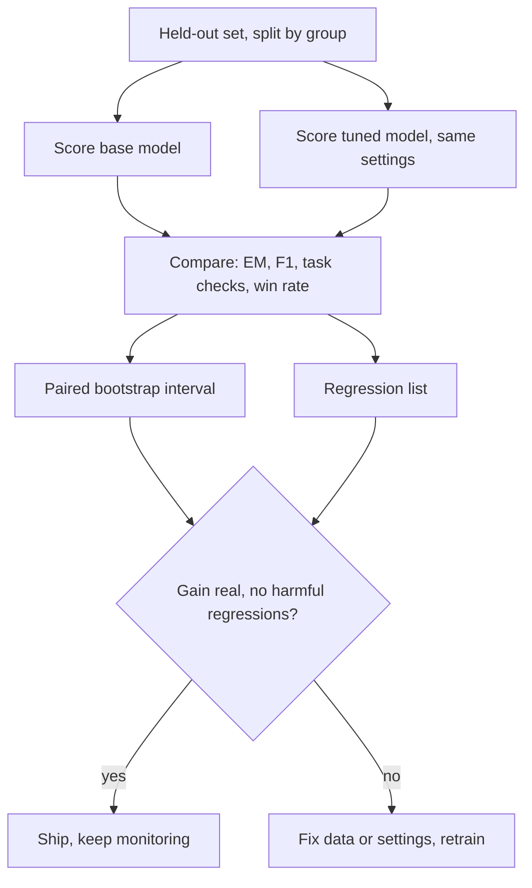

# Evaluating Fine-Tuned Models
> **Level:** Advanced · **Reading time:** 12 min · **Phase:** 8 · Fine-tuning

**In one line:** You only know a fine-tune helped if it beats the base model on held-out examples it never saw, with a margin of error you can defend, no regressions on things that used to work, and an honest view of the limits of any automatic judge; preference tuning (RLHF, DPO) is the optional next step that teaches a model what people prefer.

**Before you start:** [Training Pipelines and Hyperparameters](06-training-pipelines-and-hyperparameters.md) and [Dataset Preparation](03-dataset-preparation.md). For evaluation ideas in retrieval, see [Phase 2 · Advanced RAG](../../02-advanced-rag/README.md). For RLHF and DPO in one page, see [How LLMs Are Trained](../../03-llm-concepts/topics/24-how-llms-are-trained.md).

**Words to know:**
- **Held-out set:** examples reserved for measuring, never used in training or tuning decisions.
- **Exact match (EM):** 1 if the answer equals the reference after normalising, else 0.
- **Token F1:** overlap between answer words and reference words, balancing precision and recall.
- **Win rate:** the share of examples where model A is judged better than model B.
- **Bootstrap confidence interval:** a range for a score, found by resampling the examples many times.
- **Regression:** something the base model did well that the tuned model now does worse.
- **Preference pair:** one prompt with a *chosen* and a *rejected* answer.

## Explain it like I'm new
A student says they studied hard. You do not ask them; you give an exam they have never seen, and you give the same exam to their previous self. If the new score is only a bit higher on a ten-question quiz, you cannot tell skill from luck, so you want more questions and a sense of how much the score would wobble. You also check that learning the new material did not make them forget the old (regression).

Then there is the grader. If the exam is marked by another student (an LLM judge), that grader has habits: it likes long answers, it likes answers that look like its own, and sometimes it prefers whichever answer comes first. Useful, but you must check it against human marking.

<!-- anim:ft-evaluation -->
## Watch it


*It plays on a loop. Read the caption in the box, one step at a time. Want to go at your own pace? [Step through it with Previous and Next](https://techsaurabh-394.github.io/ai-engineer-roadmap/#ft-evaluation).*

## How it works
### 1. A held-out set, and a baseline
Build the evaluation set at the same time as the training set, from the same distribution, split by group (lesson 3) so nothing leaks. It should include the awkward cases you care about. Then **score the base model first**, with its best prompt. If you never measure the baseline, you cannot say what the tuning added. Measure the tuned model on the *same* questions with the *same* settings (temperature, prompt wrapper, stop rules).

### 2. Metrics that fit the task
- **Exact match:** strict, fine for short factual or classification answers.
- **Token F1:** forgiving of extra or missing words. Pred "visa mastercard amex" against gold "visa mastercard": precision 2/3, recall 1, so F1 = 2 x (2/3 x 1) / (2/3 + 1) = **0.8**.
- **Task checks:** does the JSON parse? Does the code pass its tests? Is the label correct? Use these whenever you can: they are cheap and objective.
- **Win rate:** for open-ended answers, compare pairs. Count a tie as half a win.

### 3. A margin of error
A score on 12 examples is a noisy estimate. A **bootstrap** resamples the examples with replacement many times, recomputes the mean each time, and reports the middle 95% of those means. For a *comparison* use a **paired** bootstrap: resample the same examples for both models and bootstrap the per-example differences, so you ask "does the gain survive?" and not just "do the two ranges overlap?".

### 4. Regression tests
Averages hide damage. Keep a list of prompts the base model handled well (and general capabilities you care about: following system rules, refusing correctly, not breaking JSON) and check that the tuned model still does them. Fine-tuning can cause *forgetting* of abilities outside your data, especially with a high learning rate or many epochs.

### Worked example
From [`ft_eval.py`](../code/ft_eval.py): a 12-question held-out set, with the base and the tuned model given as small dictionaries of answers.

1. **Exact match:** base **0.417** (5 of 12), tuned **0.917** (11 of 12).
2. **Token F1:** base **0.496**, tuned **0.988**.
3. **Win rate** (tuned against base, by token F1): wins 7, ties 4, losses 1, so (7 + 0.5 x 4) / 12 = **0.750**.
4. **Bootstrap:** the tuned exact-match score has a 95% interval of **[0.750, 1.000]**. The paired difference (tuned minus base) has a 95% interval of **[0.083, 0.833]**: it stays above zero, so the gain is believable, but the interval is wide because 12 examples is few.
5. **Too small a sample:** using only the first 4 questions, the paired interval is (0.0, 1.0): it includes zero, so you could not claim a gain.
6. **Regression:** the one loss is "Accepted cards?". The tuned model said "Visa Mastercard and Amex", adding a card that is not accepted, so its F1 fell below the base. The average rose a lot and still hid a real error.

All data here is toy data written for the demo, not results from a real model.

### 5. LLM-as-judge: useful, with caveats
For open-ended outputs a strong model can grade answers against a rubric. It scales, but:
- **Position bias:** it may prefer the first (or last) answer. Randomise the order, or judge both orders.
- **Length bias:** longer answers often score higher regardless of quality.
- **Self-preference:** a judge may favour text that resembles its own style.
- **Drift and noise:** different judge versions give different scores; judge scores on small sets are noisy.
- **Rubric matters:** give a specific rubric, not "which is better?".

Calibrate by having humans grade a sample (50 to 100 examples) and check the judge agrees with them. Prefer objective checks wherever the task allows.

### 6. Preference tuning: RLHF and DPO (conceptually)
SFT shows the model *good* answers. It cannot easily say "this answer is better than that one". **Preference tuning** uses pairs: for a prompt, a chosen answer and a rejected answer.
- **RLHF** (the approach in [InstructGPT](https://arxiv.org/abs/2203.02155)): (a) train a *reward model* on human rankings so chosen scores above rejected; (b) use reinforcement learning to move the model toward higher reward, with a penalty that keeps it close to the SFT model so it does not drift into nonsense. It works, but has several moving parts.
- **DPO** ([Rafailov et al., 2023](https://arxiv.org/abs/2305.18290)): skips the separate reward model and the RL loop. A single loss, computed on the preference pairs, raises the probability of the chosen answer *relative to a frozen reference model* and lowers it for the rejected one. The reference is usually the SFT model you started from.

The DPO loss, as given in the paper (with y_w the chosen answer, y_l the rejected one, pi_theta the model being trained, pi_ref the frozen reference, beta a strength setting and sigma the sigmoid):

```text
L_DPO = - log sigmoid( beta * [ (log pi_theta(y_w|x) - log pi_ref(y_w|x))
                              - (log pi_theta(y_l|x) - log pi_ref(y_l|x)) ] )
```

In words: measure how much the model has moved from the reference on the chosen answer and on the rejected answer. Reward moving up on the chosen one and down on the rejected one. Beta controls how strongly: it acts like how far you let the model stray from the reference.

**Worked numbers** (beta = 0.1, summed log-probabilities of whole answers, all from the demo):
1. **Nothing learned yet:** policy equals reference, so both differences are 0, the margin is 0, and the loss is -log(0.5) = **0.6931**. That is ln 2, the loss of a coin flip.
2. **Policy improved:** chosen log-prob rises from -10 to -8 (up 2), rejected falls from -12 to -15 (down 3). Margin = 0.1 x (2 - (-3)) = **+0.50**, loss **0.4741**.
3. **Policy went the wrong way:** chosen falls from -10 to -13, rejected rises from -12 to -9. Margin = 0.1 x (-3 - 3) = **-0.60**, loss **1.0375**.

Preference tuning is a refinement: do it after SFT works, with good pairs, and evaluate it just like everything above (including a regression check, since it can change style, verbosity and refusals).



## Code example
From [`ft_eval.py`](../code/ft_eval.py) (run `python 10-fine-tuning/code/ft_eval.py`):

```python
import ft_eval as e

b = e.score_model(e.BASE, e.HELDOUT, e.exact_match)
t = e.score_model(e.TUNED, e.HELDOUT, e.exact_match)
print(round(e.mean(b), 3), round(e.mean(t), 3))        # -> 0.417 0.917

lo, hi = e.paired_bootstrap_diff(t, b, seed=1)
print(round(lo, 3), round(hi, 3))                      # -> 0.083 0.833

loss, margin = e.dpo_loss(-8, -15, -10, -12, beta=0.1)
print(round(margin, 2), round(loss, 4))                # -> 0.5 0.4741
```

The tests in [`test_ft_eval.py`](../code/test_ft_eval.py) check token F1 by hand (0.8), the win-rate counts, that the bootstrap is reproducible for a seed, that the paired interval excludes zero on 12 examples and not on 4, that the regression finder returns exactly "Accepted cards?", and that the DPO loss at the start is ln 2 and equals the hand-computed values.

**In real projects** use your task's real metrics and a larger held-out set (hundreds of examples if you can), keep a growing regression suite, and for preference tuning use a trainer library such as [TRL](https://huggingface.co/docs/trl), whose API changes, so check the current docs.

## When to use it / when not to
| Situation | Do this |
|---|---|
| Any fine-tune you intend to ship | Held-out set, baseline, regression suite |
| Short, checkable answers | Exact match, F1, task checks |
| Open-ended answers | Pairwise win rate, human spot checks, a judge with a rubric |
| Small eval set | Report the interval, not just the mean; grow the set |
| You have rankings of good vs bad answers | Consider DPO after SFT works |
| You only have ideal answers, no preference data | SFT is enough; skip preference tuning |

## Common mistakes
- Comparing the tuned model with its training score, or with nothing.
- Skipping the baseline, or giving the base model a weak prompt to make the tune look good.
- Reporting a mean on a tiny set with no interval.
- Trusting an LLM judge without checking position and length bias or comparing with humans.
- Tuning decisions made on the test set.
- Moving to preference tuning before SFT works, or without checking for regressions.

## Recap
If you remember only three things:
- Evaluate on held-out data against the base model, with a paired interval: in the demo exact match rises 0.417 to 0.917 with a gain interval of [0.083, 0.833].
- Look for regressions: one wrong "Amex" answer hid inside a large average gain.
- DPO loss is -log sigmoid(beta x [(chosen moved) - (rejected moved)]): it is ln 2 = 0.6931 at the start and falls as the policy prefers the chosen answer.

## Interview questions
**1. How do you prove a fine-tune is better than the base model?**
<details><summary>Answer</summary>
Score both on the same held-out set, split without leakage, with the same prompts and settings and the base model's best prompt. Use metrics that fit the task, report a paired bootstrap interval for the difference, and check a regression suite for abilities that got worse.
</details>

**2. What are the main weaknesses of LLM-as-judge?**
<details><summary>Answer</summary>
Position bias (prefers the first answer), length bias, self-preference for its own style, noise on small sets, and sensitivity to the prompt and judge version. Mitigate by randomising order, using a specific rubric, and checking agreement with human grades on a sample.
</details>

**3. Explain the DPO loss in plain words and what beta does.**
<details><summary>Answer</summary>
For a chosen and a rejected answer, measure how much the trained model's log-probability has moved from a frozen reference on each. The loss is -log sigmoid(beta times (chosen movement minus rejected movement)), so it is smallest when the model raises the chosen answer and lowers the rejected one relative to the reference. Beta scales how strongly that margin counts, and so how far the model is allowed to move from the reference.
</details>

## Go deeper
- [Direct Preference Optimization (Rafailov et al., 2023)](https://arxiv.org/abs/2305.18290)
- [Training language models to follow instructions with human feedback (InstructGPT, Ouyang et al., 2022)](https://arxiv.org/abs/2203.02155)
- [Hugging Face TRL docs](https://huggingface.co/docs/trl)

**Prev:** [Training Pipelines and Hyperparameters](06-training-pipelines-and-hyperparameters.md) · **Next:** [Phase 9 · Multimodal AI](../../11-multimodal-ai/README.md) · **Back to phase:** [Phase 8](../README.md)
