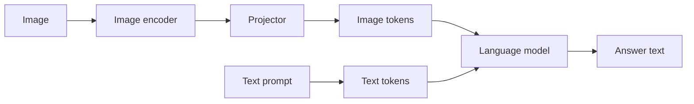

# Vision Language Models
> **Level:** Intermediate · **Reading time:** 10 min · **Phase:** 9 · Multimodal AI

**In one line:** A vision-language model (VLM) is a language model that can read pictures: an image encoder turns the image into vectors, a small projector reshapes them into "image tokens", and the LLM reads those tokens next to your words.

**Before you start:** [Transformer Architecture](../../03-llm-concepts/topics/01-transformer-architecture.md) and [Self Attention](../../03-llm-concepts/topics/02-self-attention.md). You should know that an LLM reads a sequence of token vectors and predicts the next token.

**Words to know:**
- **Modality:** a type of data, such as text, image or audio.
- **Image encoder:** a network (often a vision transformer) that turns an image into a grid of vectors. The next lesson, [How Models See Images](02-how-models-see-images.md), opens it up.
- **Projector (or adapter):** a small trained layer that converts image vectors into the same size and "language" as the LLM's word vectors.
- **Image token:** one vector, produced from the image, that the LLM treats like a word.
- **Cross-attention:** attention where the queries come from one sequence (text) and the keys and values come from another (image features).
- **Instruction tuning:** training on example conversations (here: image plus question plus answer) so the model follows requests.

## Explain it like I'm new
Imagine a friend who is brilliant with words but blind. You hire an interpreter who looks at a photo and whispers a long list of short notes: "top left: red shape, round, shiny...". Your friend reads the notes the same way they read a sentence, then answers your question.

A VLM works much the same way, with two differences. The interpreter is a trained neural network, not a person. And its notes are not English words but **vectors**, lists of numbers, written in the exact format your friend (the LLM) already uses inside its head. So nothing is "described in text" first. The picture goes in directly as extra tokens.

The recipe has three parts, and each can be reused from existing models:
1. A **vision encoder** that already understands pictures.
2. A **language model** that already understands text.
3. A small **bridge** (the projector, or attention layers) trained to connect them.

That is why a VLM can be built far more cheaply than training a model from nothing: most of the knowledge already exists, and the training teaches the two sides to talk.

<!-- anim:mm-vision-language-models -->
## Watch it


*It plays on a loop. Read the caption in the box, one step at a time. Want to go at your own pace? [Step through it with Previous and Next](https://techsaurabh-394.github.io/ai-engineer-roadmap/#mm-vision-language-models).*

## How it works
```text
image  ->  encoder  ->  N patch vectors (width D_v)
                        |
                    projector (a learned linear layer or small MLP)
                        |
                    N image tokens (width D_llm)
sequence given to the LLM = [image tokens] + [text prompt tokens]
```

**Step by step**
1. **Encode.** The image encoder cuts the image into patches and returns one vector per patch. A 224 x 224 image with 16 x 16 patches gives 196 vectors (see the numbers below).
2. **Project.** Image vectors have width `D_v` (say 768). The LLM's word vectors have width `D_llm` (say 4096). The projector is a trained matrix of shape `D_v x D_llm` (or a small stack of them) that maps one to the other. Only this bridge is trained first; encoder and LLM can stay frozen.
3. **Splice.** The projected vectors are placed in the input sequence where the image appears. A placeholder in the prompt such as `<image>` marks the spot.
4. **Read.** The LLM runs as usual. Its self-attention lets every text token look at every image token, so the answer can depend on what is in the picture. Image tokens are inputs only: the model does not *generate* them, it writes text.
5. **Answer.** Decoding is the normal next-token loop, one word at a time.

### Two ways to connect the sides
| Style | Idea | Cost and trade-off |
|---|---|---|
| **Token-in-sequence** (LLaVA-style, see [LLaVA](https://arxiv.org/abs/2304.08485)) | Project image features to tokens and put them in the same sequence as text. | Simple. The LLM is unchanged. Every image token takes room in the context window and in the KV cache. |
| **Cross-attention** (Flamingo-style, see [Flamingo](https://arxiv.org/abs/2204.14198)) | Keep text as the only sequence. New layers inside the LLM let text tokens attend to image features. | The image does not use text context length. The model has extra layers to train, and the design is more involved. |

Flamingo also used a "resampler" idea: compress a large number of image features into a small, fixed number of vectors before the language model sees them. That makes the image cost predictable no matter how big the picture is. Many later models use a similar trick (a small set of learned query vectors that summarise the image) when they need to save tokens.

### Worked example: what an image costs
The numbers come from [`mm_patches.py`](../code/mm_patches.py). With patch size 16 and one extra class token (CLS):

| Resolution | Patches | Tokens |
|---|---|---|
| 224 | 196 | 197 |
| 336 | 441 | 442 |
| 448 | 784 | 785 |

1. At 224, one image is 197 tokens. Ten images are 1,970 tokens before any text.
2. At 448, one image is 785 tokens, about four times as many, because doubling the side quadruples the patches.
3. If the LLM has a context window of 8,000 tokens, ten images at 448 would take 7,850 of them. Almost nothing is left for the question and answer.

Some systems keep every patch, some drop the CLS token, and some merge neighbouring patches to cut the count. The exact number depends on the model, so always read its documentation. The principle is fixed: **more pixels means more tokens, and tokens cost money, memory and time**.



## Code example
Run [`mm_patches.py`](../code/mm_patches.py) (`python 11-multimodal-ai/code/mm_patches.py`). The key part counts how many tokens an image gives the LLM, and how a projector changes the width:

```python
from mm_patches import count_tokens, project

for res in (224, 336, 448):
    print(res, count_tokens(res, 16))      # 197, 442, 785

# A toy projector: patch vector of length 3 -> LLM width 2
patch_vector = [1, 2, 3]
weights = [[1, 0], [0, 1], [1, 1]]         # shape 3 x 2
print(project(patch_vector, weights))      # [4, 5]
```

**In real projects** you pass an image to a hosted VLM as part of the message (a URL or base64 data, depending on the provider) and let the provider handle the encoder. With open models, the Hugging Face [Transformers documentation](https://huggingface.co/docs/transformers) lists the vision-language model classes. Check the model card for the supported image sizes, how many tokens each image uses, and the right prompt format.

## When to use it / when not to
| Task | Why a VLM fits |
|---|---|
| Describe or answer questions about a photo, chart or screenshot | The answer depends on pixels |
| Read a form, slide or diagram | Layout carries meaning that plain text loses |
| Check a UI or document visually | Easier than writing rules |

- **Prefer plain OCR or a parser** when you only need the text from a clean scan. It is cheaper and exact.
- **Prefer a specialist model** for strict counting, precise measurement or medical decisions. VLMs are fluent but can be confidently wrong.
- **Watch the token cost** of images in long conversations. Resize before you send.

## Common mistakes
- Assuming the model "sees" like a person. It reads patch vectors; small text, fine detail and exact counts are weak spots.
- Sending huge images and paying for thousands of tokens that add no detail the question needs.
- Trusting a VLM's reading of numbers in a chart without a check. It can hallucinate values, just as an LLM hallucinates facts.
- Forgetting that the image takes up context. Images plus long history can silently push out the earlier text.
- Thinking a VLM is "text plus a separate captioner". In most designs the image enters as vectors, not as a written caption.

## Recap
If you remember only three things:
- A VLM = image encoder + projector + language model. The projector turns image patches into tokens the LLM can read.
- Image tokens either join the text sequence (LLaVA-style) or are reached through cross-attention layers (Flamingo-style).
- Image cost is token cost: doubling resolution roughly quadruples the tokens.

## Interview questions
**1. How does an image get into a language model?**
<details><summary>Answer</summary>
An image encoder turns it into one vector per patch. A projector, a small trained layer, maps those vectors to the LLM's embedding width so they act as image tokens. They are placed in the input sequence (or reached by cross-attention) and the LLM reads them like words.
</details>

**2. What is the difference between LLaVA-style and cross-attention (Flamingo-style) designs?**
<details><summary>Answer</summary>
LLaVA-style puts image tokens in the same sequence as text, leaving the LLM unchanged, but each image token uses context and cache. Cross-attention designs add layers in which text tokens attend to image features, so the image does not lengthen the text sequence, at the cost of extra layers to train.
</details>

**3. Your VLM bill and latency doubled after you moved to higher-resolution screenshots. Why, and what do you do?**
<details><summary>Answer</summary>
Higher resolution means more patches and so more image tokens (doubling the side gives about four times the tokens). Downscale or crop to the region that matters, send fewer images, cache results, and only use high resolution where small text must be read.
</details>

## Go deeper
- [Visual Instruction Tuning, LLaVA (Liu et al., 2023)](https://arxiv.org/abs/2304.08485)
- [Flamingo: a Visual Language Model for Few-Shot Learning (Alayrac et al., 2022)](https://arxiv.org/abs/2204.14198)
- [Attention Is All You Need (Vaswani et al., 2017)](https://arxiv.org/abs/1706.03762)
- [Hugging Face Transformers documentation](https://huggingface.co/docs/transformers)

**Prev:** [Phase 8 · Fine-Tuning](../../10-fine-tuning/README.md) · **Next:** [How Models See Images](02-how-models-see-images.md) · **Back to phase:** [Phase 9](../README.md)
