# How Models See Images
> **Level:** Intermediate · **Reading time:** 10 min · **Phase:** 9 · Multimodal AI

**In one line:** A vision transformer cuts an image into small square patches, turns each patch into one vector, adds position information, and then runs the same self-attention a text model uses, so the number of patches, not the number of pixels, sets the cost.

**Before you start:** [Self Attention](../../03-llm-concepts/topics/02-self-attention.md) and [Positional Encoding](../../03-llm-concepts/topics/04-positional-encoding.md). The previous lesson, [Vision Language Models](01-vision-language-models.md), shows where these vectors go next.

**Words to know:**
- **Pixel:** one dot of an image. A colour pixel is three numbers: red, green, blue (0 to 255).
- **Patch:** a small square block of pixels, for example 16 x 16.
- **Patch embedding:** the vector made from one patch by a learned linear layer.
- **ViT (Vision Transformer):** a transformer that treats an image as a sequence of patches. See [the ViT paper](https://arxiv.org/abs/2010.11929).
- **CLS token:** one extra learned token added to the sequence whose final vector summarises the whole image.
- **Resolution:** the number of pixels on a side, such as 224.

## Explain it like I'm new
Imagine describing a photograph to a friend by phone, but you can only read out one tile at a time from a grid laid over it: "tile one, tile two..." If you give the tile positions, your friend can rebuild the picture in their head. If you do not, they get a bag of tiles and the picture is gone.

A vision transformer does exactly that. A text model reads words in a row. An image is a grid, so the model first chops it into tiles, flattens each tile into a row of numbers, and treats each tile like a "word". The tile positions are added so the model knows which tile was above which. After that there is nothing special about images: it is the same self-attention you saw for text.

This explains the main surprise. A 224 x 224 picture holds 50,176 pixels, but the model does not look at 50,176 things. It looks at 196 tiles.

<!-- anim:mm-how-models-see-images -->
## Watch it


*It plays on a loop. Read the caption in the box, one step at a time. Want to go at your own pace? [Step through it with Previous and Next](https://techsaurabh-394.github.io/ai-engineer-roadmap/#mm-how-models-see-images).*

## How it works
```text
patches per side   = resolution / patch_size
number of patches  = (resolution / patch_size)^2
tokens             = patches + 1                      (the +1 is the CLS token)
patch vector length = patch_size * patch_size * channels
patch embedding    : vector (length P) x weights (P x D) -> token of width D
```

1. **Cut.** Slice the image into non-overlapping `patch x patch` squares, left to right, top to bottom.
2. **Flatten.** Write each patch's pixel values as one list, row after row, all channels included.
3. **Embed.** Multiply that list by one learned matrix `P x D`. The same matrix is used for every patch, so this is cheap and treats all positions alike. (A strided convolution does the same arithmetic.)
4. **Add position.** Attention ignores order, so add a position vector to each token. In the original ViT these are learned vectors, one per grid cell. Models can also use 2D schemes, since the position is really a (row, column) pair, not a single index.
5. **Add CLS.** Put one extra token in front.
6. **Encode.** A stack of transformer blocks mixes all tokens by self-attention.

### Worked example: tokens and resolution
Numbers from [`mm_patches.py`](../code/mm_patches.py), patch size 16:

| Resolution | Patches | Tokens (with CLS) | Attention pairs (tokens squared) |
|---|---|---|---|
| 224 | 196 | 197 | 38,809 |
| 336 | 441 | 442 | 195,364 |
| 448 | 784 | 785 | 616,225 |
| 672 | 1,764 | 1,765 | 3,115,225 |
| 896 | 3,136 | 3,137 | 9,840,769 |

1. **224 / 16 = 14** patches per side, and 14 x 14 = **196** patches. With CLS that is 197 tokens.
2. **Patch vector:** one RGB 16 x 16 patch is 16 x 16 x 3 = **768** numbers. Mapping to width 768 needs a 768 x 768 matrix: **589,824** weights, shared across every patch.
3. **Double the side:** 224 to 448 gives 784 patches, exactly **4.0** times as many (the code prints this).
4. **Cost of attention:** every token attends to every token, so pairs grow as tokens squared. Going from 197 to 785 tokens (4x) gives 616,225 / 38,809, roughly **16** times as many pairs. Doubling the resolution costs about 4x in tokens but about 16x in attention work.

**A smaller patch means more tokens.** With patch size 14 at 224 you get 256 patches, versus 196 for patch size 16. Finer patches see more detail but cost more.

**Position and different sizes.** Learned position vectors are tied to one grid size. Run a 224-trained model at 448 and the grid no longer matches; common fixes are to stretch (interpolate) the position vectors or to fine-tune at the new size. This is one reason image tools often resize to a fixed size first.

**Tiny worked patch.** In the demo, an 8 x 8 grayscale image with patch 4 gives 4 patches. Patch 0 flattens to 16 numbers: `[165, 77, 202, 24, 109, 19, 44, 222, 217, 30, 63, 114, 23, 68, 148, 214]`, and the position grid is `(0,0) (0,1) (1,0) (1,1)`. With RGB, each patch has 4 x 4 x 3 = 48 numbers.


## Code example
From [`mm_patches.py`](../code/mm_patches.py) (run `python 11-multimodal-ai/code/mm_patches.py`):

```python
from mm_patches import make_image, split_into_patches, flatten_patch, count_tokens, position_grid

image = make_image(8, 8, channels=1, seed=7)       # 8 x 8 grayscale, nested lists
patches = split_into_patches(image, 4)             # 4 patches, row-major
print(len(patches), flatten_patch(patches[0]))     # 4, then 16 numbers
print(position_grid(2, 2))                         # [(0,0),(0,1),(1,0),(1,1)]
print(count_tokens(224, 16), count_tokens(448, 16))  # 197 785
```

**In real projects** you rarely write this. A library's image processor resizes and normalises the picture, and the model does the patching. Check the processor settings in the [Transformers documentation](https://huggingface.co/docs/transformers) and the model card, because the expected size, patch size and normalisation values are part of the model.

## When to use it / when not to
- **Know this** whenever you estimate VLM cost: image tokens = (side / patch)^2 (plus any extras).
- **Raise resolution** only when small details (fine print, thin lines) matter to the task.
- **Lower resolution or crop** for coarse tasks such as "is this a receipt?".
- **Do not assume** that every model uses patch 16, a CLS token, or a fixed grid. Some models tile large images into several crops, others compress tokens. Read the model's documentation.

## Common mistakes
- Thinking cost scales with pixels one-to-one. It scales with patches, and attention with patches squared.
- Resizing a wide screenshot to a square and squashing the text beyond reading.
- Ignoring position: shuffling patches without position information gives the same output set, so order would be lost.
- Feeding an image size the model was never trained on and expecting the same quality.
- Forgetting that an image whose side is not divisible by the patch size needs padding or resizing first (the demo raises an error for this).

## Recap
If you remember only three things:
- A ViT cuts an image into patches, flattens each into a vector, embeds it with one shared linear layer, and adds position information.
- Tokens = (resolution / patch)^2 (+ CLS): 224 and patch 16 gives 196, and doubling resolution quadruples the count.
- Self-attention cost grows with tokens squared, so high resolution gets expensive quickly.

## Interview questions
**1. How many tokens does a 224 x 224 image give with 16 x 16 patches, and what happens at 448 x 448?**
<details><summary>Answer</summary>
(224 / 16)^2 = 196 patches, plus a CLS token if used (197). At 448 it is 784 patches, four times as many, and attention work grows about sixteen times because it scales with tokens squared.
</details>

**2. Why does a vision transformer need position information?**
<details><summary>Answer</summary>
Self-attention ignores order, so without position the patches would be an unordered bag and the layout (what is above what) would be lost. Position vectors, learned or fixed, tell the model where each patch sat in the grid.
</details>

**3. A model trained at 224 pixels is run at 448. What can go wrong?**
<details><summary>Answer</summary>
The patch grid no longer matches the learned position vectors, so they must be interpolated or the model fine-tuned at the new size, and the token count and cost rise sharply. Without that, quality can drop.
</details>

## Go deeper
- [An Image is Worth 16x16 Words: Transformers for Image Recognition at Scale (Dosovitskiy et al., 2020)](https://arxiv.org/abs/2010.11929)
- [Attention Is All You Need (Vaswani et al., 2017)](https://arxiv.org/abs/1706.03762)
- [Hugging Face Transformers documentation](https://huggingface.co/docs/transformers)

**Prev:** [Vision Language Models](01-vision-language-models.md) · **Next:** [Audio and Speech to Text](03-audio-and-speech-to-text.md) · **Back to phase:** [Phase 9](../README.md)
