# Audio and Speech to Text
> **Level:** Intermediate · **Reading time:** 10 min · **Phase:** 9 · Multimodal AI

**In one line:** Speech recognition turns a sound wave into a list of numbers, cuts it into short frames, measures which frequencies each frame holds (a spectrogram), and lets a transformer encoder-decoder write the words, scored by word error rate.

**Before you start:** [Encoder Decoder Models](../../03-llm-concepts/topics/06-encoder-decoder-models.md) and [Self Attention](../../03-llm-concepts/topics/02-self-attention.md).

**Words to know:**
- **Waveform:** the raw sound as a list of numbers over time. Each number is how far the air pressure (microphone signal) is from rest at one instant.
- **Sample rate:** how many numbers are recorded per second, in hertz (Hz). Speech models commonly use 16,000 Hz.
- **Frame:** a short slice of the signal (for example 25 milliseconds) analysed on its own.
- **Hop:** how far the frame window moves each step (for example 10 ms). Frames overlap when the hop is smaller than the frame.
- **Spectrogram:** a table of how much energy each frequency has in each frame. Time runs one way, frequency the other.
- **Mel scale:** a pitch scale that follows how ears hear: it spaces low frequencies finely and high ones coarsely.
- **WER (word error rate):** the share of words the system got wrong, counted by edit distance.

## Explain it like I'm new
A sound wave is like a wobbling line. Record it, and what you store is just the height of that line, measured thousands of times a second. That list is hard to read: you cannot see "hello" in it.

Now think of a piano. When someone plays, you do not track every wobble of the string; you notice **which keys** are pressed and **when**. A spectrogram does the same job. For each short slice of time it asks, "how much of each pitch is in here?" Speech then looks like a picture: bright bands move and change as the mouth shapes vowels and consonants.

Once speech is a picture over time, a transformer can read it like it reads a sentence. An **encoder** reads the whole picture. A **decoder** writes the text one token at a time, looking back at the encoder. This is the design described in the [Whisper paper](https://arxiv.org/abs/2212.04356). A different family, [wav2vec 2.0](https://arxiv.org/abs/2006.11477), learns from raw audio without labels first and is then fine-tuned for recognition.

<!-- anim:mm-audio-and-speech-to-text -->
## Watch it


*It plays on a loop. Read the caption in the box, one step at a time. Want to go at your own pace? [Step through it with Previous and Next](https://techsaurabh-394.github.io/ai-engineer-roadmap/#mm-audio-and-speech-to-text).*

## How it works
```text
samples per second  = sample rate                      (16,000 Hz -> 16,000 numbers/s)
frame count         = 1 + (N - frame_len) // hop       (full frames only)
bin frequency (Hz)  = k * sample_rate / frame_len
mel(f)              = 2595 * log10(1 + f / 700)
WER                 = (S + D + I) / N_words_in_reference
```
`S` = substituted words, `D` = deleted, `I` = inserted.

1. **Sample.** The microphone signal is measured `sample rate` times per second. The highest frequency you can capture is half that (the Nyquist limit): 8,000 Hz at 16,000 Hz, which covers most speech.
2. **Frame.** Cut into overlapping windows, say 25 ms long, moving 10 ms each time.
3. **Transform.** For each frame, apply a Fourier transform to get the magnitude of each frequency bin. The DFT (discrete Fourier transform) is the plain formula; real systems use the fast version (FFT).
4. **Mel and log.** Group the bins into mel bands (Whisper-style models use 80), then take the logarithm, which compresses loudness the way hearing does. The result is a **log-mel spectrogram**.
5. **Encode.** An encoder (transformer blocks, often after a small convolution that shortens the sequence) reads the spectrogram.
6. **Decode.** The decoder writes tokens: text, plus special tokens for things like language or task. Decoding works like any [encoder-decoder](../../03-llm-concepts/topics/06-encoder-decoder-models.md) model.

### Worked example (from `mm_audio.py`)
Use a pretend sample rate of 800 Hz so the arithmetic is small.

1. **Samples:** 1 second = 800 numbers. A 100 Hz tone has 8 samples per cycle: `0.0, 0.707, 1.0, 0.707, 0.0, -0.707, -1.0, -0.707`.
2. **Frames:** frame 200 samples (250 ms), hop 100 (125 ms). 1 + (800 - 200) // 100 = **7** frames. The code framing the signal finds 7, too.
3. **Frequency bins:** a 200-sample frame at 800 Hz has bins every 800 / 200 = **4 Hz**. A pure 100 Hz tone peaks in bin **25** (25 x 4 = 100 Hz). A 200 Hz tone peaks in bin 50. A 50 Hz tone lands in bin 13, which reads as 52 Hz, because 50 falls between bins 12 (48 Hz) and 13 (52 Hz). Bin spacing limits precision.
4. **Two tones at once:** mixing 100 Hz with a weaker 300 Hz tone gives two peaks, at 100 Hz and 300 Hz.
5. **Real speech sizes:** at 16,000 Hz with a 400-sample (25 ms) frame and 160-sample (10 ms) hop, 1 second gives **98** frames, and 30 seconds gives **2,998** frames. About 100 frames per second is where the number "100 frames a second" comes from.
6. **Mel:** 1,000 Hz maps to 1000.0 mel and 2,000 Hz to 1521.4. Doubling the frequency adds only 521 mel, not 1000: the scale is compressive at high pitch.

**Word error rate.** Reference: `the quick brown fox jumps` (5 words). Output: `the quick brown box jumps over`. One substitution (fox to box) and one insertion (over): WER = (1 + 0 + 1) / 5 = **0.40**. A perfect match gives 0.0. WER can exceed 1.0 if the system adds many extra words. The edit distance is found with the same dynamic-programming table you would use for string edit distance, but on words.


## Code example
From [`mm_audio.py`](../code/mm_audio.py) (run `python 11-multimodal-ai/code/mm_audio.py`):

```python
from mm_audio import sine_wave, dominant_frequency, num_frames, word_error_rate

tone = sine_wave(100, 800, 0.25)[:200]
print(dominant_frequency(tone, 800))                    # (25, 100.0)
print(num_frames(16000 * 30, 400, 160))                 # 2998
print(word_error_rate("the quick brown fox jumps",
                      "the quick brown box jumps over"))  # 0.4
```

**In real projects** you load audio, resample it to the rate the model expects (a very common source of bugs), and call a recognition model through a library or API. See the [Transformers documentation](https://huggingface.co/docs/transformers) for speech-recognition pipelines. Lower-case and strip punctuation consistently before computing WER, or the score will punish formatting rather than hearing.

## When to use it / when not to
- **Use ASR** for meeting notes, captions, voice interfaces, searchable audio and call analytics.
- **Use a bigger model or domain vocabulary** for names, jargon and noisy rooms.
- **Do not rely on WER alone.** A system can have a low WER and still mangle names or numbers that matter. Check those separately.
- **Think about privacy.** Recordings often hold personal data. Know where audio is sent and stored.

## Common mistakes
- Feeding audio at the wrong sample rate. A 44,100 Hz file sent to a 16,000 Hz model sounds slowed and deep, and recognition fails.
- Comparing WER numbers computed with different text clean-up rules.
- Forgetting that long audio is processed in windows (for example 30-second chunks). Words at the chunk edges can be cut or repeated, and you need overlap or smarter stitching.
- Trusting the transcript for exact digits, names or medical and legal terms without review.
- Expecting the model to know who spoke. Recognition writes words; telling speakers apart (diarisation) is a separate job.

## Recap
If you remember only three things:
- Audio is a list of samples; cut it into overlapping frames, take frequencies per frame, and you get a spectrogram (log-mel) a transformer can read.
- Whisper-style recognition is an encoder-decoder: the encoder reads the spectrogram, the decoder writes text tokens.
- WER = (substitutions + deletions + insertions) / reference words, and it can exceed 1.

## Interview questions
**1. What is a log-mel spectrogram and why use it instead of the raw waveform?**
<details><summary>Answer</summary>
It is a table of energy per mel-spaced frequency band for each short frame, with the logarithm applied. It makes the pitch content visible, matches how hearing compresses frequency and loudness, and is far shorter and easier for a model to learn from than tens of thousands of raw samples per second.
</details>

**2. How many frames does 10 seconds of 16 kHz audio give with a 25 ms window and 10 ms hop?**
<details><summary>Answer</summary>
Window is 400 samples, hop 160, total 160,000 samples. Frames = 1 + (160,000 - 400) // 160 = 998. Roughly 100 per second.
</details>

**3. Reference "turn left now", output "turn the left". What is the WER?**
<details><summary>Answer</summary>
The best alignment keeps "turn" and "left", inserts "the" and deletes "now": 2 edits (no cheaper alignment exists). WER = 2 / 3 = 0.67, and the denominator is the 3 words of the reference.
</details>

## Go deeper
- [Robust Speech Recognition via Large-Scale Weak Supervision, Whisper (Radford et al., 2022)](https://arxiv.org/abs/2212.04356)
- [wav2vec 2.0: A Framework for Self-Supervised Learning of Speech Representations (Baevski et al., 2020)](https://arxiv.org/abs/2006.11477)
- [Hugging Face Transformers documentation](https://huggingface.co/docs/transformers)

**Prev:** [How Models See Images](02-how-models-see-images.md) · **Next:** [Text to Speech](04-text-to-speech.md) · **Back to phase:** [Phase 9](../README.md)
