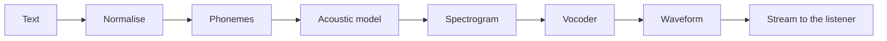

# Text to Speech
> **Level:** Intermediate · **Reading time:** 9 min · **Phase:** 9 · Multimodal AI

**In one line:** Text to speech (TTS) cleans the text, predicts a spectrogram that describes how it should sound, and then a vocoder turns that spectrogram into an audio waveform, with latency, quality and consent as the real engineering concerns.

**Before you start:** [Audio and Speech to Text](03-audio-and-speech-to-text.md). TTS runs that lesson's pipeline in the opposite direction.

**Words to know:**
- **Text normalisation:** rewriting numbers, dates, symbols and abbreviations into the words a person would say.
- **Phoneme:** a basic speech sound, such as the "k" in "cat".
- **Acoustic model:** the model that maps text (or phonemes) to a spectrogram.
- **Vocoder:** the model that converts a spectrogram into the actual waveform samples.
- **Prosody:** rhythm, stress, pitch and pauses: the "music" of speech.
- **MOS (mean opinion score):** a rating of naturalness, from 1 to 5, averaged over human listeners.
- **Streaming:** playing the first audio while the rest is still being generated.

## Explain it like I'm new
Think of a person reading a script aloud. Before speaking, they quietly sort things out: "12/03 is the twelfth of March", "$5 is five dollars", "Dr. is Doctor, but Dr. in a street name is Drive". Then they decide how to say it: which words to stress, where to pause, whether it is a question. Finally their throat and mouth make the sound.

TTS does the same in three stages. **Normalise** the text. **Plan the sound** (the acoustic model draws the spectrogram, the same kind of picture you met in speech recognition). **Make the sound** (the vocoder fills in the thousands of wave samples per second).

Why two sound stages instead of one? A spectrogram is compact: it says "which pitches, how loud, at each 10 ms". A waveform at 16,000 Hz has 160 numbers for every one of those 10 ms steps and holds fine detail the spectrogram does not fix. Splitting the job lets one model concentrate on what to say and how, and another on making it sound smooth. Some modern systems merge or skip stages, but the split is still the clearest way to learn it.

<!-- anim:mm-text-to-speech -->
## Watch it


*It plays on a loop. Read the caption in the box, one step at a time. Want to go at your own pace? [Step through it with Previous and Next](https://techsaurabh-394.github.io/ai-engineer-roadmap/#mm-text-to-speech).*

## How it works
```text
text -> normalised text -> phonemes (optional) -> acoustic model -> spectrogram -> vocoder -> waveform
frames per second   = sample_rate / hop
samples per frame   = hop                    (what the vocoder must produce per spectrogram step)
```

1. **Normalise.** "Meet at 3:30 on 12/03 for $5" becomes words a speaker would say. Rules or a small model decide, and the right reading depends on locale (12/03 is different in different countries).
2. **Phonemes (optional).** A pronunciation step turns words into sounds. Names and loanwords are the usual failures. Some models work straight from letters.
3. **Acoustic model.** A transformer or similar network predicts one spectrogram frame at a time (or in parallel). It decides pitch, length of each sound and loudness. Predicting the same text twice can give different results if the model samples.
4. **Vocoder.** A neural network produces the waveform that matches the spectrogram. It needs to make `hop` new samples for each spectrogram step.
5. **Post-process.** Resample, normalise loudness, add silence and encode.

### Worked example: what the vocoder must produce
With the values from [`mm_audio.py`](../code/mm_audio.py): sample rate 16,000 Hz and hop 160 samples (10 ms).

1. Spectrogram frames per second: 16,000 / 160 = **100**.
2. One second of speech therefore needs 100 spectrogram frames from the acoustic model, and the vocoder must turn each into 160 samples to give **16,000** samples.
3. A 30-second reading is 2,998 full analysis frames with a 400-sample window (the same frame count formula as before); you need roughly three thousand steps of acoustic modelling for half a minute of speech.
4. At 800 Hz (the toy rate in the demo) one second is 800 numbers, and a 100 Hz tone has 8 samples per cycle. Make the sample rate too low and high pitches cannot be represented at all: the highest representable frequency is half the sample rate.

**Evaluation** is harder than for text because "good" is partly a matter of listening.
- **Intelligibility:** transcribe the output with a speech recogniser and compute the [word error rate](03-audio-and-speech-to-text.md) against the input text. It is an objective check for dropped or mangled words.
- **Naturalness:** human listeners rate samples (MOS). It needs enough listeners and care with test design.
- **Specifics:** test numbers, names, acronyms, long sentences and questions, where systems slip.

**Latency and streaming.** Two numbers matter: **time to first audio** (when the user hears something) and **real-time factor** (generation time divided by audio length; below 1 means faster than playback). For a voice assistant, start playing as soon as the first sentence or chunk is ready. Split long text at sentence boundaries, stream chunks, and keep a short buffer so playback never runs dry.

**Consent and voice-cloning risk.** Some systems can copy a voice from a short sample. That enables accessibility tools and also fraud, impersonation and harassment. Practical rules: only clone voices with clear, recorded consent; keep records; label synthetic audio; refuse to clone public figures or private people without permission; protect any stored voice samples; and be ready for abuse reports. Treat a voice as personal data.



## Code example
The audio arithmetic from [`mm_audio.py`](../code/mm_audio.py) (run `python 11-multimodal-ai/code/mm_audio.py`) sets the budget for any TTS system:

```python
from mm_audio import num_frames, sine_wave

sample_rate, hop = 16000, 160
print(sample_rate // hop)                       # 100 spectrogram frames per second
print(num_frames(16000, 400, 160))              # 98 full analysis frames in 1 s
print(len(sine_wave(100, 800, 1.0)))            # 800 samples for 1 s at 800 Hz
```

**In real projects** you call a TTS API or load an open model through a library such as those in the [Transformers documentation](https://huggingface.co/docs/transformers). Request a streaming response if you need low latency, pick the sample rate your audio player expects, and keep the original text so you can re-render when you upgrade the voice.

## When to use it / when not to
- **Use TTS** for assistants, accessibility (screen readers, audiobooks), alerts, language learning and narration.
- **Use prerecorded audio** for a handful of fixed phrases: it sounds best and costs least.
- **Avoid cloning** unless you have consent and a clear policy.
- **Avoid TTS alone** for safety-critical announcements without testing numbers, units and names.

## Common mistakes
- Skipping normalisation, so "1,234" or "Dr." is read wrongly.
- Measuring only average latency, not time to first audio.
- Evaluating with a handful of easy sentences and shipping to users who say names and numbers.
- Sending one long paragraph as a single request, so users wait for the whole thing.
- Cloning a voice from audio you were not given permission to use.

## Recap
If you remember only three things:
- TTS = normalise text, predict a spectrogram, vocode it to a waveform. At 16,000 Hz with a 10 ms hop that is 100 spectrogram steps and 16,000 samples per second.
- Judge quality with an intelligibility check (ASR plus WER), human naturalness ratings, and targeted tests on numbers and names. Judge responsiveness by time to first audio.
- Voice cloning needs consent, labelling and safeguards because it enables impersonation.

## Interview questions
**1. Why is TTS usually split into an acoustic model and a vocoder?**
<details><summary>Answer</summary>
The spectrogram is a compact plan (pitch, loudness and timing per 10 ms), so the acoustic model can focus on what is said and how. The vocoder then fills in the fine detail of the waveform, which needs many samples per step (160 at 16 kHz with a 10 ms hop). Each model can be improved or swapped on its own.
</details>

**2. How would you evaluate a TTS system?**
<details><summary>Answer</summary>
Run the output through a speech recogniser and compute WER against the source text for intelligibility; collect human naturalness ratings (MOS) on a varied set; add targeted tests for numbers, names and long sentences; and measure time to first audio and real-time factor.
</details>

**3. Your assistant waits three seconds before speaking. What do you change?**
<details><summary>Answer</summary>
Stream: split the reply into sentences, synthesise the first one immediately and play it while the rest is made, and use a streaming API. Track time to first audio rather than total generation time.
</details>

## Go deeper
- [Robust Speech Recognition via Large-Scale Weak Supervision, Whisper (Radford et al., 2022)](https://arxiv.org/abs/2212.04356), useful as the recogniser in a TTS intelligibility check
- [Hugging Face Transformers documentation](https://huggingface.co/docs/transformers)

**Prev:** [Audio and Speech to Text](03-audio-and-speech-to-text.md) · **Next:** [Video Understanding](05-video-understanding.md) · **Back to phase:** [Phase 9](../README.md)
