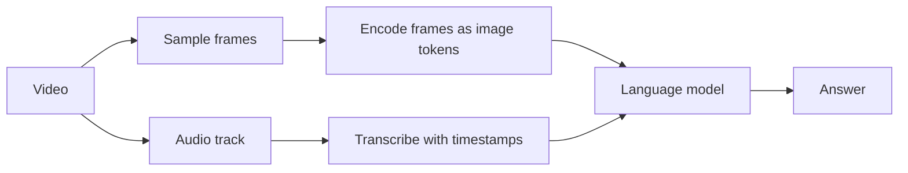

# Video Understanding
> **Level:** Advanced · **Reading time:** 10 min · **Phase:** 9 · Multimodal AI

**In one line:** Most video models treat a video as a short list of sampled frames, each encoded like an image, so the real engineering work is choosing which frames to keep, paying the token bill, keeping time order, and adding the audio track.

**Before you start:** [How Models See Images](02-how-models-see-images.md) and [Vision Language Models](01-vision-language-models.md). Also useful: [Context Window](../../03-llm-concepts/topics/08-context-window.md).

**Words to know:**
- **Frame:** one still image from a video.
- **FPS (frames per second):** how many frames a video has per second, or how many you sample per second.
- **Frame sampling:** choosing a subset of frames to give the model.
- **Temporal modelling:** any way of letting the model understand order and change over time.
- **Token budget:** the number of tokens you can afford to spend, set by the context window and your cost limit.
- **Keyframe:** a frame picked because it differs a lot from the one before (a scene change, for example).

## Explain it like I'm new
A flip book is a stack of drawings. Flip fast and you see motion. A video is a flip book with 24 to 60 pages per second.

Now imagine you must describe a 10-minute flip book to a friend, but you can only show them a few pages, and each page you show costs you money. You would not show all 14,400 pages (at 24 per second). You would pick some: one every few seconds, plus any page where something big changes. You would also keep the pages in order, or the story makes no sense. And if the film has a soundtrack, you would give your friend the words that are spoken, because dialogue often carries the plot.

That is video understanding for most current models. They are image models plus a plan for **which pages to show**, **in what order**, and **with what sound**.

<!-- anim:mm-video-understanding -->
## Watch it


*It plays on a loop. Read the caption in the box, one step at a time. Want to go at your own pace? [Step through it with Previous and Next](https://techsaurabh-394.github.io/ai-engineer-roadmap/#mm-video-understanding).*

## How it works
```text
frames sampled     = seconds * sampled_fps
tokens per frame   = (resolution / patch)^2 + 1        (for a ViT-style encoder)
total video tokens = frames sampled * tokens per frame
```

1. **Sample frames.** Options: uniform (every n-th frame, simple, never misses long events but can miss short ones), keyframe or scene-change based (spends frames where things change), or query-aware (pick frames related to the question, perhaps using [CLIP-style similarity](06-multimodal-embeddings-and-clip.md)).
2. **Encode each frame** with an image encoder, exactly as in the previous lessons.
3. **Reduce tokens.** Options: lower the resolution of each frame, merge similar neighbouring patches, or compress each frame to a small set of summary tokens.
4. **Model time.** Several approaches exist. The simplest is to put frame tokens in order in one sequence, perhaps with a timestamp text such as "00:12" between frames. Other designs add attention across frames or use dedicated video encoders that treat small blocks of space-time as patches. All of them try to give the model the idea of "before" and "after".
5. **Add audio.** Transcribe the audio track with [speech recognition](03-audio-and-speech-to-text.md) and add the text (with timestamps) to the prompt. Speech often tells you what the picture cannot.
6. **Answer** with the usual language-model decoding.

### Worked example: the token bill
Numbers from [`mm_patches.py`](../code/mm_patches.py): one 224-pixel frame with patch size 16 is 197 tokens.

| Video length | Sampling | Frames | Tokens |
|---|---|---|---|
| 10 s | 1 fps | 10 | 1,970 |
| 60 s | 1 fps | 60 | 11,820 |
| 60 s | 2 fps | 120 | 23,640 |
| 600 s | 1 fps | 600 | 118,200 |

1. A 60-second clip at one frame per second is 60 x 197 = **11,820** tokens.
2. Double the sampling to 2 fps and the cost doubles to **23,640**. Double the frame resolution instead and, by the [patch arithmetic](02-how-models-see-images.md), each frame costs about four times as much.
3. A 10-minute video at 1 fps needs **118,200** tokens, more than many context windows hold, before the question or any transcript.
4. **Fixes:** sample fewer frames (8 frames from a 60 s clip are at 0.0, 7.5, 15.0, 22.5, 30.0, 37.5, 45.0 and 52.5 seconds, 8 x 197 = 1,576 tokens), shrink frames, or split the video into segments, answer per segment and then combine the answers.

The risk of sparse sampling is clear from that list: with 7.5 seconds between frames, anything shorter than that can fall between two samples and never be seen. Pick the sampling rate from the shortest event you care about.

**Long videos.** Never push everything into one prompt. A common design is **retrieve then reason**: index segments (frames plus transcript) as in [Multimodal RAG](07-multimodal-rag.md), fetch the few segments that match the question, and send only those to the model.



## Code example
From [`mm_patches.py`](../code/mm_patches.py) (run `python 11-multimodal-ai/code/mm_patches.py`):

```python
from mm_patches import video_tokens

for seconds, fps in ((10, 1), (60, 1), (60, 2), (600, 1)):
    frames, tokens = video_tokens(seconds, fps, 224)
    print(seconds, fps, frames, tokens)
# 10 1 10 1970
# 60 1 60 11820
# 60 2 120 23640
# 600 1 600 118200
```

**In real projects** you extract frames with a media tool or library, resize them, and pass them as a series of images (or a video input if your provider accepts one) together with timestamped text. Check the provider's documentation for how many images or video seconds it allows and how they are counted. Log tokens per request: video makes a bill grow unpredictably.

## When to use it / when not to
- **Use a frame-based VLM** for questions like "what happens in this clip?", "when does the person enter?", summarising demos or checking a process on video.
- **Add the transcript** for lectures, meetings and interviews: the words matter more than the pictures.
- **Do not expect** precise motion measurement, exact counting across frames, or fine-grained timing from a handful of sampled frames.
- **Do not use it** if a simpler signal answers the question (for example a log file or a sensor).

## Common mistakes
- Sampling too sparsely and then asking about brief events.
- Forgetting timestamps, so the answer cannot say "at what time".
- Spending the whole context on frames and leaving no room for the question, transcript and answer.
- Ignoring the audio track.
- Assuming the model tracks an object smoothly. With sparse frames it sees snapshots and guesses what happened between them.

## Recap
If you remember only three things:
- A video is usually handled as sampled frames, each encoded as an image: tokens = frames x tokens per frame.
- The budget is brutal: 60 s at 1 fps and 224 px is 11,820 tokens, and 10 minutes is 118,200.
- Keep time order (positions or timestamps), add the transcript, and retrieve only the relevant segments for long videos.

## Interview questions
**1. How do you estimate the token cost of a video?**
<details><summary>Answer</summary>
Frames sampled (seconds times sampled fps) times tokens per frame, which for a ViT-style encoder is (resolution / patch)^2 plus any extra token. For 224 px and patch 16 each frame is 197 tokens, so 60 s at 1 fps is 11,820 tokens.
</details>

**2. A user asks "when does the door open?" in a 5-minute video. How do you design it?**
<details><summary>Answer</summary>
Sample frames with timestamps, probably coarse first and then denser around candidate times (or retrieve segments by similarity to the query), include the transcript, and ask the model to answer with a timestamp. Verify by re-sampling densely around the answer.
</details>

**3. What do you lose by sampling one frame per second?**
<details><summary>Answer</summary>
Anything shorter than about a second can be missed, and motion between frames is only inferred. Choose the sampling rate from the shortest event that matters, or use keyframe or query-aware sampling.
</details>

## Go deeper
- [An Image is Worth 16x16 Words (Dosovitskiy et al., 2020)](https://arxiv.org/abs/2010.11929), the patch arithmetic behind the per-frame cost
- [Flamingo: a Visual Language Model for Few-Shot Learning (Alayrac et al., 2022)](https://arxiv.org/abs/2204.14198), which handles interleaved images and video frames with text
- [Robust Speech Recognition via Large-Scale Weak Supervision, Whisper (Radford et al., 2022)](https://arxiv.org/abs/2212.04356), for the audio track
- [Hugging Face Transformers documentation](https://huggingface.co/docs/transformers)

**Prev:** [Text to Speech](04-text-to-speech.md) · **Next:** [Multimodal Embeddings and CLIP](06-multimodal-embeddings-and-clip.md) · **Back to phase:** [Phase 9](../README.md)
