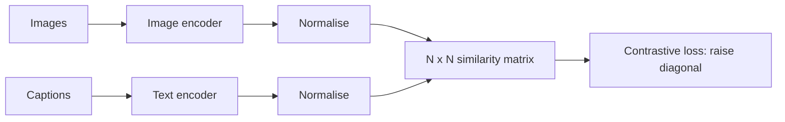

# Multimodal Embeddings and CLIP
> **Level:** Intermediate · **Reading time:** 11 min · **Phase:** 9 · Multimodal AI

**In one line:** CLIP trains one encoder for images and one for text so that a picture and its caption land close together in the same vector space, using a contrastive loss that rewards the right pairs and punishes the wrong ones.

**Before you start:** [Embeddings](../../01-rag-foundations/topics/02-embeddings.md) and [Cosine Similarity](../../01-rag-foundations/topics/11-cosine-similarity.md). Also helpful: [Temperature](../../03-llm-concepts/topics/09-temperature.md), because the same idea appears in the loss.

**Words to know:**
- **Joint (shared) embedding space:** one vector space in which images and text can be compared directly.
- **Contrastive learning:** training by pulling matching pairs together and pushing non-matching pairs apart.
- **Positive / negative pair:** a matching (image, caption) pair, or a mismatched one.
- **InfoNCE loss:** the cross-entropy loss over a similarity matrix, where the right answer for each row is the matching item.
- **Temperature:** a number that scales the similarities before softmax. It controls how sharp the scores are.
- **Zero-shot classification:** classifying with labels the model was never specifically trained on, by comparing the image with text prompts.

## Explain it like I'm new
Imagine a huge map where every photo and every sentence gets a pin. You want the pin for a photo of a cat to sit right next to the pin for the sentence "a photo of a cat", and far from "a plate of pasta".

To teach that, you show the system a batch of pairs: three photos with their three captions. You ask it to score every photo against every caption. That gives a 3 x 3 table. The right answers are on the diagonal (photo 1 with caption 1, and so on). Training nudges the system so the diagonal scores go up and the other cells go down. Repeat across hundreds of millions of image-caption pairs from the web (the [CLIP paper](https://arxiv.org/abs/2103.00020) describes this at scale) and the map organises itself so that meaning, not file type, decides who sits near whom.

The payoff is search and classification with no special training. To search images with a sentence, embed the sentence and find the nearest image pins. To classify a photo, write the possible labels as sentences and see which sentence is nearest.

<!-- anim:mm-multimodal-embeddings-and-clip -->
## Watch it


*It plays on a loop. Read the caption in the box, one step at a time. Want to go at your own pace? [Step through it with Previous and Next](https://techsaurabh-394.github.io/ai-engineer-roadmap/#mm-multimodal-embeddings-and-clip).*

## How it works
```text
u_i = image_encoder(image_i) / ||image_encoder(image_i)||      (length 1)
v_j = text_encoder(text_j)   / ||text_encoder(text_j)||        (length 1)
S[i][j] = u_i . v_j                                            (cosine similarity)
logits  = S / T                                                (T = temperature)
loss_image_to_text = mean_i  -log softmax(row i of logits)[i]
loss_text_to_image = mean_j  -log softmax(column j of logits)[j]
loss = (loss_image_to_text + loss_text_to_image) / 2
```

1. **Encode both sides.** The image goes through an image encoder (such as a [ViT](02-how-models-see-images.md)). The text goes through a text transformer. Each produces a vector of the same length.
2. **Normalise** to length 1. Then a dot product is exactly cosine similarity.
3. **Score every pair** in the batch: an N x N matrix. With N pairs there are N right cells and N x N - N wrong cells, so every batch automatically supplies many "negatives" for free.
4. **Divide by temperature** so the softmax is neither too flat nor too spiky.
5. **Cross-entropy both ways.** Each image must pick its caption among N captions, and each caption must pick its image among N images.
6. **Update** both encoders by gradient descent.

### Worked example: a 3 x 3 table
Numbers from [`mm_clip_contrastive.py`](../code/mm_clip_contrastive.py). Three toy images and their three captions (hand-made vectors in 3 dimensions) give this cosine matrix (rows images, columns captions):

| | caption 0 | caption 1 | caption 2 |
|---|---|---|---|
| image 0 | **0.99** | 0.32 | 0.14 |
| image 1 | 0.30 | **0.99** | 0.32 |
| image 2 | 0.15 | 0.38 | **0.98** |

1. **Row 0 at temperature 0.5:** divide by 0.5: logits `1.98, 0.64, 0.27`. Softmax gives probabilities `0.693, 0.182, 0.125`. The right answer is column 0, so the row loss is -ln(0.693) = **0.366**.
2. Do the same for every row and every column, and average: the symmetric loss is **0.395** at T = 0.5, and **0.683** at T = 1.0.
3. **Chance level.** If every cell were equal, each row would give probability 1/3 to the right caption and the loss would be ln(3) = **1.099**. Our table is well below that, so the pairs are well separated.
4. **Temperature again:** at T = 0.07 the loss here is 0.000 to three places, because dividing by a small number makes even modest gaps decisive. Small temperatures make the loss demand clear separation; the CLIP paper describes how it handles this value.
5. **Loss falls as pairs get closer.** In the demo's noise sweep, where each pair shares a hidden concept plus noise on both sides, and T = 0.1: noise 2.0 gives loss 4.819, noise 1.0 gives 3.473, noise 0.5 gives 0.707, noise 0.1 gives 0.000. Less noise means matched pairs are more alike and the loss drops.
6. **Bigger batch, harder game.** With N = 32 pairs the chance loss is ln(32) = 3.466. The demo's 32-pair set (noise 0.5, T = 0.1) gets 0.165. More negatives per batch make the task harder, which is why large batches matter for this method.

**Zero-shot classification.** Embed each label as a prompt (for example "a photo of a cat", "a photo of a dog", "a photo of a car"), embed the image, take the highest cosine. In the demo, image 0 scores `0.99, 0.32, 0.14` and is labelled "cat"; image 1 gives "dog"; image 2 gives "car". No classifier was trained for these three labels.

**Limits** you should know:
- **Not exact.** A shared space says "about the same thing", not "has exactly three red cars". Counting, spatial relations ("left of") and fine text reading are weak.
- **Prompt wording matters.** "a photo of a dog" can beat "dog". Test your labels.
- **Inherits web biases and gaps.** Training pairs come from captions people wrote; rare domains (medical scans, your internal diagrams) may be poorly covered. Evaluate on your own data.
- **Similarity is not truth.** A high score can come from a confusing look-alike. Use thresholds and a fallback such as "none of the above".



## Code example
From [`mm_clip_contrastive.py`](../code/mm_clip_contrastive.py) (run `python 11-multimodal-ai/code/mm_clip_contrastive.py`):

```python
import math

def softmax(xs):
    m = max(xs)
    e = [math.exp(x - m) for x in xs]
    return [v / sum(e) for v in e]

def info_nce(sim, temperature):
    logits = [[s / temperature for s in row] for row in sim]
    def ce(rows):
        return sum(-math.log(softmax(r)[i]) for i, r in enumerate(rows)) / len(rows)
    cols = [list(c) for c in zip(*logits)]
    return (ce(logits) + ce(cols)) / 2
```

**In real projects** you use a pretrained model: load it through a library such as `sentence-transformers` or the [Transformers documentation](https://huggingface.co/docs/transformers), embed your images and texts, and store the vectors in a vector index as in [Embeddings](../../01-rag-foundations/topics/02-embeddings.md). For vector arithmetic see [`rag_vector_math.py`](../../01-rag-foundations/code/rag_vector_math.py). Always embed queries and documents with the same model.

## When to use it / when not to
| Task | Fit |
|---|---|
| Search a photo library with a sentence | Very good |
| Zero-shot sorting into labels you can describe in words | Good start, test it |
| Find near-duplicate or similar images | Good |
| Exact counting, reading small text, strict spatial answers | Poor: use OCR or a VLM |
| A domain far from web photos | Evaluate first; fine-tuning may be needed |

## Common mistakes
- Comparing embeddings from two different models. Their spaces are unrelated.
- Forgetting to normalise vectors before using a dot product.
- Using single words as prompts, then blaming the model.
- Treating the score as a probability. Cosine values of 0.3 can be the best match in one setting and meaningless in another.
- Believing that matching in embedding space proves the caption is true of the image.

## Recap
If you remember only three things:
- Two encoders, one shared space: matching image and text pairs end up close, mismatched pairs far.
- Training builds an N x N cosine table, divides by a temperature, and applies cross-entropy in both directions so the diagonal wins.
- Zero-shot classification just compares the image to label prompts, and the limits are exact detail, prompt wording and domain gaps.

## Interview questions
**1. Explain the CLIP training objective.**
<details><summary>Answer</summary>
For a batch of N matching image-text pairs, compute the N x N cosine similarity matrix of normalised embeddings, divide by a temperature, and apply cross-entropy so that each image picks its own caption among the N, and each caption picks its own image. The two losses are averaged. The other N - 1 items in the batch act as negatives.
</details>

**2. How does zero-shot image classification work with CLIP?**
<details><summary>Answer</summary>
Write each class as a text prompt, embed the prompts and the image, and choose the class whose prompt embedding has the highest cosine similarity with the image embedding. No classifier is trained, but results depend on prompt wording and on how well the domain was covered in training.
</details>

**3. What does temperature do in the loss, and what is the chance-level loss for a batch of 8?**
<details><summary>Answer</summary>
It scales the similarities before softmax: a small temperature sharpens the distribution so small gaps count more. If all scores are equal, each caption gets probability 1/8, so the loss is ln(8), about 2.08.
</details>

## Go deeper
- [Learning Transferable Visual Models From Natural Language Supervision, CLIP (Radford et al., 2021)](https://arxiv.org/abs/2103.00020)
- [An Image is Worth 16x16 Words (Dosovitskiy et al., 2020)](https://arxiv.org/abs/2010.11929)
- [Hugging Face Transformers documentation](https://huggingface.co/docs/transformers)

**Prev:** [Video Understanding](05-video-understanding.md) · **Next:** [Multimodal RAG](07-multimodal-rag.md) · **Back to phase:** [Phase 9](../README.md)
