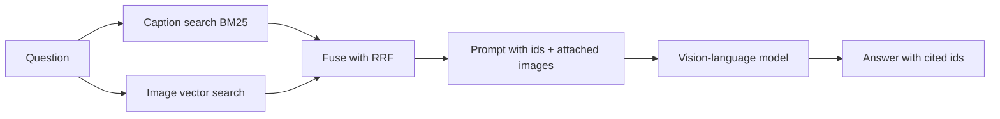

# Multimodal RAG
> **Level:** Advanced · **Reading time:** 11 min · **Phase:** 9 · Multimodal AI

**In one line:** Multimodal RAG makes images (and charts, slides, scans) searchable and then shows the best ones to a vision-language model, usually by indexing both a caption and an image embedding and fusing the two result lists.

**Before you start:** [Multi Modal RAG](../../02-advanced-rag/topics/15-multi-modal-rag.md) gives the overview; this lesson goes deeper with working retrieval code. You should also know [Multimodal Embeddings and CLIP](06-multimodal-embeddings-and-clip.md), [Vision Language Models](01-vision-language-models.md) and [BM25](../../01-rag-foundations/topics/17-bm25.md).

**Words to know:**
- **Caption index:** images stored with a text description, searched like text.
- **Multimodal embedding:** a vector for an image made by a model that shares a space with text, so a text query can match it.
- **BM25:** a keyword-matching score that rewards rare shared words.
- **Reciprocal rank fusion (RRF):** a way to merge ranked lists: each item gets `1 / (k + rank)` from every list it appears in, and the scores are added.
- **Grounding:** making the answer depend on, and point to, the retrieved sources.
- **Recall@k:** the share of questions for which the right item appears in the top k results.

## Explain it like I'm new
You are looking for "last year's revenue chart" in a shared folder of 5,000 images. Two ways to look:
1. **Read the labels.** Each file has a caption someone typed. You search the captions for "revenue" and "chart". Fast, but a chart captioned "Figure 4" never turns up.
2. **Look at the pictures.** A helper who understands both pictures and words can say, "this image looks like a revenue bar chart". It finds "Figure 4", but it can also pull up a similar-looking chart from the wrong year.

Using both and merging the results is more reliable than either one. Then you hand the real pictures, not their labels, to a model that can look at them and answer.

That is the whole idea. The details are in how you index, how you merge and how you check the result.

<!-- anim:mm-multimodal-rag -->
## Watch it


*It plays on a loop. Read the caption in the box, one step at a time. Want to go at your own pace? [Step through it with Previous and Next](https://techsaurabh-394.github.io/ai-engineer-roadmap/#mm-multimodal-rag).*

## How it works
```text
Index time:   for each image -> caption (person or VLM), embedding, id, path, page, source doc
Query time:   caption list  = BM25(question, captions and text chunks)
              vector list   = cosine(query vector, image vectors)
              fused list    = RRF(caption list, vector list)      score = sum 1 / (k + rank)
Answer time:  prompt = instructions + sources named by id (+ the actual images attached)
```

**Three indexing designs**

| Design | How | Strength | Weak spot |
|---|---|---|---|
| **Captions only** | Describe each image in text (by hand or with a VLM), index text | Reuses your text stack; easy to debug | Caption quality caps recall. "Figure 4." is a dead end |
| **Multimodal embeddings only** | Embed images with a CLIP-style model; embed the query text with its text side | Finds images with no useful caption | Weak on exact words, numbers, names and fine text; similar-looking decoys |
| **Both, fused** | Run both searches and merge with RRF | Each covers the other's gaps | Two indexes to maintain |

**Passing images to the model.** Retrieval finds ids. The generation step attaches the original images (or crops) to the prompt and names each one by id so the model can cite it. Do not send only the caption: the point of a VLM is that it looks at the pixels. Mind the [image token cost](01-vision-language-models.md): send the top few, resized.

### Worked example (from `mm_rag.py`)
Corpus: two text chunks (`t1`, `t2`) and four images (`img1` bar chart of quarterly revenue, `img2` pump diagram, `img3` captioned only "Figure 4." but really a chart, `img4` team photo). Question: *"how did revenue change by quarter"*.

1. **Caption search (BM25)** returns only `img1` (score 2.4538) and `t1` (2.0389). The chart `img3` is missing, because its caption shares no words with the question.
2. **Vector search (cosine on toy features)** returns `img1` 0.9997, `img3` 0.9787, `img2` 0.2035, `img4` 0.0000. Here the uncaptioned chart is found.
3. **Reciprocal rank fusion** with k = 60: `img1` is rank 1 in both lists, so it gets 1/61 + 1/61 = **0.0328**. `img3` (rank 2 in one list only) gets 1/62 = 0.0161. `t1` (rank 2 in the caption list) also gets 0.0161. `img2` (rank 3 in vectors) gets 1/63 = 0.0159.
4. **Top 3** after fusion: `img1`, `img3`, `t1`. Two images are attached to the prompt.
5. **The prompt** names each source, so the model can cite `[img1]`:

```text
[img1] (image attached) caption: Bar chart of quarterly revenue by region.
[img3] (image attached) caption: Figure 4.
[t1] Revenue grew steadily in the third quarter across all regions.

Question: how did revenue change by quarter
```

The agreement bonus is the heart of RRF: an item two searches both like beats an item only one likes. Ties (such as `img3` and `t1` at 0.0161) are broken by id in this demo; real systems often use a reranker.

**Evaluation.** Test retrieval separately from the answer, as in [RAG evaluation](../../02-advanced-rag/topics/20-rag-evaluation.md):
- Build 30-100 real questions, each with the id of the image or chunk that should be found.
- Measure **recall@k** and rank of the right item for each design (captions, vectors, fused).
- Then grade the final answers: is the claim supported by the attached image, and are cited ids real?
- Slice by type: charts, screenshots, photos, scans. Averages hide the types that fail.

**Failure modes**
- **Dead captions** ("Figure 4"). Fix: generate richer captions, include the surrounding text or the figure title.
- **Look-alike decoys** (this year's chart versus last year's). Fix: metadata filters (year, document), reranking, and showing the model the source labels.
- **Text inside images** (axis labels, numbers) missed by embeddings. Fix: OCR the text and index it too.
- **Too many images in the prompt**: cost and distraction. Fix: top 2-4, resize, crop to the figure.
- **Ungrounded answers**: the model describes what it expects, not what it sees. Fix: require cited ids, ask for quoted values, and spot-check.
- **Lost provenance:** no link from a hit back to its page. Fix: store id, path, page and document with every item.



## Code example
From [`mm_rag.py`](../code/mm_rag.py) (run `python 11-multimodal-ai/code/mm_rag.py`):

```python
from mm_rag import CORPUS, QUERY_TEXT, QUERY_FEATURES, rank_by_caption, rank_by_vector, rrf, build_prompt

fused = rrf([rank_by_caption(QUERY_TEXT, CORPUS), rank_by_vector(QUERY_FEATURES, CORPUS)])
top = [doc_id for doc_id, _ in fused[:3]]
print(top)                                   # ['img1', 'img3', 't1']
print(build_prompt(QUERY_TEXT, top, CORPUS))
```

**In real projects** the toy feature vectors become embeddings from a CLIP-style model (see the [Transformers documentation](https://huggingface.co/docs/transformers)), the lists come from a vector database and a keyword index, and the final prompt sends the actual image files to a VLM. The vector math is the same as in [`rag_vector_math.py`](../../01-rag-foundations/code/rag_vector_math.py).

## When to use it / when not to
- **Use it** for manuals, slide decks, product catalogues, reports with charts, and screenshots.
- **Start with captions only** if most meaning is in text and tables: cheapest and easiest to inspect.
- **Add image embeddings** when captions are poor or missing, or users search by look.
- **Skip it** if your content is text: the extra indexing and image tokens buy nothing.

## Common mistakes
- Passing the caption to the model instead of the picture, then wondering why chart questions fail.
- Judging only the final answer, so retrieval errors look like model errors.
- Mixing embeddings from different models in one index.
- Dropping the link from item to page or file.
- Sending full-size images for every hit and paying for tokens that add nothing.

## Recap
If you remember only three things:
- Index images by caption, by multimodal embedding, or both; the two methods fail in different places.
- Merge ranked lists with reciprocal rank fusion, then attach the real images to the prompt with ids the model can cite.
- Evaluate retrieval separately (recall@k per image type) and look at failure modes: dead captions, look-alikes, text in images, too many images.

## Interview questions
**1. Why index both captions and image embeddings?**
<details><summary>Answer</summary>
Captions give exact-word matching and are easy to debug, but a poor caption hides an image. Embeddings find images by content even without good captions, but are weaker on exact words and can return look-alikes. Fusing both covers each side's gaps.
</details>

**2. How does reciprocal rank fusion work, and why use it?**
<details><summary>Answer</summary>
Each list gives an item 1 / (k + rank), the scores are summed across lists, and items are sorted by the total. It needs only ranks, not comparable scores, and rewards items that several searches agree on. With k = 60, an item ranked first in two lists scores 2/61, about 0.033.
</details>

**3. Your multimodal RAG answers chart questions wrongly. How do you find the cause?**
<details><summary>Answer</summary>
Check retrieval first: was the right chart in the top k (recall@k on labelled questions)? If not, improve captions, add embeddings, OCR the text and use filters. If it was retrieved, check that the actual image, not just its caption, was attached at suitable resolution, and that the prompt asked for cited values you can verify.
</details>

## Go deeper
- [Learning Transferable Visual Models From Natural Language Supervision, CLIP (Radford et al., 2021)](https://arxiv.org/abs/2103.00020)
- [Visual Instruction Tuning, LLaVA (Liu et al., 2023)](https://arxiv.org/abs/2304.08485)
- [Hugging Face Transformers documentation](https://huggingface.co/docs/transformers)

**Prev:** [Multimodal Embeddings and CLIP](06-multimodal-embeddings-and-clip.md) · **Next:** [Phase 9 checkpoint quiz](../README.md) · **Back to phase:** [Phase 9](../README.md)
