# Reasoning Models and Test-Time Compute
> **Level:** Advanced · **Reading time:** 10 min · **Phase:** 10 · Frontier AI Engineering

**In one line:** A reasoning model spends extra tokens thinking before it answers, and test-time compute is the idea that you can buy better answers with more thinking at inference time instead of a bigger model.

**Before you start:** [Temperature](../../03-llm-concepts/topics/09-temperature.md) and [Prompt Engineering](../../03-llm-concepts/topics/14-prompt-engineering.md).

## Explain it like I'm new
Imagine a maths exam. One student blurts the first answer that comes to mind. Another uses scrap paper, tries an approach, checks it, and only then writes the final answer. Both students have the same brain. The second just spends more time. A **reasoning model** is trained to use scrap paper: it writes a long hidden or visible chain of thought, then the answer.

The second idea is that you can also buy accuracy by asking the same question many times and taking the most common answer (**self-consistency**, or majority voting). Both tricks trade money and delay for quality. That trade is called **test-time compute**.

<!-- anim:fa-reasoning-test-time-compute -->
<!-- anim:fa-reasoning-test-time-compute -->
## Watch it


*It plays on a loop. Read the caption in the box, one step at a time. Want to go at your own pace? [Step through it with Previous and Next](https://techsaurabh-394.github.io/ai-engineer-roadmap/#fa-reasoning-test-time-compute).*

## How it works
### 1. Three ways to spend more compute at answer time
1. **Think longer.** The model writes more intermediate steps before the answer. Cost grows with the number of thinking tokens, and those tokens are normally billed as output.
2. **Sample many, then vote.** Run `n` independent attempts and pick the most common final answer ([Wang et al., 2022](https://arxiv.org/abs/2203.11171)).
3. **Sample many, then verify.** Generate `n` candidates and let a checker (unit tests, a calculator, a trained verifier) choose. This works best when checking is easier than solving.

### 2. How reasoning models are trained, in one paragraph
Models are trained with reinforcement learning on problems that have checkable answers (maths, code). The reward is whether the final answer is right. Over training, the model learns to write longer, more careful chains: re-reading the question, trying a different route, catching its own mistake. You do not hand-write the reasoning; the reward shapes it. See [How LLMs Are Trained](../../03-llm-concepts/topics/24-how-llms-are-trained.md) for where this sits in the pipeline.

### 3. Why voting works, with real numbers
Suppose one attempt is right with probability `p = 0.6` and a wrong attempt always lands on the same single wrong answer. Voting over `n` samples is right when more than half the samples are right. From the demo (exact binomial arithmetic):

| Samples n | P(majority correct) |
|---|---|
| 1 | 0.6000 |
| 3 | 0.6480 |
| 5 | 0.6826 |
| 11 | 0.7535 |
| 21 | 0.8256 |

Hand check for n = 3: `3 × 0.6² × 0.4 + 0.6³ = 0.432 + 0.216 = 0.648`.

It gets better when wrong answers disagree with each other. With `p = 0.4` and the wrong answers spread over five different values, a seeded simulation of 20,000 trials gives 0.397 at n = 1, 0.701 at n = 5, 0.830 at n = 11 and 0.930 at n = 21. A model that is right only 40 percent of the time becomes right 93 percent of the time, because the right answer is the only one that repeats.

### 4. When voting hurts
If the model makes the **same** mistake more often than it finds the right answer, voting makes things worse. With `p = 0.45` and a single common wrong answer, the demo gives 0.450 at n = 1, 0.407 at n = 5 and 0.321 at n = 21. Voting amplifies whichever answer is most likely, right or wrong. Independent errors are the assumption that makes voting work, and real model errors are often correlated.

### 5. The bill
Sampling 21 attempts of 800 tokens each, against one 100-token answer, costs `21 × 800 / 100 = 168` times as many tokens. Latency grows too unless the samples run in parallel. Thinking tokens also fill the [context window](../../03-llm-concepts/topics/08-context-window.md).

### 6. Choosing how much to think
- Easy lookups, formatting, classification: a plain model with no extended thinking. Extra thinking adds cost and sometimes overthinks a simple question.
- Multi-step maths, code with tests, planning with constraints: reasoning or sampling helps most.
- Anything with a cheap automatic checker: sample several, check each, keep a passing one.
- Set a **thinking budget** (maximum thinking tokens) and measure accuracy against cost on your own questions.

### Worked example
From real output of [`fa_reasoning.py`](../code/fa_reasoning.py).

1. One attempt is right 60 percent of the time. Three attempts with a vote: 0.648.
2. Twenty-one attempts: 0.8256. That is 22 points better, and it costs 21 times as many calls.
3. Change the setup so the model repeats one wrong answer 55 percent of the time. Now 21 votes give 0.321, worse than one attempt.
4. Lesson: measure on your own data before paying for voting.

## Code example
```python
from math import comb

def majority_correct_binary(p, n):
    # n odd; each sample right with probability p
    return sum(comb(n, k) * p**k * (1 - p) ** (n - k)
               for k in range(n // 2 + 1, n + 1))

print(round(majority_correct_binary(0.6, 3), 4))    # 0.648
print(round(majority_correct_binary(0.6, 21), 4))   # 0.8256
```

Run `python 12-frontier-ai/code/fa_reasoning.py`; tests: `pytest 12-frontier-ai/code/test_fa_reasoning.py`.

**In real projects** you call a model with a thinking or reasoning setting and a budget. You do not write the loop above, but you do need to know that the cost multiplier is real and that voting needs independent errors.

## Common mistakes
- Using a reasoning model for every request, including simple classification, and being surprised by the bill.
- Assuming majority voting always helps. If errors are correlated, it makes accuracy worse.
- Forgetting that thinking tokens are billed and count toward the context window.
- Treating the displayed chain of thought as a faithful explanation of how the answer was reached. It can be incomplete or wrong even when the answer is right.
- Measuring on five easy examples instead of a real held-out set.

## Recap

**If you remember only three things:**
- A reasoning model writes intermediate steps before answering. Extra thinking tokens buy accuracy on multi-step problems.
- Voting over many samples helps only when wrong answers are scattered. Correlated mistakes get amplified.
- The price is real: 21 samples of 800 tokens is 168 times the tokens of one 100-token answer.

## Interview questions
**1. Why can majority voting turn a 40 percent model into a 90 percent one, and when does it fail?**
<details><summary>Answer</summary>
When wrong answers are spread over many values, the right answer is the only one that repeats, so it wins the vote as n grows (0.40 becomes about 0.93 at n = 21 in the demo with five wrong values). It fails when mistakes are correlated: if the model gives one specific wrong answer more often than the right one, voting amplifies the mistake.
</details>

**2. How would you decide whether a task deserves extended thinking?**
<details><summary>Answer</summary>
Run a held-out set at several thinking budgets and plot accuracy against cost and latency. Tasks with many dependent steps or a cheap checker usually gain; lookups, formatting and classification usually do not. Choose the smallest budget where the curve flattens.
</details>

**3. What is the difference between voting and verifying?**
<details><summary>Answer</summary>
Voting picks the most common answer and needs no checker. Verifying generates candidates and uses a checker (tests, a calculator, a trained verifier) to pick one that passes. Verifying beats voting when checking is much cheaper than solving.
</details>

## Go deeper
- [Self-Consistency Improves Chain of Thought Reasoning (Wang et al., 2022)](https://arxiv.org/abs/2203.11171)
- [Chain-of-Thought Prompting (Wei et al., 2022)](https://arxiv.org/abs/2201.11903)
- [Scaling LLM Test-Time Compute Optimally (Snell et al., 2024)](https://arxiv.org/abs/2408.03314)

**Prev:** [Phase 9 · Multimodal AI](../../11-multimodal-ai/README.md) · **Next:** [Context Engineering and Prompt Caching](02-context-engineering-and-prompt-caching.md) · **Back to phase:** [Phase 10](../README.md)
