# Context Engineering and Prompt Caching
> **Level:** Intermediate · **Reading time:** 10 min · **Phase:** 10 · Frontier AI Engineering

**In one line:** Context engineering is choosing exactly what goes into the model's window and in what order, and prompt caching makes the unchanging front part of that window much cheaper to resend.

**Before you start:** [Context Window](../../03-llm-concepts/topics/08-context-window.md) and [KV Cache](../../03-llm-concepts/topics/07-kv-cache.md).

## Explain it like I'm new
Think of briefing a new colleague before each task. You can hand over a 300-page binder every time, or a one-page brief with the three facts that matter. Context engineering is writing that brief: instructions, a few examples, retrieved facts, tool results and history, arranged on purpose.

Prompt caching is a photocopier trick. If the first 50 pages of the binder never change, the provider remembers the work it did reading them and charges you much less for those pages next time. The catch: it only remembers an unbroken **prefix**. Change page 1 and every page after it must be read again.

<!-- anim:fa-context-and-prompt-caching -->
<!-- anim:fa-context-and-prompt-caching -->
## Watch it


*It plays on a loop. Read the caption in the box, one step at a time. Want to go at your own pace? [Step through it with Previous and Next](https://techsaurabh-394.github.io/ai-engineer-roadmap/#fa-context-and-prompt-caching).*

## How it works
### 1. What goes in the window
A typical agent request is built from layers, from most stable to least stable:

1. System instructions and policies (rarely change).
2. Tool definitions (change when you ship a new tool).
3. Examples and reference documents (change per task type).
4. Conversation history (grows every turn).
5. Retrieved chunks and tool results for this turn (different every turn).
6. The user's latest message.

Context engineering means deciding what earns a place in each layer, trimming what does not, and keeping the order stable. Failure modes: stuffing everything in (cost, delay and *context rot*, where the model misses facts buried in the middle), leaving too little (hallucination), and contradictory instructions at different layers.

### 2. The four moves
- **Select:** retrieve only what the task needs (see [Reranking](../../02-advanced-rag/topics/01-reranking.md)).
- **Compress:** summarise old turns, drop stale tool output ([Context Compression](../../02-advanced-rag/topics/04-context-compression.md)).
- **Isolate:** give sub-tasks their own small context (a sub-agent) instead of one huge shared one.
- **Persist:** save facts outside the window and fetch them when needed ([Long-term Memory](../../04-agentic-ai/topics/09-long-term-memory.md)).

### 3. How a prefix cache works
The server stores the intermediate attention state (the [KV cache](../../03-llm-concepts/topics/07-kv-cache.md)) for a prefix. A new request reuses it only for the leading tokens that are **identical**. From the demo, a 2,002-token prompt:

- Edit at the very end: 2,001 of 2,002 tokens shared. Almost everything is reused.
- Edit at the very start (for example a timestamp inserted as the first line): 0 of 2,002 shared. Nothing is reused.

So the rule is simple: **stable things first, changing things last.** A "current time" line belongs at the end of the prompt, not the top.

### 4. The money, with illustrative prices
Prices below are made up for the demo ($3.00 per million uncached input tokens, $0.30 per million cached tokens, $3.75 per million to write the cache). Check your provider.

| 20-turn chat, 6,000-token system prompt, 400 tokens per turn | Input cost |
|---|---|
| No caching | $0.6120 |
| With caching | $0.1047 |

That is about 5.8 times cheaper in this setup. Writing to the cache costs slightly more than a normal read, so it pays off after a fraction of one reuse: the demo's break-even is 0.278 reads (`(3.75 − 3.00) / (3.00 − 0.30)`).

### 5. Things that silently break caching
- A timestamp, request id or user name near the top of the prompt.
- Re-ordering tool definitions or JSON keys between calls.
- Editing earlier history (for example rewriting an old message) instead of appending.
- Caches expire after minutes of inactivity, so a quiet app may see fewer hits than a busy one.

### 6. Measure it
Providers return usage fields that separate cached from uncached input tokens. Log the cache-hit ratio as a metric ([Observability](../../07-production-ai/topics/13-observability.md)). A drop after a deploy usually means someone put a changing value near the top.

### Worked example
From real output of [`fa_context.py`](../code/fa_context.py).

1. A 2,000-token system prompt plus two user tokens. Change the last token: 2,001 tokens still shared.
2. Instead, put a timestamp in the first position: 0 shared. The whole prompt is re-read at full price.
3. Run a 20-turn chat with a 6,000-token system prompt. No cache: $0.6120. Cache: $0.1047.
4. Fix: move the timestamp to the end, keep the cache.

## Code example
```python
def prefix_cache_hits(prev, new):
    n = 0
    for a, b in zip(prev, new):
        if a != b:
            break
        n += 1
    return n

system = list(range(2000))
print(prefix_cache_hits(system + [1, 2], system + [1, 3]))      # 2001
print(prefix_cache_hits(system + [1, 2], [777] + system[1:]))   # 0
```

Run `python 12-frontier-ai/code/fa_context.py`; tests: `pytest 12-frontier-ai/code/test_fa_context.py`.

**In real projects** you enable caching through your provider's API (often by marking the end of the stable prefix) and then verify the hit ratio in usage logs. Do not assume it is working.

## Common mistakes
- Putting a timestamp or request id at the top of the system prompt.
- Sending everything you have, instead of what this task needs. More context is not always better.
- Assuming a cache hit without reading the usage fields.
- Rewriting old history every turn (for example re-summarising it) so the prefix never matches.
- Treating illustrative prices as real. Always check your provider's current price page.

## Recap

**If you remember only three things:**
- Order the window from most stable to least stable, and keep that order the same between calls.
- A prefix cache reuses only identical leading tokens: one changed token near the start voids everything after it.
- Measure the cache-hit ratio. In the demo, caching cut a 20-turn chat's input cost from $0.6120 to $0.1047.

## Interview questions
**1. Your cache-hit ratio fell from 90 percent to 2 percent after a release. What do you check first?**
<details><summary>Answer</summary>
Whether something that changes per request, such as a timestamp, user name or reordered tool list, moved into the early part of the prompt. A prefix cache matches only identical leading tokens, so any early change invalidates the rest. Diff the rendered prompts of two consecutive calls and find the first differing token.
</details>

**2. What does context engineering mean, beyond writing a good prompt?**
<details><summary>Answer</summary>
Deciding what information enters the window, in what order, and in what form: selecting retrieved facts, compressing history, isolating sub-tasks in separate contexts and persisting facts outside the window. It treats the window as a scarce, costly resource instead of a dumping ground.
</details>

**3. Why can too much context hurt accuracy?**
<details><summary>Answer</summary>
Long windows cost more and are slower, and models can miss or misuse facts buried in the middle or contradicted elsewhere in the prompt. Smaller, relevant context often beats a larger, noisier one, so measure with your own questions.
</details>

## Go deeper
- [Anthropic: Prompt caching](https://docs.anthropic.com/en/docs/build-with-claude/prompt-caching)
- [OpenAI: Prompt caching](https://platform.openai.com/docs/guides/prompt-caching)
- [Lost in the Middle (Liu et al., 2023)](https://arxiv.org/abs/2307.03172)

**Prev:** [Reasoning Models and Test-Time Compute](01-reasoning-models-and-test-time-compute.md) · **Next:** [Speculative Decoding](03-speculative-decoding.md) · **Back to phase:** [Phase 10](../README.md)
