# Speculative Decoding
> **Level:** Advanced · **Reading time:** 9 min · **Phase:** 10 · Frontier AI Engineering

**In one line:** Speculative decoding lets a small, fast draft model guess several tokens ahead, then has the big model check them all in one pass, so you get the big model's exact output faster.

**Before you start:** [Inference Serving and Batching](../../03-llm-concepts/topics/20-inference-serving-and-batching.md) and [KV Cache](../../03-llm-concepts/topics/07-kv-cache.md).

## Explain it like I'm new
Picture a senior editor and an intern. The editor is slow and careful. The intern is quick but makes mistakes. Instead of the editor writing every word, the intern drafts the next four words, and the editor reads all four at a glance, crosses out the first wrong one, and carries on from there. If the intern is usually right, the text comes out much faster, and because the editor approves every word, the result is what the editor would have written.

That is speculative decoding. The key fact: checking four tokens costs the big model about the same as generating one, because it reads them in parallel.

<!-- anim:fa-speculative-decoding -->
<!-- anim:fa-speculative-decoding -->
## Watch it


*It plays on a loop. Read the caption in the box, one step at a time. Want to go at your own pace? [Step through it with Previous and Next](https://techsaurabh-394.github.io/ai-engineer-roadmap/#fa-speculative-decoding).*

## How it works
### 1. Why decoding is slow
Generating text is one token per big-model pass, and each pass has to load the model's weights from memory. The hardware is often waiting for memory, not busy computing. That leaves spare compute, and speculative decoding uses it ([Leviathan et al., 2022](https://arxiv.org/abs/2211.17192); [Chen et al., 2023](https://arxiv.org/abs/2302.01318)).

### 2. The loop
1. The **draft** model proposes `k` next tokens, one at a time (cheap).
2. The **target** model scores all `k` positions in a single pass.
3. Keep the longest prefix the target agrees with. At the first disagreement, take the target's own token instead and stop.
4. Even if every draft is accepted, the target adds one extra token. So each round produces between 1 and `k + 1` tokens.

With a correct acceptance rule (rejection sampling), the output has **exactly the same distribution** as the target model alone. It is not an approximation.

### 3. The maths
If each draft token is accepted with probability `a`, independently, the expected tokens per target pass is a geometric sum:

```text
E = 1 + a + a² + ... + a^k = (1 − a^(k+1)) / (1 − a)
```

From the demo, with `k = 4`:

| Acceptance a | Expected tokens per pass | Simulated (50,000 rounds) |
|---|---|---|
| 0.5 | 1.938 | 1.941 |
| 0.7 | 2.773 | 2.770 |
| 0.9 | 4.095 | 4.092 |

### 4. Real speed-up includes the draft's cost
If one draft step costs a fraction `c` of a target step, a round costs `k × c + 1` target-steps. Speed-up is expected tokens divided by that. With `c = 0.1` and `k = 4`:

| Acceptance a | Speed-up | Best k |
|---|---|---|
| 0.5 | 1.38x | 2 |
| 0.7 | 1.98x | 4 |
| 0.9 | 2.93x | 10 |

A bad draft backfires: `a = 0.3` with a draft costing 40 percent of the target gives 0.55x, slower than not using it at all.

### 5. What makes a good draft
- Same tokenizer and similar training data as the target, so they agree often.
- Much smaller (often 10 to 20 times), so it is cheap.
- Predictable text (code, boilerplate, JSON) is accepted more often than creative writing.
- Variants exist that skip the separate draft model, using extra prediction heads or the prompt itself as the source of guesses.

### 6. When it helps
- Latency-sensitive, low-batch serving: the spare compute is real.
- Less helpful at very high batch sizes, where the GPU is already busy and there is no spare compute to spend.
- It costs extra memory for the draft model.

### Worked example
From real output of [`fa_speculative.py`](../code/fa_speculative.py).

1. A draft that is right 70 percent of the time, proposing 4 tokens a round.
2. Expected tokens per target pass: 2.773 (simulation: 2.770).
3. Draft costs 10 percent of a target step, so a round costs 1.4 steps. Speed-up: 2.773 / 1.4 = 1.98x.
4. Swap in a weak draft (a = 0.3, cost 0.4): 0.55x. A fast guesser that is often wrong is worse than nothing.

## Code example
```python
def expected_tokens_per_pass(a, k):
    return k + 1 if a == 1 else (1 - a ** (k + 1)) / (1 - a)

def speedup(a, k, draft_cost):
    return expected_tokens_per_pass(a, k) / (k * draft_cost + 1)

print(round(expected_tokens_per_pass(0.7, 4), 3))   # 2.773
print(round(speedup(0.7, 4, 0.1), 2))                # 1.98
```

Run `python 12-frontier-ai/code/fa_speculative.py`; tests: `pytest 12-frontier-ai/code/test_fa_speculative.py`.

**In real projects** you turn on speculative decoding in your serving engine and pick a draft model. Benchmark tokens per second on your own prompts, because acceptance depends on the text.

## Common mistakes
- Thinking speculative decoding changes the answers. With correct verification it does not.
- Picking a draft model with a different tokenizer, which breaks token-by-token checking.
- Using a long draft length with a low acceptance rate. The extra guesses are wasted.
- Benchmarking on easy, repetitive text and expecting the same speed-up on creative writing.
- Forgetting the draft model's extra memory.

## Recap

**If you remember only three things:**
- A cheap draft model guesses k tokens; the big model checks all of them in one pass and keeps the agreed prefix.
- The output distribution is identical to the big model alone. Only speed changes.
- Speed-up depends on the acceptance rate and the draft's cost. A poor draft can make things slower (0.55x in the demo).

## Interview questions
**1. Why is checking k tokens about as cheap as generating one?**
<details><summary>Answer</summary>
Decoding is limited by loading the weights from memory, not by arithmetic, so scoring k positions in one pass uses spare compute at almost the same time as scoring one position. The big model reads all the draft tokens in parallel, as it does with a prompt.
</details>

**2. Does speculative decoding reduce output quality?**
<details><summary>Answer</summary>
No, when implemented with the proper acceptance rule. Draft tokens are accepted or replaced so that the final text follows exactly the target model's distribution. Only latency changes.
</details>

**3. A team reports a 0.8x speed-up after enabling it. What do you suspect?**
<details><summary>Answer</summary>
A low acceptance rate or an expensive draft: perhaps a mismatched model family, a draft that is too large, or a batch size so high that no spare compute existed. Measure acceptance rate, draft cost and tokens per second, and shorten k or change the draft.
</details>

## Go deeper
- [Fast Inference from Transformers via Speculative Decoding (Leviathan et al., 2022)](https://arxiv.org/abs/2211.17192)
- [Accelerating LLM Decoding with Speculative Sampling (Chen et al., 2023)](https://arxiv.org/abs/2302.01318)

**Prev:** [Context Engineering and Prompt Caching](02-context-engineering-and-prompt-caching.md) · **Next:** [Preference Tuning: RLHF and DPO](04-preference-tuning-rlhf-and-dpo.md) · **Back to phase:** [Phase 10](../README.md)
