# Preference Tuning: RLHF and DPO
> **Level:** Advanced · **Reading time:** 11 min · **Phase:** 10 · Frontier AI Engineering

**In one line:** Preference tuning teaches a model which of two answers people prefer, either with a separate reward model plus reinforcement learning (RLHF) or directly with a simple loss (DPO).

**Before you start:** [Supervised and Instruction Tuning](../../10-fine-tuning/topics/02-supervised-and-instruction-tuning.md) and [How LLMs Are Trained](../../03-llm-concepts/topics/24-how-llms-are-trained.md).

## Explain it like I'm new
Supervised tuning shows a model good answers to copy. But for many questions there is no single right answer; there is a *better* one. It is easier for a person to say "answer A is better than answer B" than to write the perfect answer from scratch.

So we collect those A-versus-B choices, and train the model to move towards what people choose. One recipe (RLHF) first trains a judge that scores answers, then lets the model practise against that judge. The newer recipe (DPO) skips the judge and nudges the model directly using the pairs.

<!-- anim:fa-preference-tuning -->
<!-- anim:fa-preference-tuning -->
## Watch it


*It plays on a loop. Read the caption in the box, one step at a time. Want to go at your own pace? [Step through it with Previous and Next](https://techsaurabh-394.github.io/ai-engineer-roadmap/#fa-preference-tuning).*

## How it works
### 1. The data
Each example is a prompt with a **chosen** answer and a **rejected** answer. People (or a stronger model acting as a judge) choose. Typical sources: human raters, rubric-based AI feedback, or pairs built from tests passing and failing.

### 2. Step A in RLHF: the reward model
A reward model gives each answer a number. It is trained so that the chosen answer scores higher than the rejected one, using the Bradley-Terry loss for one pair:

```text
loss = −log sigmoid(r_chosen − r_rejected)
```

From the demo: equal rewards give 0.6931 (that is `ln 2`, the "no idea" value); chosen higher by 2 gives 0.1269; chosen lower by 2 gives 2.1269. A confidently wrong ranking is punished hard.

### 3. Step B in RLHF: reinforcement learning
The language model generates answers, the reward model scores them, and a reinforcement algorithm such as PPO updates the model to raise the score. A penalty keeps the model close to a frozen **reference** model (the one you started from), because otherwise it learns to exploit quirks of the reward model and produces nonsense that scores well. That failure is called **reward hacking**.

### 4. DPO: the same goal, no reward model
Direct Preference Optimization ([Rafailov et al., 2023](https://arxiv.org/abs/2305.18290)) rewrites the problem so the language model itself is the judge. For one pair:

```text
margin = beta × ((logp_chosen − ref_chosen) − (logp_rejected − ref_rejected))
loss   = −log sigmoid(margin)
```

`logp` is the log-probability of the answer under the model being trained and `ref` is under the frozen reference. In words: make the chosen answer more likely, relative to the reference, than the rejected one. There is no sampling loop and no separate reward model, so it is simpler and cheaper.

From the demo:
- At the start (model equals reference): loss 0.6931, again `ln 2`.
- After the chosen answer's log-probability rises by 5 and the rejected one's falls by 5, with beta 0.1: margin = `0.1 × (5 − (−5)) = 1.0`, loss 0.3133.
- Same shift with beta 0.5: loss 0.0067. A larger beta amplifies the margin, so the model gets rewarded for smaller movements.

### 5. Choosing between them
| | RLHF with PPO | DPO |
|---|---|---|
| Extra models | Reward model, reference, often a value model | Reference only |
| Loop | Generate, score, update | Offline pairs, ordinary training |
| Stability | Touchy, many knobs | Simpler |
| Online feedback | Yes: learns from its own new outputs | Fixed pairs unless you regenerate them |
| Common use | Frontier chat models, reasoning with checkable rewards | Open models, small teams |

Variants include IPO, KTO and ORPO. All answer the same question: how to learn from preference data with less machinery.

### 6. Pitfalls you will really meet
- **Noisy labels:** raters disagree, and the reward is only as good as they are. Measure agreement.
- **Length bias:** judges often prefer longer answers, and the tuned model becomes wordy.
- **Sycophancy:** if people like agreement, the model learns to agree.
- **Over-optimisation:** pushing too far lowers real quality while the proxy score keeps rising. Hold out a human-labelled check.

### Worked example
From real output of [`fa_preference.py`](../code/fa_preference.py).

1. Before training, model equals reference. DPO loss is 0.6931 = ln 2.
2. After tuning, the chosen answer's log-probability moved from −10 to −5 and the rejected from −12 to −17.
3. Margin = 0.1 × ((−5 − (−10)) − (−17 − (−12))) = 0.1 × (5 + 5) = 1.0, so loss = −log sigmoid(1.0) = 0.3133.
4. A reward model that ranks 3 of 4 held-out pairs the right way has preference accuracy 0.75.

## Code example
```python
import math

def sigmoid(x):
    return 1 / (1 + math.exp(-x)) if x >= 0 else math.exp(x) / (1 + math.exp(x))

def dpo_loss(lp_c, lp_r, ref_c, ref_r, beta=0.1):
    margin = beta * ((lp_c - ref_c) - (lp_r - ref_r))
    return -math.log(sigmoid(margin))

print(round(dpo_loss(-10, -12, -10, -12), 4))   # 0.6931
print(round(dpo_loss(-5, -17, -10, -12), 4))    # 0.3133
```

Run `python 12-frontier-ai/code/fa_preference.py`; tests: `pytest 12-frontier-ai/code/test_fa_preference.py`.

**In real projects** you use a training library that supports DPO and feed it a dataset with prompt, chosen and rejected columns. Your main work is the quality of the pairs and the evaluation, not the loss function.

## Common mistakes
- Training on preference pairs that raters barely agree on.
- Skipping the reference model or setting beta so large that the model drifts far from it.
- Treating a rising reward score as proof of better answers. Check with humans or a held-out judge.
- Ignoring length bias and ending up with a model that pads answers.
- Using preference tuning to add facts. It changes style and choices, not knowledge.

## Recap

**If you remember only three things:**
- Preference data is a prompt with a chosen and a rejected answer.
- RLHF trains a reward model, then runs reinforcement learning against it. DPO folds that into one simple loss with a frozen reference.
- Watch for reward hacking, length bias and sycophancy. A rising score is not the same as better answers.

## Interview questions
**1. Explain the DPO loss in plain words.**
<details><summary>Answer</summary>
It raises the probability of the chosen answer, relative to a frozen reference model, more than that of the rejected answer. The margin is beta times the difference of the two log-probability gains, and the loss is −log sigmoid of it. At the start the margin is 0 and the loss is ln 2 = 0.693.
</details>

**2. What is reward hacking and how does RLHF limit it?**
<details><summary>Answer</summary>
The model finds outputs that score high with the reward model but are not actually good, such as padded or oddly styled text. RLHF adds a penalty for drifting away from the reference model, and teams monitor with held-out human-labelled checks.
</details>

**3. When would you pick DPO over PPO-based RLHF?**
<details><summary>Answer</summary>
When you have a fixed preference dataset, a small team and want a stable, cheaper recipe with fewer moving parts. PPO-style RLHF fits when you need online learning from the model's own new outputs or when you have a programmatic reward such as tests passing.
</details>

## Go deeper
- [Direct Preference Optimization (Rafailov et al., 2023)](https://arxiv.org/abs/2305.18290)
- [Training language models to follow instructions with human feedback (Ouyang et al., 2022)](https://arxiv.org/abs/2203.02155)
- [Proximal Policy Optimization (Schulman et al., 2017)](https://arxiv.org/abs/1707.06347)

**Prev:** [Speculative Decoding](03-speculative-decoding.md) · **Next:** [Distillation and Synthetic Data](05-distillation-and-synthetic-data.md) · **Back to phase:** [Phase 10](../README.md)
