# Distillation and Synthetic Data
> **Level:** Intermediate · **Reading time:** 9 min · **Phase:** 10 · Frontier AI Engineering

**In one line:** Distillation trains a small student model to copy a big teacher's output, and synthetic data uses a model to write training examples, which only helps when you filter hard.

**Before you start:** [Dataset Preparation](../../10-fine-tuning/topics/03-dataset-preparation.md) and [Temperature](../../03-llm-concepts/topics/09-temperature.md).

## Explain it like I'm new
A master chef teaches an apprentice. Giving the apprentice only the final dish ("this is a good soup") teaches little. Letting the apprentice taste the chef's reasoning ("mostly tomato, a little basil, very little pepper") teaches much more. A teacher model's **soft** probabilities are that richer signal: not just "the answer is cat", but "90 percent cat, 8 percent lynx, 2 percent dog".

Synthetic data is the related trick of asking a strong model to write examples for you. It is cheap and fast, and also easy to ruin: copies of copies make a model worse unless you filter.

<!-- anim:fa-distillation-synthetic-data -->
<!-- anim:fa-distillation-synthetic-data -->
## Watch it


*It plays on a loop. Read the caption in the box, one step at a time. Want to go at your own pace? [Step through it with Previous and Next](https://techsaurabh-394.github.io/ai-engineer-roadmap/#fa-distillation-synthetic-data).*

## How it works
### 1. Knowledge distillation (the classic form)
Hinton et al. ([2015](https://arxiv.org/abs/1503.02531)) trained a student on the teacher's softened output distribution. The teacher's logits go through softmax with a **temperature** `T`. A higher `T` flattens the distribution and shows how the teacher ranks the wrong answers.

From the demo, teacher logits `[4.0, 2.0, 1.0, 0.5]`:
- `T = 1`: `[0.823, 0.111, 0.041, 0.025]`
- `T = 3`: `[0.456, 0.234, 0.168, 0.142]`

The loss is the KL divergence between teacher and student distributions, multiplied by `T²` so gradients keep a similar size across temperatures.

| Student | Loss at T = 2 |
|---|---|
| identical to teacher | 0.0000 |
| close: `[3.5, 2, 1, 1]` | 0.0584 |
| flat: `[1, 1, 1, 1]` | 0.9914 |

### 2. Distillation for language models in practice
Big API models do not usually expose full logits, so teams distil by **imitating outputs**: the teacher writes answers (sometimes with its reasoning steps), and the student is fine-tuned on those with ordinary [supervised tuning](../../10-fine-tuning/topics/02-supervised-and-instruction-tuning.md). Reasoning traces from a strong reasoning model, used to teach a smaller one, are a common modern recipe.

Check the teacher's **terms of use**: some providers forbid training competing models on their outputs.

### 3. Synthetic data
Uses:
- Fill gaps: rare cases, other languages, edge-case formats.
- Create instruction pairs from your own documents (questions written from each passage).
- Build evaluation sets and adversarial test cases (but keep eval data separate from training data).
- Rewrite and augment existing examples.

Risks:
- **Model collapse:** training repeatedly on model-written text narrows variety and amplifies errors.
- **Boilerplate:** "As an AI language model..." leaks into the data.
- **Duplicates:** the same idea phrased the same way many times.
- **Hidden errors:** the generator is confident and wrong sometimes.

### 4. A minimal cleaning pipeline
The demo drops rows that are too short, contain boilerplate, or duplicate another row after lowercasing and whitespace normalisation. On five rows it keeps two and reports `{'short': 1, 'banned': 1, 'duplicate': 1}`.

Real pipelines add: near-duplicate detection (hashes or embeddings), a judge model or rules to check correctness, diversity checks across topics, and a human-reviewed sample. Always spot-check 50 random rows by eye.

### 5. Decide with evidence
1. Fix a held-out test set made by humans.
2. Train the student on synthetic data only, on real data only, and on a mix.
3. Compare on the held-out set, with a [confidence interval](06-evaluating-generative-models-and-benchmarks.md).
4. Keep the recipe that wins, and log where each training row came from.

### Worked example
From real output of [`fa_distill.py`](../code/fa_distill.py).

1. The teacher gives `[0.823, 0.111, 0.041, 0.025]` at T = 1 and `[0.456, 0.234, 0.168, 0.142]` at T = 3. The second shows more about the runner-up answers.
2. A student whose logits are close to the teacher's scores a loss of 0.0584. A flat student scores 0.9914.
3. Five synthetic rows go through the filter. A too-short row, a boilerplate refusal and a duplicate are removed. Two rows remain.

## Code example
```python
import math

def softmax(logits, temperature=1.0):
    scaled = [x / temperature for x in logits]
    m = max(scaled)
    exps = [math.exp(x - m) for x in scaled]
    return [e / sum(exps) for e in exps]

teacher = [4.0, 2.0, 1.0, 0.5]
print([round(x, 3) for x in softmax(teacher)])        # [0.823, 0.111, 0.041, 0.025]
print([round(x, 3) for x in softmax(teacher, 3)])     # [0.456, 0.234, 0.168, 0.142]
```

Run `python 12-frontier-ai/code/fa_distill.py`; tests: `pytest 12-frontier-ai/code/test_fa_distill.py`.

**In real projects** you generate teacher outputs, filter them, and fine-tune a small model with a training library, then compare it with the teacher on a held-out set before replacing anything.

## Common mistakes
- Training on unfiltered synthetic data and amplifying the teacher's mistakes.
- Including the test set (or paraphrases of it) in the synthetic training data.
- Ignoring the teacher's terms of service.
- Generating thousands of near-identical rows and calling it a big dataset.
- Declaring the student "as good as the teacher" from an average without a confidence interval.

## Recap

**If you remember only three things:**
- Distillation trains a small student on a teacher's outputs. Soft probabilities carry more signal than a single label.
- Synthetic data is cheap, but you must dedupe, filter and spot-check it, or errors compound.
- Always test student and synthetic recipes on a held-out, human-made set.

## Interview questions
**1. Why does a higher temperature help in distillation?**
<details><summary>Answer</summary>
It flattens the teacher's distribution so the relative probabilities of wrong answers become visible, for example 0.456 versus 0.142 instead of 0.823 versus 0.025. Those relationships are extra information the student can learn from.
</details>

**2. What is model collapse and how do you reduce the risk?**
<details><summary>Answer</summary>
Repeated training on model-generated text narrows diversity and compounds errors. Reduce it by mixing in real data, deduplicating, filtering with checks, tracking provenance and always evaluating on human-made held-out data.
</details>

**3. How do you check that synthetic data helped?**
<details><summary>Answer</summary>
Train on real only, synthetic only and a mix; evaluate all on the same held-out human-made set with confidence intervals. Keep synthetic examples out of the test set and spot-check random rows by hand.
</details>

## Go deeper
- [Distilling the Knowledge in a Neural Network (Hinton et al., 2015)](https://arxiv.org/abs/1503.02531)
- [Self-Instruct (Wang et al., 2022)](https://arxiv.org/abs/2212.10560)
- [The Curse of Recursion: Training on Generated Data Makes Models Forget (Shumailov et al., 2023)](https://arxiv.org/abs/2305.17493)

**Prev:** [Preference Tuning: RLHF and DPO](04-preference-tuning-rlhf-and-dpo.md) · **Next:** [Evaluating Generative Models and Benchmarks](06-evaluating-generative-models-and-benchmarks.md) · **Back to phase:** [Phase 10](../README.md)
