# Evaluating Generative Models and Benchmarks
> **Level:** Advanced · **Reading time:** 10 min · **Phase:** 10 · Frontier AI Engineering

**In one line:** To trust a model score you need the right metric (pass@k for code), an error bar, and proof that the test questions were not in the training data.

**Before you start:** [RAG Evaluation](../../02-advanced-rag/topics/20-rag-evaluation.md) and [LLM as a Judge](../../02-advanced-rag/topics/21-llm-as-a-judge.md).

## Explain it like I'm new
A leaderboard says Model A scores 72 and Model B scores 70. Is A better? Three questions decide it. How many questions were asked (50 questions gives a wide error bar)? Could the model have seen the answers during training (contamination)? And is the score measuring what your users need?

This lesson gives you three tools: pass@k for code-style tasks, a bootstrap confidence interval for any 0-or-1 score, and an n-gram overlap check for contamination.

<!-- anim:fa-evaluating-generative-models -->
<!-- anim:fa-evaluating-generative-models -->
## Watch it


*It plays on a loop. Read the caption in the box, one step at a time. Want to go at your own pace? [Step through it with Previous and Next](https://techsaurabh-394.github.io/ai-engineer-roadmap/#fa-evaluating-generative-models).*

## How it works
### 1. Metrics by task
| Task | Typical metric | Watch out for |
|---|---|---|
| Multiple choice | Accuracy | Guessing rate, answer-position bias |
| Code | pass@k with unit tests | Weak tests, contamination |
| Maths with a final number | Exact match | Format mismatch ("5" vs "5.0") |
| Summaries and chat | Rubric scores by humans or a judge model | Judge bias towards length and its own style |
| Retrieval | recall@k, MRR | Labels that are incomplete |

### 2. pass@k
Generate `n` samples per problem and run the tests. If `c` pass, the unbiased estimate of "at least one of k samples passes" is ([Chen et al., 2021](https://arxiv.org/abs/2107.03374)):

```text
pass@k = 1 − C(n − c, k) / C(n, k)
```

From the demo, n = 10 samples with c = 3 correct:

| k | pass@k |
|---|---|
| 1 | 0.3000 |
| 3 | 0.7083 |
| 5 | 0.9167 |
| 10 | 1.0000 |

Check by hand for k = 3: `1 − C(7,3)/C(10,3) = 1 − 35/120 = 0.7083`. pass@1 is just `c / n`.

Pick `k` to match how the product works: pass@1 if users get one answer, pass@5 if the tool shows five candidates or runs tests before replying.

### 3. Error bars: a bootstrap
A score from 50 questions is noisy. A **bootstrap** resamples the question results with replacement many times and looks at the spread of the average. The demo scores 36 correct of 50 (72 percent) and gets a 95 percent interval of about **0.58 to 0.84**. A rival scoring 70 percent is inside that range, so you cannot say A beats B. More questions narrow the interval, and so does comparing both models on the same questions (a paired comparison).

### 4. Contamination
If benchmark questions leaked into training data, the model has memorised answers and the score overstates ability. A quick check compares word n-grams (here 5-word sequences). In the demo, a test question and a blog post that quotes most of it share 0.8 of the question's 5-grams. Common practice: flag items above a threshold, report scores with and without them, and prefer fresh or private test sets you wrote yourself.

### 5. LLM-as-judge, carefully
A strong model scoring answers is fast and cheap but biased: it prefers longer answers, its own style and the first option shown. Mitigate by swapping answer order, using a written rubric, calibrating against a human-labelled sample, and reporting agreement with humans. See [LLM as a Judge](../../02-advanced-rag/topics/21-llm-as-a-judge.md).

### 6. Build your own eval, small and honest
1. Collect 100 real prompts from your product, with the outcome you want.
2. Split into a dev set (tune prompts on it) and a locked test set (look once).
3. Score with the cheapest reliable method: exact match, tests, or a rubric.
4. Report a mean with an interval, never a single number.
5. Add every production failure back into the set, and refresh the locked part so it cannot be overfit.

### Worked example
From real output of [`fa_evals.py`](../code/fa_evals.py).

1. A model writes 10 solutions to a coding task. Three pass the tests.
2. pass@1 = 0.30, pass@3 = 0.7083, pass@5 = 0.9167. The more tries the product allows, the better it looks.
3. A separate run scores 36 of 50 on a quiz: 72 percent, interval 0.58 to 0.84. A rival at 70 percent is not meaningfully behind.
4. A test question shares 80 percent of its 5-grams with a blog post. Treat that item as contaminated.

## Code example
```python
from math import comb

def pass_at_k(n, c, k):
    if n - c < k:
        return 1.0
    return 1.0 - comb(n - c, k) / comb(n, k)

print(round(pass_at_k(10, 3, 1), 4))   # 0.3
print(round(pass_at_k(10, 3, 3), 4))   # 0.7083
```

Run `python 12-frontier-ai/code/fa_evals.py`; tests: `pytest 12-frontier-ai/code/test_fa_evals.py`.

**In real projects** you use an eval framework to run prompts and score them, but the three ideas stay the same: the right metric, an interval, and a clean test set.

## Common mistakes
- Comparing two models on 30 questions and declaring a winner from a 2-point gap.
- Computing pass@k by taking only k samples once. The estimator above uses n larger than k and is unbiased.
- Tuning prompts on the test set until the score looks good.
- Trusting a public benchmark without asking if its questions were in the training data.
- Letting a judge model grade answers without checking its agreement with humans.

## Recap

**If you remember only three things:**
- Pick the metric that matches how the product uses the model. For code, pass@k with real tests.
- Report an interval, not a single number. 72 percent on 50 questions is really 58 to 84 percent.
- Check for contamination, and keep a locked test set you never tune on.

## Interview questions
**1. Explain pass@k and when pass@1 is more appropriate than pass@5.**
<details><summary>Answer</summary>
pass@k is the probability that at least one of k samples passes the tests, estimated as 1 − C(n−c, k)/C(n, k) from n samples with c passing. Use pass@1 when the user gets a single answer; pass@5 only if the product really shows or tests five candidates.
</details>

**2. Model A scores 72 percent and Model B 70 percent on 50 questions. What do you conclude?**
<details><summary>Answer</summary>
Nothing yet. A 95 percent bootstrap interval for 72 percent on 50 questions is roughly 58 to 84, which easily contains 70. You need more questions or a paired comparison on the same items before claiming a difference.
</details>

**3. How do you detect and handle benchmark contamination?**
<details><summary>Answer</summary>
Compare n-gram overlap between test items and training text, flag high-overlap items, report results with and without them, and prefer private or newly written test sets. Also keep your own evaluation data out of any synthetic data or tuning sets.
</details>

## Go deeper
- [Evaluating Large Language Models Trained on Code (Chen et al., 2021)](https://arxiv.org/abs/2107.03374)
- [Judging LLM-as-a-Judge with MT-Bench (Zheng et al., 2023)](https://arxiv.org/abs/2306.05685)
- [An Introduction to the Bootstrap (Efron and Tibshirani)](https://www.routledge.com/An-Introduction-to-the-Bootstrap/Efron-Tibshirani/p/book/9780412042317)

**Prev:** [Distillation and Synthetic Data](05-distillation-and-synthetic-data.md) · **Next:** [Back to the roadmap](../../README.md) · **Back to phase:** [Phase 10](../README.md)
