# Context Compaction for Long-Running Agents
> **Level:** Advanced · **Reading time:** 10 min · **Phase:** 11 · Agent Engineering

**In one line:** Compaction shrinks an agent's history to fit its budget, and every strategy (truncate, clear tool output, summarise, take notes) decides which facts you are willing to lose.

**Before you start:** [Context Engineering and Prompt Caching](../../12-frontier-ai/topics/02-context-engineering-and-prompt-caching.md) and [Short-term Memory](../../04-agentic-ai/topics/08-short-term-memory.md).

## Explain it like I'm new
An agent that works for an hour reads files, calls tools and chats with the user. Its history grows until it no longer fits the window, or fits but costs a fortune and makes the model lose track. You must throw something away.

Think of packing for a long trip with a small bag. You can leave behind the oldest things you packed (truncate), swap bulky items for a photo of them (clear tool output), roll everything into one tiny bundle (summarise), or write the three things you cannot forget on a card kept in your pocket (notes). Each choice loses something different.

<!-- anim:ae-context-compaction -->
<!-- anim:ae-context-compaction -->
## Watch it


*It plays on a loop. Read the caption in the box, one step at a time. Want to go at your own pace? [Step through it with Previous and Next](https://techsaurabh-394.github.io/ai-engineer-roadmap/#ae-context-compaction).*

## How it works
### 1. What fills the window
In a typical agent run, **tool results dominate**: file contents, search results and logs are often several times larger than the chat. In the demo run (30 messages) tool outputs are 900 tokens each and chat turns 120, so tool output is 13,500 of 15,300 tokens, 88 percent. Compaction is mostly about tool output.

### 2. Four strategies, measured
The demo run has three facts the agent will need later: an order id (turn 4, chat), a refund limit (turn 11, inside a tool result) and a customer preference (turn 24, chat). The system prompt at turn 0 is pinned. Budget: 6,000 tokens. Real output:

| Strategy | Tokens after | Facts kept |
|---|---|---|
| Truncate oldest | 5,220 | 1 of 3 |
| Clear old tool results (keep last 4) | 5,532 | 2 of 3 |
| Summarise old turns (summary happened to keep 1) | 4,392 | 2 of 3 |
| Agent notes + clear old tool results | 5,547 | 3 of 3 |

Same budget, different losses. Truncation is simplest and drops the oldest facts blindly. Clearing tool results keeps the conversation but loses the refund limit, which lived only in a tool result. A summary keeps what the summariser judged important, which may not be what you will need. Notes win here because the agent wrote the refund limit down at the moment it saw it.

### 3. Strategy details
- **Truncate:** drop oldest messages, always keeping the system prompt and the task. Cheap, predictable, lossy.
- **Clear tool results:** replace an old tool output with a stub like `[tool result removed: 900 tokens]`. The model still knows it called the tool. Keep the most recent few results intact. Re-fetching is often cheaper than carrying them.
- **Summarise:** have a model compress old turns. Costs a model call, can drop details, and can add errors. Keep the last few messages verbatim so the model has exact recent context.
- **Notes (structured memory):** the agent writes short durable facts to a notes block or file as it learns them, and notes are pinned. This is a small version of [long-term memory](../../04-agentic-ai/topics/09-long-term-memory.md).

### 4. A good default
1. Pin the task and rules.
2. Clear old tool results first (largest win, easiest to reverse).
3. Let the agent keep notes of decisions, ids, constraints and open questions.
4. Summarise only what remains when still over budget, and keep the last turns verbatim.
5. Compact at a threshold (for example 70 percent of the window), not at the very edge.

### 5. Compaction versus caching
Rewriting history breaks a [prefix cache](../../12-frontier-ai/topics/02-context-engineering-and-prompt-caching.md), because everything after the first changed token is re-read at full price. Compact in big, infrequent steps, not a little every turn, and keep the pinned prefix identical.

### 6. How to test it
Build a test run with known facts at known positions, compact it, then ask questions that need those facts. Score recall. The demo does exactly this with a count of surviving facts. Real systems use long recorded runs and a question set.

### Worked example
From real output of [`ae_compaction.py`](../code/ae_compaction.py).

1. A 30-message run is 15,300 tokens with three needed facts. The budget is 6,000.
2. Truncating the oldest messages gives 5,220 tokens but only 1 of 3 facts survives, since the order id and refund limit were old.
3. Clearing old tool results gives 5,532 tokens and 2 of 3: the refund limit lived in a cleared tool result.
4. If the agent had written `refund limit is 50 dollars` in a pinned note when it saw it, the same clearing keeps 3 of 3 at 5,547 tokens.

## Code example
```python
def clear_old_tool_results(msgs, keep_recent=4, stub_tokens=12):
    tool_idx = [i for i, m in enumerate(msgs) if m["role"] == "tool"]
    old = set(tool_idx[:-keep_recent]) if keep_recent else set(tool_idx)
    return [({**m, "tokens": stub_tokens, "fact": None} if i in old else dict(m))
            for i, m in enumerate(msgs)]
```

Run `python 13-agent-engineering/code/ae_compaction.py`; tests: `pytest 13-agent-engineering/code/test_ae_compaction.py`.

**In real projects** your framework or the model provider may offer context editing or automatic summarising. Treat it as a default to measure, and add notes for facts that must never be lost.

## Common mistakes
- Truncating by age only. The oldest message is often the task statement.
- Trusting a summary without testing which facts it kept.
- Clearing tool results that held the only copy of a needed fact.
- Compacting a little every turn and destroying the prompt cache.
- Compacting at 100 percent of the window, leaving no room for the next tool result.

## Recap

**If you remember only three things:**
- Tool output is usually most of the window, so clear old tool results first.
- Each strategy loses different facts. In the demo: truncate 1 of 3, clear 2 of 3, summarise 2 of 3, notes plus clear 3 of 3.
- Pin the task, let the agent write notes, compact at a threshold, and test recall on a recorded run.

## Interview questions
**1. Why clear tool results before summarising the conversation?**
<details><summary>Answer</summary>
Tool results are usually the bulk of the tokens, are easy to replace with a stub, and can often be re-fetched. Clearing them gives a large saving with little risk to reasoning, while summarising costs a model call and can drop or distort details.
</details>

**2. An agent forgets a constraint it was told 40 turns ago. What would you change?**
<details><summary>Answer</summary>
Pin constraints in the system prompt or a notes block that survives compaction, make the agent record decisions and constraints as notes when they appear, and add a recall test with a known constraint at a known position.
</details>

**3. How can compaction raise your token bill?**
<details><summary>Answer</summary>
Rewriting earlier history changes the prefix, so the prompt cache misses and the whole prompt is billed at full price again. Compact in infrequent big steps and keep the pinned prefix identical.
</details>

## Go deeper
- [Anthropic: Effective context engineering for AI agents](https://www.anthropic.com/engineering/effective-context-engineering-for-ai-agents)
- [Lost in the Middle (Liu et al., 2023)](https://arxiv.org/abs/2307.03172)
- [MemGPT: Towards LLMs as Operating Systems (Packer et al., 2023)](https://arxiv.org/abs/2310.08560)

**Prev:** [Phase 10 · Frontier AI Engineering](../../12-frontier-ai/README.md) · **Next:** [Sandboxing Agent Tools](02-sandboxing-agent-tools.md) · **Back to phase:** [Phase 11](../README.md)
