# Sandboxing Agent Tools
> **Level:** Advanced · **Reading time:** 11 min · **Phase:** 11 · Agent Engineering

**In one line:** An agent that can run code, touch files or call the network must be boxed in by policy checks and by real isolation, because a prompt can be tricked and a policy check can be bypassed.

**Before you start:** [AI Security](../../07-production-ai/topics/11-ai-security.md) and [Agent Guardrails](../../04-agentic-ai/topics/16-agent-guardrails.md).

## Explain it like I'm new
You would not give a new contractor the keys to every room, the safe and the company bank card on day one. You would give a key to one room, tell them which tools they may use, and watch the door. A **sandbox** is that one room for an agent.

There are two layers. **Policy** is the rule list ("only this folder, only these programs, only these websites"). **Isolation** is a real wall, such as a container or a virtual machine, that holds even when the policy has a bug. You want both, because an agent reads untrusted text, and untrusted text can talk it into odd requests.

<!-- anim:ae-sandboxing-tools -->
<!-- anim:ae-sandboxing-tools -->
## Watch it


*It plays on a loop. Read the caption in the box, one step at a time. Want to go at your own pace? [Step through it with Previous and Next](https://techsaurabh-394.github.io/ai-engineer-roadmap/#ae-sandboxing-tools).*

## How it works
### 1. Why this matters
Agents read web pages, emails and files written by strangers. If any of that text says "run this command", a weak agent might. This is **prompt injection**. Assume the model can be fooled and make the *tools* safe: a fooled agent in a good sandbox can do little harm.

### 2. Layer 1: policy checks
The demo implements three checks. All are stdlib code you can read in a minute.

**Paths.** Join the requested path to the workspace, normalise it (resolve `..`), then check it is still inside. Real output, workspace `/work/project`:

| Request | Resolves to | Allowed |
|---|---|---|
| `src/app.py` | `/work/project/src/app.py` | True |
| `../../etc/passwd` | `/etc/passwd` | False |
| `/etc/passwd` | `/etc/passwd` | False |
| `src/../../secret` | `/work/secret` | False |
| `src/./x/../y.py` | `/work/project/src/y.py` | True |

Test with `root + "/"` as the prefix, not `root`: otherwise `/work/project-evil` passes a plain `startswith`. Symbolic links can still escape: resolve real paths (`os.path.realpath`) before checking in real code.

**Commands.** Allow a short list of programs and reject shell operators anywhere in the raw string. The demo output: `ls -la` and `cat notes.txt` pass; `cat a.txt; rm -rf /` is blocked as a shell operator; `rm -rf /` as program not allowed; `grep x $(whoami)` as substitution. A first version of this check scanned parsed tokens and *missed* `cat a.txt; rm -rf /` because the parser kept `a.txt;` as one token, so the check had to scan the raw text. Allow-lists beat block-lists: you cannot list every dangerous command, but you can list the few safe ones.

**Network.** Allow `https` and exact hostnames only:

| URL | Allowed |
|---|---|
| `https://api.example.com/v1` | True |
| `http://api.example.com/v1` | False (not https) |
| `https://api.example.com.evil.io/x` | False (look-alike host) |
| `https://evil.io/api.example.com` | False (name in the path) |

### 3. What policy cannot do
A policy layer is code, and code has bugs. Allowed programs can themselves run anything (`python3 -c ...`). The demo's last layer is only a **hard timeout and an almost-empty environment** for a child process: `while True: pass` returns `timeout`, and the child saw 2 environment variables, not 0, because Python itself adds some. This is a speed bump, not a wall. It cannot stop a process from reading files the user can read.

### 4. Layer 2: real isolation
| Option | Isolates | Notes |
|---|---|---|
| Container (Docker) | Filesystem view, processes, resource limits | Shares the host kernel; drop capabilities, run non-root, read-only root, no mounted secrets |
| gVisor or similar | Intercepts system calls in user space | Stronger than a plain container, some slowdown |
| MicroVM (Firecracker style) | Separate kernel per task | Strongest common option, fast start, more setup |
| Hosted code-execution service | Someone else runs the wall | Check data handling and network rules |

Whatever you pick: no network by default, a throw-away filesystem, CPU, memory and time limits, secrets never inside the box, and the workspace copied in and results copied out.

### 5. Least privilege for tools
- Give the agent narrow tools (`read_file(path)`) instead of a shell.
- Use short-lived, scoped credentials. Never put your own admin key in the sandbox.
- Separate **read** tools from **write** tools. Put a [human approval](../../04-agentic-ai/topics/14-human-in-the-loop.md) in front of irreversible ones (send, pay, delete).
- Log every call with arguments, for audit.

### 6. Test your sandbox like an attacker
Write a small suite of hostile requests: path traversal, symlink escape, `curl` to a random host, reading `~/.ssh`, a fork bomb, a 10 GB write. Each must fail safely. Run it on every change. Re-read [Agent Guardrails](../../04-agentic-ai/topics/16-agent-guardrails.md) for the policy side.

### Worked example
From real output of [`ae_sandbox.py`](../code/ae_sandbox.py).

1. The agent asks to read `../../etc/passwd`. It resolves to `/etc/passwd`: blocked.
2. It asks to run `cat a.txt; rm -rf /`. The raw-text operator scan blocks it before anything runs.
3. It asks to fetch `https://api.example.com.evil.io/x`. Hostname is not in the allow-list: blocked, even though it starts with a trusted name.
4. It runs `while True: pass`. The child process is killed at the timeout and returns `timeout`.
5. Lesson: these are four small checks. None replaces a container.

## Code example
```python
import posixpath

def path_allowed(user_path, root="/work/project"):
    joined = user_path if user_path.startswith("/") else posixpath.join(root, user_path)
    p = posixpath.normpath(joined)
    return p == root or p.startswith(root + "/")

print(path_allowed("src/app.py"))          # True
print(path_allowed("../../etc/passwd"))    # False
```

Run `python 13-agent-engineering/code/ae_sandbox.py`; tests: `pytest 13-agent-engineering/code/test_ae_sandbox.py`.

**In real projects** run tool code in a container or microVM with no network and no secrets, and keep these checks as a first line of defence and as clear error messages for the model.

## Common mistakes
- Checking paths with a plain string prefix. Add the trailing slash, and resolve symlinks.
- Block-listing bad commands instead of allow-listing safe ones.
- Checking parsed tokens when the shell sees the raw string.
- Treating a timeout and an empty environment as a sandbox.
- Putting real credentials inside the sandbox, so a tricked agent can leak them.

## Recap

**If you remember only three things:**
- Assume the model can be fooled; make the tools safe.
- Policy checks (paths, commands, hosts) are a first layer. Real isolation (container, gVisor, microVM) is the wall.
- Narrow tools, scoped short-lived credentials, no network by default, logs, and human approval for irreversible actions.

## Interview questions
**1. Why is a plain startswith check on a workspace path unsafe?**
<details><summary>Answer</summary>
Without normalising, `..` segments escape the folder, and without a trailing slash a sibling like `/work/project-evil` shares the prefix. Resolve to a normal absolute path, resolve symlinks, and compare against the root plus a slash.
</details>

**2. What is the difference between a policy check and a sandbox?**
<details><summary>Answer</summary>
A policy check is code that decides whether a request looks allowed and can have bugs or gaps. A sandbox is real isolation, such as a container or microVM, that limits what a process can touch even if the policy fails. Use both.
</details>

**3. An agent reads a web page that says to email your files to a stranger. How do you limit the damage?**
<details><summary>Answer</summary>
Assume the injection can succeed. The agent has no tool that can send email to arbitrary addresses, files outside the workspace are not mounted, there is no network by default, credentials are scoped, and irreversible actions need human approval. Log and alert on blocked attempts.
</details>

## Go deeper
- [OWASP Top 10 for LLM Applications](https://owasp.org/www-project-top-10-for-large-language-model-applications/)
- [gVisor documentation](https://gvisor.dev/docs/)
- [Firecracker microVMs](https://firecracker-microvm.github.io/)

**Prev:** [Context Compaction for Long-Running Agents](01-context-compaction-for-long-agents.md) · **Next:** [Evaluating Tool Use and Trajectories](03-evaluating-tool-use-and-trajectories.md) · **Back to phase:** [Phase 11](../README.md)
