# Evaluating Tool Use and Trajectories
> **Level:** Advanced · **Reading time:** 10 min · **Phase:** 11 · Agent Engineering

**In one line:** To evaluate an agent you score the sequence of tool calls it made, not only its final answer, and you measure reliability by asking whether it succeeds every time (pass^k), not just once (pass@k).

**Before you start:** [Agent Evaluation](../../04-agentic-ai/topics/15-agent-evaluation.md) and [Evaluating Generative Models and Benchmarks](../../12-frontier-ai/topics/06-evaluating-generative-models-and-benchmarks.md).

## Explain it like I'm new
A new driver passes the test and arrives at the destination. But did they stop at the red lights? Did they take the long way three times? A final-answer check says "arrived: pass". A **trajectory** check watches the drive.

An agent is the same. It may give the right answer after calling the wrong tool, using the wrong amount, or retrying five times. And one more thing matters for real use: a customer does not run your agent once. They run it every day. An agent that works 8 times out of 10 sounds fine, but the chance it works three days in a row is much lower.

<!-- anim:ae-tool-use-evals -->
<!-- anim:ae-tool-use-evals -->
## Watch it


*It plays on a loop. Read the caption in the box, one step at a time. Want to go at your own pace? [Step through it with Previous and Next](https://techsaurabh-394.github.io/ai-engineer-roadmap/#ae-tool-use-evals).*

## How it works
### 1. Two things to score
- **Outcome:** did the world end in the right state (refund issued once, file changed, answer correct)? This is the most important check and the hardest to fake.
- **Trajectory:** which tools were called, with which arguments, in what order, and how many extra calls. This tells you *why* a run failed, and catches right-answer-wrong-process cases.

Prefer checking the **end state** (a database row, a file diff) over matching text, and use trajectory checks as diagnostics.

### 2. A trajectory scorer
Compare the expected list of (tool, arguments) to the actual list. The demo computes four numbers: tool accuracy, argument accuracy, whether the first use of each tool is in the right order, and extra calls. Expected: `search_orders(customer c42)`, then `get_order(8841)`, then `issue_refund(8841, 40)`. Real output:

| Run | Tool acc. | Arg acc. | Order ok | Extra calls | Success |
|---|---|---|---|---|---|
| Correct | 1.00 | 1.00 | yes | 0 | yes |
| Refund of 400 instead of 40 | 1.00 | 0.67 | yes | 0 | **no** |
| Looked up the order before searching | 1.00 | 1.00 | **no** | 0 | **no** |
| Two extra `get_order` retries | 1.00 | 1.00 | yes | 2 | yes |

Notice the second row: every tool was right and the run still failed because one argument was wrong. A tool-name-only metric would call it perfect. The last row passes but wastes calls; track extra calls as a cost metric.

Some tasks allow several valid paths. For those, score the outcome and only forbid clearly wrong actions (a rule such as "never refund more than the order total") instead of demanding one exact sequence.

### 3. Reliability: pass@k versus pass^k
Run each task `n` times. Say `c` runs succeed.
- **pass@k:** at least one of k tries succeeds. It answers "can it ever do this?".
- **pass^k:** all k tries succeed. It answers "can I rely on it?".

With 10 runs and 8 successes (80 percent), real output:

| k | pass@k | pass^k |
|---|---|---|
| 1 | 0.8000 | 0.8000 |
| 3 | 1.0000 | 0.4667 |
| 5 | 1.0000 | 0.2222 |
| 8 | 1.0000 | 0.0222 |

Same data, opposite stories. pass@3 says perfect; pass^3 says the agent fails at least once in a three-run streak more than half the time. For a customer-facing agent, pass^k is the honest number. Hand check: pass^3 = C(8,3)/C(10,3) = 56/120 = 0.4667.

### 4. Building the eval set
1. Take 30 to 100 real tasks from logs, with the end state you want.
2. Include hard cases: ambiguous request, missing data, a tool that errors, a user who changes their mind.
3. Run each task several times; models are not deterministic.
4. Report success with an interval ([bootstrap](../../12-frontier-ai/topics/06-evaluating-generative-models-and-benchmarks.md)), not one number.
5. Keep a locked test set, and add each production failure to the dev set.

### 5. Simulated users and judges
For multi-turn tasks, another model can play the user. It is useful and noisy: fix its script where you can, and check a sample by hand. If a model judges free-text answers, calibrate it against human labels, as in [LLM as a Judge](../../02-advanced-rag/topics/21-llm-as-a-judge.md).

### 6. Safety metrics belong here too
Add checks that the agent did *not* do forbidden things: no write outside scope, no action without approval, no secret in the output. A run that gets the right answer and breaks a safety rule is a failure.

### Worked example
From real output of [`ae_tool_evals.py`](../code/ae_tool_evals.py).

1. A refund task expects three calls. An agent makes all three calls but refunds 400 instead of 40. Tool accuracy 1.00, argument accuracy 0.67, success **False**.
2. Another run calls `get_order` before searching. Arguments are fine, order is wrong: success **False**.
3. A third run makes two extra retries. It succeeds, but with 2 extra calls, and that shows up as cost.
4. Across 10 runs with 8 successes, pass@3 is 1.0 and pass^3 is 0.4667. Report the second to anyone who will depend on it.

## Code example
```python
from math import comb

def pass_at_k(n, c, k):
    return 1.0 if n - c < k else 1.0 - comb(n - c, k) / comb(n, k)

def pass_hat_k(n, c, k):
    return 0.0 if c < k else comb(c, k) / comb(n, k)

print(round(pass_at_k(10, 8, 3), 4), round(pass_hat_k(10, 8, 3), 4))   # 1.0 0.4667
```

Run `python 13-agent-engineering/code/ae_tool_evals.py`; tests: `pytest 13-agent-engineering/code/test_ae_tool_evals.py`.

**In real projects** use an eval framework to run tasks and record trajectories, but write the end-state checkers yourself. They are the part that encodes what "correct" means for your product.

## Common mistakes
- Scoring only the final text, so right-answer-wrong-process runs pass.
- Checking tool names but not arguments.
- Demanding one exact sequence when several paths are valid.
- Running each task once and reporting one number. Agents are not deterministic.
- Quoting pass@k for a product people will run every day. Use pass^k for reliability.

## Recap

**If you remember only three things:**
- Check the end state first; use the trajectory (tools, arguments, order, extra calls) to explain failures.
- pass@k asks if it can ever work. pass^k asks if it always works. In the demo, 80 percent single-run success becomes 46.7 percent at pass^3.
- Use real tasks, hard cases, repeated runs, intervals and a locked test set. Include safety checks.

## Interview questions
**1. An agent has 80 percent success per run. What is the probability it succeeds on all of three independent runs, and why does it matter?**
<details><summary>Answer</summary>
Roughly 0.8 cubed, about 0.51 under independence. The demo's finite-sample estimate from 10 runs with 8 successes is C(8,3)/C(10,3) = 0.4667. It matters because users run agents repeatedly, so reliability over streaks is what they experience.
</details>

**2. Why can a run with the right final answer still be a failure?**
<details><summary>Answer</summary>
The process may have broken a rule or wasted resources: a wrong or unsafe call that happened to be harmless this time, an unauthorised action, or many extra calls. The end state and the trajectory both need checks, plus explicit safety assertions.
</details>

**3. How do you evaluate a task with several valid solution paths?**
<details><summary>Answer</summary>
Check the final state and a set of invariants (never refund more than the order total, never write outside the workspace) instead of one expected sequence. Use trajectory comparison only as a diagnostic.
</details>

## Go deeper
- [tau-bench: A Benchmark for Tool-Agent-User Interaction (Yao et al., 2024)](https://arxiv.org/abs/2406.12045)
- [Evaluating Large Language Models Trained on Code (Chen et al., 2021)](https://arxiv.org/abs/2107.03374)
- [SWE-bench](https://www.swebench.com/)

**Prev:** [Sandboxing Agent Tools](02-sandboxing-agent-tools.md) · **Next:** [Agent-to-Agent Protocols (A2A)](04-agent-to-agent-protocols-a2a.md) · **Back to phase:** [Phase 11](../README.md)
