# Agent-to-Agent Protocols (A2A)
> **Level:** Advanced · **Reading time:** 10 min · **Phase:** 11 · Agent Engineering

**In one line:** A2A is an open protocol for one agent to discover another agent, send it a task and follow that task to completion, whereas MCP connects an agent to tools and data.

**Before you start:** [Model Context Protocol](../../06-mcp/topics/01-model-context-protocol.md) and [Multi-Agent Systems](../../04-agentic-ai/topics/13-multi-agent-systems.md).

## Explain it like I'm new
Imagine a company with a travel desk. You do not tell the desk which airline website to click through. You hand over a request ("get me to New York on 12 December"), the desk may ask you a question ("which airport?"), works for a while, and later hands back a ticket. The desk is a separate team with its own tools and rules, and you do not see inside.

A2A is the standard envelope for that kind of hand-off between agents built by different teams or companies: a business card saying what the other agent can do, a way to send a request, and agreed states such as *working*, *needs input* and *done*.

<!-- anim:ae-a2a-protocol -->
<!-- anim:ae-a2a-protocol -->
## Watch it


*It plays on a loop. Read the caption in the box, one step at a time. Want to go at your own pace? [Step through it with Previous and Next](https://techsaurabh-394.github.io/ai-engineer-roadmap/#ae-a2a-protocol).*

## How it works
### 1. MCP versus A2A
| | MCP | A2A |
|---|---|---|
| Connects | An agent to **tools and data** | An agent to **another agent** |
| The other side is | Passive: runs a function and returns | Active: reasons, may ask questions, runs for a long time |
| Typical call | `get_weather(city)` returns a result | "Plan my trip" returns a task that evolves |
| Opaque? | Tool inputs and outputs are explicit | The other agent's internals stay hidden |

They fit together: an agent uses MCP for its own tools and A2A to delegate to other agents. The A2A project is open source and moves fast, so **names and fields change between versions**. The demo is a teaching model of the general shape. Read the current spec before building.

### 2. The agent card
An agent publishes a small JSON document, commonly at a well-known URL, describing itself: name, description, endpoint URL, version, the **skills** it offers, and what it supports (streaming, authentication). Clients read it to decide whom to call and how. The demo validates a card. A good card passes with no problems; a bad one returned `['missing description', 'missing version', 'no skills', 'url must be https']`.

### 3. Tasks have a life cycle
A request starts a **task** that moves through states. The demo uses: `submitted`, `working`, `input-required`, `auth-required`, `completed`, `failed`, `canceled`, `rejected`. The first four are not final. The last four are **terminal**: nothing moves after them. Legal moves from `working` in the demo: `auth-required`, `canceled`, `completed`, `failed`, `input-required`.

Why this matters: a plain function call returns once. An agent task can pause for the human, take minutes, or fail half-way. Clients must handle all of that.

### 4. A conversation, step by step
Real output from the demo, using JSON-RPC style messages:
1. Client sends "Book me a flight London to New York". The remote agent replies task `t1`, state `input-required` (no date).
2. Client sends "on 12 Dec" on the same task. Reply: state `completed`.
3. Client asks for the task. Reply includes an **artifact**: `LHR to JFK, 12 Dec, 420 GBP`.
4. Client tries to cancel the finished task. Error `-32002`: `illegal move completed -> canceled`.
5. Client calls an unknown method. Error `-32601`: `method not found`.

Artifacts are the outputs (a file, a quote); messages are the conversation around them.

### 5. Security still applies
- Treat the other agent's output as **untrusted input**, as you would a web page. It can contain injected instructions.
- Authenticate (tokens or mutual TLS) and authorise per skill. Do not forward your user's full credentials to a third-party agent.
- Send the minimum data needed for the task.
- Set timeouts and [budgets](06-agent-budgets-and-loop-detection.md) for delegated work; a remote agent can loop too.
- Log who was called, with what, and what came back.

### 6. When to use it
Use A2A when the other agent is owned by someone else, needs to run long, may ask questions, or must stay opaque. For your own two cooperating functions in one codebase, a normal function call or sub-agent is simpler. Do not add a protocol for the sake of it.

### Worked example
From real output of [`ae_a2a.py`](../code/ae_a2a.py).

1. A client sends a flight request with no date. The remote agent creates task `t1` and answers `input-required`.
2. The client answers "on 12 Dec" on `t1`. The state becomes `completed` and an artifact holds `LHR to JFK, 12 Dec, 420 GBP`.
3. The client tries to cancel. The task is terminal, so the agent returns error `-32002` `illegal move completed -> canceled`.
4. Lesson: a task is a small state machine, and both sides must respect it.

## Code example
```python
ALLOWED = {
    "submitted": {"working", "rejected", "canceled"},
    "working": {"input-required", "auth-required", "completed", "failed", "canceled"},
    "input-required": {"working", "canceled", "failed"},
    "auth-required": {"working", "canceled", "failed"},
}

def can_move(old, new):
    return new in ALLOWED.get(old, set())

print(can_move("working", "completed"))     # True
print(can_move("completed", "canceled"))    # False
```

Run `python 13-agent-engineering/code/ae_a2a.py`; tests: `pytest 13-agent-engineering/code/test_ae_a2a.py`.

**In real projects** use an official A2A SDK instead of hand-rolling messages, and read the spec version you target.

## Common mistakes
- Confusing A2A with MCP. One is agent-to-tool, the other agent-to-agent.
- Treating a delegated task like a synchronous function call, with no handling for input-required or long runs.
- Trusting the other agent's output as instructions.
- Sending the user's full credentials or data to a third-party agent.
- Copying field names from an old article. The protocol is evolving: check the spec.

## Recap

**If you remember only three things:**
- MCP gives an agent tools and data. A2A lets one agent delegate to another, opaque agent.
- An agent card advertises skills and endpoint. A task moves through states and ends in a terminal state with artifacts.
- Remote output is untrusted input. Authenticate, scope data, set budgets and log.

## Interview questions
**1. How is A2A different from MCP, and can you use both?**
<details><summary>Answer</summary>
MCP connects an agent to tools and data sources that run a function and return. A2A connects an agent to another autonomous agent that can reason, ask questions and work over time while keeping its internals hidden. They are complementary: use MCP for your own tools and A2A to delegate to other agents.
</details>

**2. Why are task states important in agent-to-agent calls?**
<details><summary>Answer</summary>
A delegated task can pause for input or authentication, take a long time, fail or be cancelled. A state machine gives both sides a shared view, for example input-required means the client must answer, and terminal states mean no further changes.
</details>

**3. What security risks come with calling another company's agent?**
<details><summary>Answer</summary>
Its output may contain injected instructions, it may receive more data than it needs, and it may loop or run up cost. Treat output as untrusted, authenticate and authorise per skill, send minimal data, set timeouts and budgets, and log calls.
</details>

## Go deeper
- [A2A Protocol (project site)](https://a2a-protocol.org/)
- [A2A on GitHub](https://github.com/a2aproject/A2A)
- [JSON-RPC 2.0 specification](https://www.jsonrpc.org/specification)

**Prev:** [Evaluating Tool Use and Trajectories](03-evaluating-tool-use-and-trajectories.md) · **Next:** [Durable Agent Runs and Idempotency](05-durable-agent-runs-and-idempotency.md) · **Back to phase:** [Phase 11](../README.md)
