# Durable Agent Runs and Idempotency
> **Level:** Advanced · **Reading time:** 10 min · **Phase:** 11 · Agent Engineering

**In one line:** A long agent run will crash or time out part-way, so save progress and give every side effect an idempotency key, or resuming will charge the card twice.

**Before you start:** [Agent Loops](../../04-agentic-ai/topics/12-agent-loops.md) and [Celery](../../07-production-ai/topics/05-celery.md).

## Explain it like I'm new
You are filling in a long form on a website and the browser crashes. A good site saved your answers, so you resume. A bad site loses everything. Now imagine the form was an order, and the crash came just after the payment went through but before the site wrote "paid". When you resume, the site pays again.

Agents have exactly this problem, with more steps. Two tools fix it: a **checkpoint** (remember where you were) and an **idempotency key** (a label on each action so the other side ignores a repeat).

<!-- anim:ae-durable-runs -->
<!-- anim:ae-durable-runs -->
## Watch it


*It plays on a loop. Read the caption in the box, one step at a time. Want to go at your own pace? [Step through it with Previous and Next](https://techsaurabh-394.github.io/ai-engineer-roadmap/#ae-durable-runs).*

## How it works
### 1. The nasty moment
A step does its real work (sends an email, charges a card) and then the process dies before it records "done". On restart, the run does not know the step happened, so it does it again. Saving progress after each step is not enough, because the crash can sit between the action and the save.

### 2. Four setups, measured
The demo runs four steps (`read ticket`, `send email`, `charge card`, `update crm`) and crashes right after `charge card` takes effect but before it is checkpointed, then resumes. Real output:

| Setup | `charge card` happened | Total effects |
|---|---|---|
| No key, no checkpoint | 2x | 7 |
| Checkpoint only | 2x | 5 |
| Checkpoint + idempotency keys | **1x** | 4 |
| Keys only | **1x** | 4 |

A checkpoint alone still repeats the crashed step, since the save did not happen. Idempotency keys alone fix the double charge, but redo the cheap earlier steps (the work is skipped by the other side, not by you). Use both: the checkpoint saves effort, the key saves you from damage.

### 3. Idempotency keys
A key is a unique string for one *intended* action, such as `run-77:step-3:charge`. You send it with the request. If the service sees the same key again it returns the earlier result instead of acting. Payment APIs and many others support this. Rules:
- Build the key from the run id and step id, so a retry produces the **same** key.
- Never use a random value generated at call time, or each retry gets a new key and nothing is protected.
- Store the key before the call, and keep it as long as retries can happen.
- If the service has no key support, check state first ("is there already a refund for order 8841?") before acting.

### 4. Retries with backoff
Network calls fail temporarily. Retry them, waiting longer each time. The demo's waits for six retries (base 1 s, doubled, capped at 30 s): `1, 2, 4, 8, 16, 30`. In real systems add random jitter so many clients do not retry in step. Retry only errors that can heal (timeouts, rate limits, server errors). A validation error will fail again: stop at once. The demo's `retry` returns `('ok', [1.0, 2.0])` for a call that failed twice, then passed, and re-raises a non-retriable error on the first attempt.

### 5. What to checkpoint
- The step index and the outputs of finished steps.
- The compacted conversation state or notes ([compaction](01-context-compaction-for-long-agents.md)).
- Pending approvals (a human may answer tomorrow).
- The budget used so far ([budgets](06-agent-budgets-and-loop-detection.md)).
Store it in a database, not process memory, so a different worker can resume.

### 6. Workflow engines
Systems such as Temporal or LangGraph persistence record every step and replay a run after a crash. They package the pattern above. You still own the key design and the check that each side effect is safe to repeat.

### Worked example
From real output of [`ae_durable.py`](../code/ae_durable.py).

1. The run does `read ticket`, `send email`, then `charge card`. The card charge goes through, then the process crashes before saving.
2. Resume with a checkpoint only: the checkpoint says 2 steps done, so it redoes `charge card`. The customer is charged twice.
3. Resume with an idempotency key `run1:2:charge card`: the second call returns `duplicate-ignored`. One charge.
4. Both together: 4 effects in total, each once.

## Code example
```python
def run(steps, world, checkpoint, crash_at=None):
    for i in range(checkpoint.get("done", 0), len(steps)):
        world.do(steps[i], key=f"run1:{i}:{steps[i]}")     # same key on every retry
        if crash_at == i:
            raise RuntimeError("crash before checkpoint")
        checkpoint["done"] = i + 1
```

Run `python 13-agent-engineering/code/ae_durable.py`; tests: `pytest 13-agent-engineering/code/test_ae_durable.py`.

**In real projects** pass the provider's idempotency header on every side-effecting call and keep checkpoints in a database or a workflow engine.

## Common mistakes
- Saving progress after the action and assuming that makes the action safe to repeat.
- Generating a fresh random key on each retry.
- Retrying errors that will never succeed, such as bad input.
- Retrying without backoff and hammering a service that is already struggling.
- Keeping checkpoints in memory so a restart loses everything.

## Recap

**If you remember only three things:**
- A crash can fall between an action and its checkpoint, so resuming may repeat the action.
- A checkpoint saves effort; an idempotency key makes a repeat harmless. Use both.
- Retry only transient errors, with exponential backoff and jitter.

## Interview questions
**1. Why is a checkpoint after every step not enough to prevent a double charge?**
<details><summary>Answer</summary>
The process can crash after the charge takes effect and before the checkpoint is written, so on resume the step looks unfinished and runs again. An idempotency key lets the payment service recognise the repeat and ignore it.
</details>

**2. How should an idempotency key be generated?**
<details><summary>Answer</summary>
Deterministically from the run id and step id, so every retry of the same intended action uses the same key. A random key created at call time defeats the purpose, since each retry looks like a new action.
</details>

**3. Which errors should an agent retry?**
<details><summary>Answer</summary>
Transient ones such as timeouts, rate limits and server errors, using exponential backoff with jitter and a retry cap. Permanent errors such as validation failures or permission denials should fail immediately.
</details>

## Go deeper
- [Stripe: Idempotent requests](https://docs.stripe.com/api/idempotent_requests)
- [AWS Architecture Blog: Exponential Backoff And Jitter](https://aws.amazon.com/blogs/architecture/exponential-backoff-and-jitter/)
- [Temporal documentation](https://docs.temporal.io/)

**Prev:** [Agent-to-Agent Protocols (A2A)](04-agent-to-agent-protocols-a2a.md) · **Next:** [Agent Budgets and Loop Detection](06-agent-budgets-and-loop-detection.md) · **Back to phase:** [Phase 11](../README.md)
