# Agent Budgets and Loop Detection
> **Level:** Intermediate · **Reading time:** 9 min · **Phase:** 11 · Agent Engineering

**In one line:** Give every agent run hard limits on steps, tokens and money, and detect repeated calls, so a stuck agent stops quickly and tells you why.

**Before you start:** [Agent Loops](../../04-agentic-ai/topics/12-agent-loops.md) and [Cost Optimization](../../07-production-ai/topics/14-cost-optimization.md).

## Explain it like I'm new
A taxi without a meter and a driver who gets lost can drive in circles all night. You want two things: a **limit** ("stop at 50 dollars") and a **lost detector** ("we have passed this shop three times"). Agents get lost too: they call the same search again and again, or flip between two actions, each time convinced the next try will work.

Budgets are the limit. Loop detection is the lost detector. Together they turn a surprise bill into a clear error message.

<!-- anim:ae-budgets-loops -->
<!-- anim:ae-budgets-loops -->
## Watch it


*It plays on a loop. Read the caption in the box, one step at a time. Want to go at your own pace? [Step through it with Previous and Next](https://techsaurabh-394.github.io/ai-engineer-roadmap/#ae-budgets-loops).*

## How it works
### 1. Three budgets
Limit all three, and check them before each step:
- **Steps** (model-plus-tool rounds): stops endless wandering.
- **Tokens**: stops a huge context from growing.
- **Dollars**: the one that protects your wallet, since steps differ in cost.

When a limit is hit, stop with a named reason and return what you have: partial work, the last error and the reason. Do not just hang or silently truncate.

### 2. Loop detection
Two cheap rules catch most loops.
- **Repeat rule:** the same tool with the same arguments appears at least `repeats` times in the last `window` calls. Sort the argument keys before comparing, so `{a:1,b:2}` and `{b:2,a:1}` match.
- **Ping-pong rule:** the last 2n calls alternate between exactly two calls (read, edit, read, edit, ...).

Real output of the demo, with budgets of 20 steps, 50,000 tokens and $1.00:

| Scenario | Stop reason | Steps done |
|---|---|---|
| Same search forever | `loop:repeat` | 3 |
| Read and edit alternate | `loop:repeat` | 5 |
| New query every time, never finishing | `budget:steps` | 20 |
| 20,000-token steps costing $0.30 each | `budget:tokens` | 2 |
| Normal 3-call run | `finished` | 3 |

Two honest details. The read/edit ping-pong was caught by the repeat rule at call 5 (the third `read` in the last six), before the dedicated ping-pong rule (which needs six alternating calls) fired. And "new query every time" is **not** a loop by call identity: only the step budget stops it. That is why you need both tools.

### 3. The budget must be enforced outside the model
Do not ask the model to watch its own budget. Count in your code, which wraps every model and tool call. Tell the model its remaining budget in the prompt if it helps, but enforce the limit yourself.

### 4. What to do on a detected loop
1. Stop the repeated call and tell the model plainly: "You made this exact call 3 times and got the same result. Try something different or explain what is blocking you."
2. If it continues, end the run with a reason code and hand over to a human or a fallback.
3. Log the call history so you can fix the cause (a tool returning an unhelpful error is a common one).

### 5. Choosing limits
Measure real successful runs: take the 95th percentile of steps, tokens and cost, then set limits at about 2 times that. Too tight and you kill good runs; too loose and the limit does not protect you. Revisit when you change model or tools. Delegated sub-agents and [remote agents](04-agent-to-agent-protocols-a2a.md) need their own budgets, taken from the parent's.

### 6. Report it
Show the stop reason in your logs and dashboard: `finished`, `budget:steps`, `budget:tokens`, `budget:dollars`, `loop:repeat`, `loop:pingpong`. A rising share of `loop:*` after a release points at a broken tool or prompt. See [Observability](../../07-production-ai/topics/13-observability.md).

### Worked example
From real output of [`ae_budget.py`](../code/ae_budget.py).

1. An agent calls `search {"q": "refund policy"}` over and over. The third identical call in the window stops it: `loop:repeat` after 3 steps.
2. An agent alternates `read` and `edit`. The repeat rule fires at call 5.
3. An agent tries 30 different queries and never finishes. No call repeats, so the step budget stops it at 20: `budget:steps`.
4. An agent takes 20,000-token steps at $0.30. It crosses 50,000 tokens on the third charge: `budget:tokens`, with 2 steps completed.

## Code example
```python
import json

def call_key(tool, args):
    return tool + ":" + json.dumps(args, sort_keys=True)

def detect_loop(calls, window=6, repeats=3):
    recent = [call_key(t, a) for t, a in calls[-window:]]
    return any(recent.count(k) >= repeats for k in set(recent))

print(detect_loop([("s", {"a": 1, "b": 2}), ("s", {"b": 2, "a": 1}), ("s", {"a": 1, "b": 2})]))   # True
```

Run `python 13-agent-engineering/code/ae_budget.py`; tests: `pytest 13-agent-engineering/code/test_ae_budget.py`.

**In real projects** put the counter in the code that wraps every model and tool call, and send stop reasons to your metrics.

## Common mistakes
- Asking the model to police its own budget.
- Only limiting steps, so a few huge steps still burn the money.
- Comparing arguments as raw strings, so key order hides a repeat.
- Detecting only exact repeats and missing slow wandering. Keep the step budget too.
- Stopping silently without a reason code or partial result.

## Recap

**If you remember only three things:**
- Limit steps, tokens and dollars in code outside the model, and stop with a named reason.
- A repeat rule and a ping-pong rule catch most loops. Endless variety needs the step budget.
- Set limits from real runs (about 2x the 95th percentile) and track stop reasons.

## Interview questions
**1. Why do you need both loop detection and a step budget?**
<details><summary>Answer</summary>
Loop detection catches repeated identical calls quickly, but an agent that tries a new variation each time never repeats exactly. The step budget catches that wandering. In the demo, 30 different queries are stopped only by the 20-step budget.
</details>

**2. How do you choose budget values?**
<details><summary>Answer</summary>
Measure successful runs, take the 95th percentile of steps, tokens and cost, and set limits near twice that. Review after changing the model or tools, and give sub-agents a share of the parent's budget.
</details>

**3. What should an agent return when it hits a limit?**
<details><summary>Answer</summary>
A named stop reason (such as budget:dollars or loop:repeat), any partial results, the last error and a suggestion for the next step, so a person or fallback can continue instead of starting blind.
</details>

## Go deeper
- [Anthropic: Building effective agents](https://www.anthropic.com/engineering/building-effective-agents)
- [OpenAI: A practical guide to building agents](https://cdn.openai.com/business-guides-and-resources/a-practical-guide-to-building-agents.pdf)

**Prev:** [Durable Agent Runs and Idempotency](05-durable-agent-runs-and-idempotency.md) · **Next:** [Back to the roadmap](../../README.md) · **Back to phase:** [Phase 11](../README.md)
