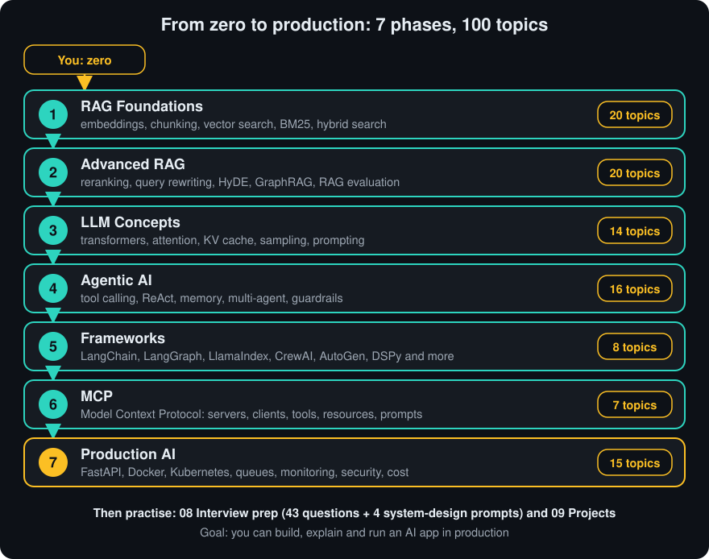
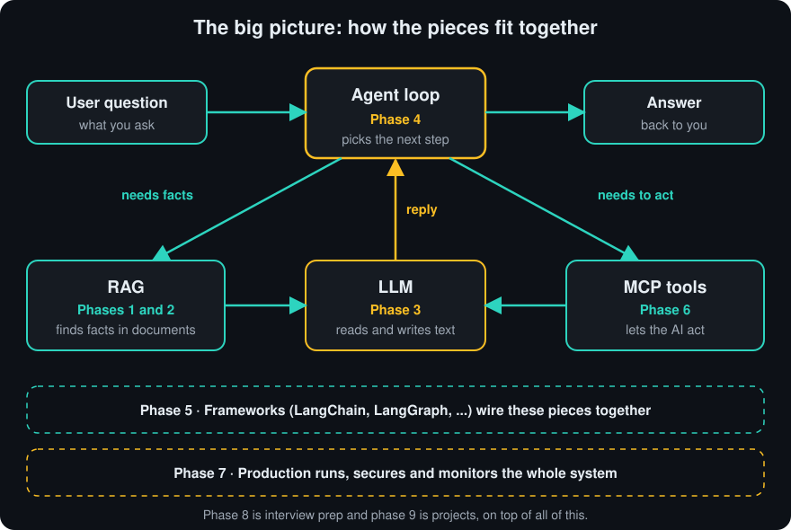
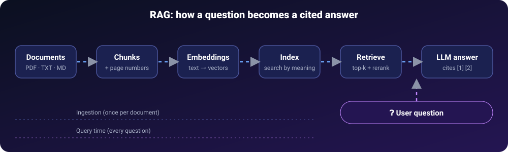
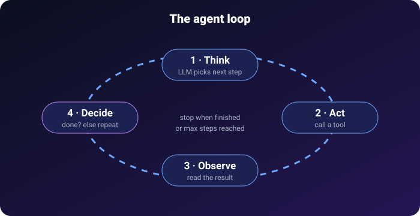
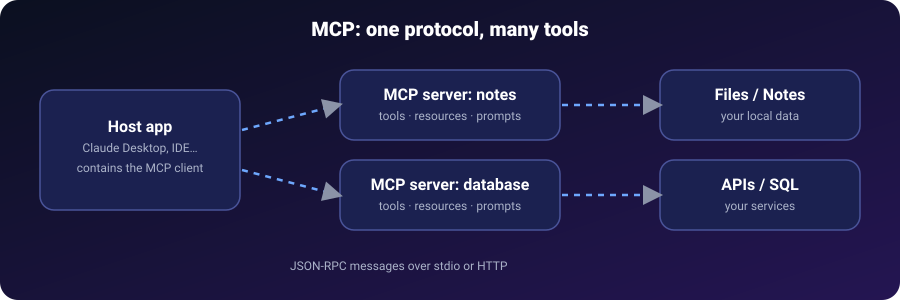

<p align="center">
  
</p>

<h1 align="center">AI Engineer Roadmap</h1>

<p align="center"><b>Learn RAG, LLMs, AI agents, frameworks, MCP and production AI step by step, with runnable code, diagrams and interview questions.</b></p>

<p align="center">
  <a href="https://github.com/techsaurabh-394/ai-engineer-roadmap/actions/workflows/ci.yml"></a>
  <a href="LICENSE"></a>
  
  
  <a href="CONTRIBUTING.md"></a>
  <a href="https://github.com/techsaurabh-394/ai-engineer-roadmap"></a>
  <a href="https://github.com/techsaurabh-394/ai-engineer-roadmap/commits/main"></a>
</p>

**100 topics in 7 phases**, each explained in plain English with an everyday analogy, a diagram, Python code, 3 interview questions and links to the original papers or official docs. If you know basic Python, you can start today. The demo scripts run offline with no API key.



## Start in 5 minutes

You need Python 3.10 or newer (CI runs 3.12) and git.

```bash
git clone https://github.com/techsaurabh-394/ai-engineer-roadmap.git
cd ai-engineer-roadmap
python3 -m venv .venv && source .venv/bin/activate      # Windows: .venv\Scripts\activate
pip install -r requirements.txt
pytest -q                                                # all green = ready
python 01-rag-foundations/code/mini_rag.py "Why use multi-stage builds?"
```

The last command runs a complete (tiny) RAG pipeline offline. This is its real output:

```text
[1] (docker.txt) Multi-stage builds compile an application in one stage and copy only the final artifact into a small runtime image. This keeps production images small and reduces the attack surface. Docker Compose describes several services in one YAML file and starts them together.
```

It chunked three sample documents, scored them against your question and printed the best passage with a citation. Set `ANTHROPIC_API_KEY` (and `pip install anthropic`) and Claude writes the answer from the retrieved passages instead. Next, open [00-start-here](00-start-here/README.md), then [topic 1: What is RAG?](01-rag-foundations/topics/01-what-is-rag.md).

## Who is this for?
- **Beginners** who keep hearing "RAG", "agents" and "MCP" and want to finally understand them
- **Developers** moving into AI engineering who want a structured path instead of random tutorials
- **Job seekers** who need to explain these topics in interviews (every topic ends with 3 questions and answers, and there is a separate [interview-prep](08-interview-prep/README.md) folder)

## Pick your path

| You are... | Start here | Then |
|---|---|---|
| Complete beginner | [00 Start here](00-start-here/README.md), then [What is RAG?](01-rag-foundations/topics/01-what-is-rag.md) and Phase 1 in order | Phases 3, 4, 6 |
| Know Python, new to AI | [What is RAG?](01-rag-foundations/topics/01-what-is-rag.md), then [What is an AI Agent?](04-agentic-ai/topics/01-what-is-an-ai-agent.md) | Phases 2, 5, 6, 7 |
| Building a RAG app now | [What is RAG?](01-rag-foundations/topics/01-what-is-rag.md), then [Reranking](02-advanced-rag/topics/01-reranking.md) | Phase 7 |
| Building agents or MCP servers | [What is an AI Agent?](04-agentic-ai/topics/01-what-is-an-ai-agent.md), then [Model Context Protocol](06-mcp/topics/01-model-context-protocol.md) | Phases 5, 7 |
| Interview in a week | [08 Interview prep](08-interview-prep/README.md) | The "Interview questions" at the end of each topic |

New to the whole thing? Read [How to study this repo](docs/how-to-study.md) and keep the [glossary](docs/glossary.md) open.

## The big picture

How the pieces fit together (the number is the phase that teaches it):



The three core ideas, in more detail:

<table>
<tr>
<td width="33%"><b>RAG</b><br/>Give the model your documents and make it cite them.<br/></td>
<td width="33%"><b>Agents</b><br/>Let the model choose tools in a loop, with limits.<br/></td>
<td width="33%"><b>MCP</b><br/>One standard way to connect AI apps to tools.<br/></td>
</tr>
</table>

More diagrams: [RAG end to end](assets/rag-end-to-end.svg) · [workflow or agent?](assets/agent-vs-workflow.svg) · [interview in a week](assets/interview-roadmap.svg) · [production checklist](assets/production-checklist.svg)

## What you'll need

Every phase works with Python. The scripts in each `code/` folder use only the standard library and run offline. The table shows what the *extra* snippets in the topic pages need if you want to run them too.

| Phase | Demos in `code/` | Extra snippets in topic pages need |
|---|---|---|
| 1 RAG Foundations | Python only, offline | `sentence-transformers`, `chromadb`, `qdrant-client`, `faiss`, `hnswlib`, `numpy`, LangChain packages (each marked with `pip install`) |
| 2 Advanced RAG | Python only, offline | `sentence-transformers` |
| 3 LLM Concepts | Python only, offline | `torch`, `transformers`, plus `openai` or `anthropic` and an API key |
| 4 Agentic AI | Python only, offline (scripted model) | `anthropic` or `openai` with an API key, `langgraph` |
| 5 Frameworks | Python only, offline (from-scratch versions) | `langchain`, `langgraph`, `llama-index`, `dspy`, OpenAI Agents SDK, and API keys for hosted models |
| 6 MCP | Python toy, offline. TypeScript server: **Node.js 18+** (CI uses 22), `npm ci`, `npm run build` | the `mcp` Python package for the snippets |
| 7 Production AI | Python only, offline: small in-process stand-ins, **no Docker, Redis or Kubernetes needed** | `fastapi`, `pydantic`, `redis`, `celery`, `mlflow`, and Docker or Kubernetes to run the Dockerfile and YAML for real |

An API key is never required. `mini_rag.py` and `agent.py` can use Claude when `ANTHROPIC_API_KEY` is set, and fall back to an offline mode otherwise.

## The full checklist

Legend: 🟢 beginner · 🟡 intermediate · 🔴 advanced.

**Progress.** Fork the repo, tick the boxes as you learn (edit this file on GitHub or locally) and update the **Done** column. The totals below are the number of topics in each phase.

| Phase | Topics | 🟢 | 🟡 | 🔴 | Done |
|---|---|---|---|---|---|
| 1 RAG Foundations | 20 | 10 | 8 | 2 | 0 / 20 |
| 2 Advanced RAG | 20 | 0 | 10 | 10 | 0 / 20 |
| 3 LLM Concepts | 14 | 5 | 8 | 1 | 0 / 14 |
| 4 Agentic AI | 16 | 5 | 8 | 3 | 0 / 16 |
| 5 Frameworks | 8 | 2 | 4 | 2 | 0 / 8 |
| 6 MCP | 7 | 2 | 4 | 1 | 0 / 7 |
| 7 Production AI | 15 | 2 | 12 | 1 | 0 / 15 |
| **Total** | **100** | **26** | **54** | **20** | **0 / 100** |

### Phase 1 — RAG Foundations

[📖 Phase overview](01-rag-foundations/README.md) · *Beginner*

- [ ] 🟢 [What is RAG?](01-rag-foundations/topics/01-what-is-rag.md)
- [ ] 🟢 [Embeddings](01-rag-foundations/topics/02-embeddings.md)
- [ ] 🟢 [Tokenization](01-rag-foundations/topics/03-tokenization.md)
- [ ] 🟢 [Chunking](01-rag-foundations/topics/04-chunking.md)
- [ ] 🟢 [Recursive Chunking](01-rag-foundations/topics/05-recursive-chunking.md)
- [ ] 🟡 [Semantic Chunking](01-rag-foundations/topics/06-semantic-chunking.md)
- [ ] 🟡 [Parent Child Chunking](01-rag-foundations/topics/07-parent-child-chunking.md)
- [ ] 🟢 [Sliding Window Chunking](01-rag-foundations/topics/08-sliding-window-chunking.md)
- [ ] 🟢 [Metadata](01-rag-foundations/topics/09-metadata.md)
- [ ] 🟡 [Vector Databases](01-rag-foundations/topics/10-vector-databases.md)
- [ ] 🟢 [Cosine Similarity](01-rag-foundations/topics/11-cosine-similarity.md)
- [ ] 🟢 [Euclidean Distance](01-rag-foundations/topics/12-euclidean-distance.md)
- [ ] 🟢 [Dot Product](01-rag-foundations/topics/13-dot-product.md)
- [ ] 🔴 [HNSW](01-rag-foundations/topics/14-hnsw.md)
- [ ] 🔴 [IVF Index](01-rag-foundations/topics/15-ivf-index.md)
- [ ] 🟡 [Hybrid Search](01-rag-foundations/topics/16-hybrid-search.md)
- [ ] 🟡 [BM25](01-rag-foundations/topics/17-bm25.md)
- [ ] 🟡 [Sparse Retrieval](01-rag-foundations/topics/18-sparse-retrieval.md)
- [ ] 🟡 [Dense Retrieval](01-rag-foundations/topics/19-dense-retrieval.md)
- [ ] 🟡 [Metadata Filtering](01-rag-foundations/topics/20-metadata-filtering.md)

### Phase 2 — Advanced RAG

[📖 Phase overview](02-advanced-rag/README.md) · *Intermediate → Advanced*

- [ ] 🟡 [Reranking](02-advanced-rag/topics/01-reranking.md)
- [ ] 🟡 [Cross Encoder](02-advanced-rag/topics/02-cross-encoder.md)
- [ ] 🟡 [Bi Encoder](02-advanced-rag/topics/03-bi-encoder.md)
- [ ] 🟡 [Context Compression](02-advanced-rag/topics/04-context-compression.md)
- [ ] 🟡 [Query Expansion](02-advanced-rag/topics/05-query-expansion.md)
- [ ] 🟡 [Multi Query Retrieval](02-advanced-rag/topics/06-multi-query-retrieval.md)
- [ ] 🔴 [HyDE](02-advanced-rag/topics/07-hyde.md)
- [ ] 🔴 [Step Back Prompting](02-advanced-rag/topics/08-step-back-prompting.md)
- [ ] 🟡 [Self Query Retriever](02-advanced-rag/topics/09-self-query-retriever.md)
- [ ] 🔴 [Multi Vector Retriever](02-advanced-rag/topics/10-multi-vector-retriever.md)
- [ ] 🟡 [Parent Document Retriever](02-advanced-rag/topics/11-parent-document-retriever.md)
- [ ] 🟡 [Ensemble Retrieval](02-advanced-rag/topics/12-ensemble-retrieval.md)
- [ ] 🔴 [Knowledge Graph RAG](02-advanced-rag/topics/13-knowledge-graph-rag.md)
- [ ] 🔴 [GraphRAG](02-advanced-rag/topics/14-graphrag.md)
- [ ] 🔴 [Multi Modal RAG](02-advanced-rag/topics/15-multi-modal-rag.md)
- [ ] 🔴 [SQL RAG](02-advanced-rag/topics/16-sql-rag.md)
- [ ] 🔴 [API RAG](02-advanced-rag/topics/17-api-rag.md)
- [ ] 🟡 [Incremental Indexing](02-advanced-rag/topics/18-incremental-indexing.md)
- [ ] 🔴 [Streaming Retrieval](02-advanced-rag/topics/19-streaming-retrieval.md)
- [ ] 🔴 [RAG Evaluation (RAGAS / DeepEval)](02-advanced-rag/topics/20-rag-evaluation.md)

### Phase 3 — LLM Concepts

[📖 Phase overview](03-llm-concepts/README.md) · *Beginner → Advanced*

- [ ] 🟢 [Transformer Architecture](03-llm-concepts/topics/01-transformer-architecture.md)
- [ ] 🟡 [Self Attention](03-llm-concepts/topics/02-self-attention.md)
- [ ] 🟡 [Multi Head Attention](03-llm-concepts/topics/03-multi-head-attention.md)
- [ ] 🟡 [Positional Encoding](03-llm-concepts/topics/04-positional-encoding.md)
- [ ] 🟡 [Decoder Only Models](03-llm-concepts/topics/05-decoder-only-models.md)
- [ ] 🟡 [Encoder Decoder Models](03-llm-concepts/topics/06-encoder-decoder-models.md)
- [ ] 🔴 [KV Cache](03-llm-concepts/topics/07-kv-cache.md)
- [ ] 🟢 [Context Window](03-llm-concepts/topics/08-context-window.md)
- [ ] 🟢 [Temperature](03-llm-concepts/topics/09-temperature.md)
- [ ] 🟢 [Top-k](03-llm-concepts/topics/10-top-k.md)
- [ ] 🟡 [Top-p](03-llm-concepts/topics/11-top-p.md)
- [ ] 🟡 [Beam Search](03-llm-concepts/topics/12-beam-search.md)
- [ ] 🟡 [Hallucination](03-llm-concepts/topics/13-hallucination.md)
- [ ] 🟢 [Prompt Engineering](03-llm-concepts/topics/14-prompt-engineering.md)

### Phase 4 — Agentic AI

[📖 Phase overview](04-agentic-ai/README.md) · *Intermediate*

- [ ] 🟢 [What is an AI Agent?](04-agentic-ai/topics/01-what-is-an-ai-agent.md)
- [ ] 🟢 [Tool Calling](04-agentic-ai/topics/02-tool-calling.md)
- [ ] 🟢 [Function Calling](04-agentic-ai/topics/03-function-calling.md)
- [ ] 🟡 [ReAct Pattern](04-agentic-ai/topics/04-react-pattern.md)
- [ ] 🟡 [Planning Agents](04-agentic-ai/topics/05-planning-agents.md)
- [ ] 🟡 [Reflection](04-agentic-ai/topics/06-reflection.md)
- [ ] 🟢 [Memory](04-agentic-ai/topics/07-memory.md)
- [ ] 🟢 [Short-term Memory](04-agentic-ai/topics/08-short-term-memory.md)
- [ ] 🟡 [Long-term Memory](04-agentic-ai/topics/09-long-term-memory.md)
- [ ] 🟡 [Semantic Memory](04-agentic-ai/topics/10-semantic-memory.md)
- [ ] 🟡 [Episodic Memory](04-agentic-ai/topics/11-episodic-memory.md)
- [ ] 🟡 [Agent Loops](04-agentic-ai/topics/12-agent-loops.md)
- [ ] 🔴 [Multi-Agent Systems](04-agentic-ai/topics/13-multi-agent-systems.md)
- [ ] 🟡 [Human in the Loop](04-agentic-ai/topics/14-human-in-the-loop.md)
- [ ] 🔴 [Agent Evaluation](04-agentic-ai/topics/15-agent-evaluation.md)
- [ ] 🔴 [Agent Guardrails](04-agentic-ai/topics/16-agent-guardrails.md)

### Phase 5 — Frameworks

[📖 Phase overview](05-frameworks/README.md) · *Intermediate*

- [ ] 🟢 [LangChain](05-frameworks/topics/01-langchain.md)
- [ ] 🟡 [LangGraph](05-frameworks/topics/02-langgraph.md)
- [ ] 🟢 [LlamaIndex](05-frameworks/topics/03-llamaindex.md)
- [ ] 🟡 [OpenAI Agents SDK](05-frameworks/topics/04-openai-agents-sdk.md)
- [ ] 🟡 [CrewAI](05-frameworks/topics/05-crewai.md)
- [ ] 🔴 [AutoGen](05-frameworks/topics/06-autogen.md)
- [ ] 🔴 [DSPy](05-frameworks/topics/07-dspy.md)
- [ ] 🟡 [Haystack](05-frameworks/topics/08-haystack.md)

### Phase 6 — MCP (Model Context Protocol)

[📖 Phase overview](06-mcp/README.md) · *Intermediate → Advanced*

- [ ] 🟢 [Model Context Protocol](06-mcp/topics/01-model-context-protocol.md)
- [ ] 🟢 [MCP Server](06-mcp/topics/02-mcp-server.md)
- [ ] 🟡 [MCP Client](06-mcp/topics/03-mcp-client.md)
- [ ] 🟡 [MCP Tools](06-mcp/topics/04-mcp-tools.md)
- [ ] 🟡 [MCP Resources](06-mcp/topics/05-mcp-resources.md)
- [ ] 🟡 [MCP Prompts](06-mcp/topics/06-mcp-prompts.md)
- [ ] 🔴 [Build a Custom MCP Server](06-mcp/topics/07-build-a-custom-mcp-server.md)

### Phase 7 — Production AI

[📖 Phase overview](07-production-ai/README.md) · *Advanced*

- [ ] 🟢 [FastAPI for AI](07-production-ai/topics/01-fastapi-for-ai.md)
- [ ] 🟢 [Docker](07-production-ai/topics/02-docker.md)
- [ ] 🟡 [Kubernetes](07-production-ai/topics/03-kubernetes.md)
- [ ] 🟡 [Redis](07-production-ai/topics/04-redis.md)
- [ ] 🟡 [Celery](07-production-ai/topics/05-celery.md)
- [ ] 🟡 [RabbitMQ](07-production-ai/topics/06-rabbitmq.md)
- [ ] 🟡 [Monitoring](07-production-ai/topics/07-monitoring.md)
- [ ] 🟡 [LangSmith](07-production-ai/topics/08-langsmith.md)
- [ ] 🟡 [MLflow](07-production-ai/topics/09-mlflow.md)
- [ ] 🟡 [Prompt Versioning](07-production-ai/topics/10-prompt-versioning.md)
- [ ] 🟡 [AI Security](07-production-ai/topics/11-ai-security.md)
- [ ] 🟡 [Guardrails](07-production-ai/topics/12-guardrails.md)
- [ ] 🟡 [Observability](07-production-ai/topics/13-observability.md)
- [ ] 🟡 [Cost Optimization](07-production-ai/topics/14-cost-optimization.md)
- [ ] 🔴 [Deploy a Production AI Application](07-production-ai/topics/15-deploy-a-production-ai-application.md)

## Extras
| Folder | What is inside |
|---|---|
| [08-interview-prep](08-interview-prep/README.md) | 43 curated questions plus 4 system-design prompts, in 5 files |
| [09-projects](09-projects/README.md) | Portfolio project ideas from beginner to advanced |
| [docs/how-to-study.md](docs/how-to-study.md) | A study routine: pace, and what to do for each topic |
| [docs/glossary.md](docs/glossary.md) | Plain-English definitions of the key terms |
| `*/code/` | Runnable, tested demos for every phase (see "What you'll need") |

Interview questions in total: **300** at the end of the 100 topic pages (3 each), plus the 43 + 4 in `08-interview-prep`.

## What makes this different
- **Plain English first.** Every term is defined where it first appears.
- **Everything runs.** Demo scripts have tests, and CI runs them on every push.
- **Basic to hard in one place.** From "what is a token" to GraphRAG, Kubernetes and prompt-injection defence.
- **Honest trade-offs.** Each topic says when *not* to use the technique.
- **Primary sources.** Each topic links to the original paper or official docs.

## Repository map
```
ai-engineer-roadmap/
├── 00-start-here/        setup and how to learn
├── 01-rag-foundations/   20 topics + code/
├── 02-advanced-rag/      20 topics + code/
├── 03-llm-concepts/      14 topics + code/
├── 04-agentic-ai/        16 topics + code/
├── 05-frameworks/        8 topics + code/
├── 06-mcp/               7 topics + code/ (incl. a TypeScript MCP server)
├── 07-production-ai/     15 topics + code/
├── 08-interview-prep/    questions and answers
├── 09-projects/          projects to build and share
├── assets/               SVG diagrams
├── docs/                 study guide and glossary
└── .github/workflows/    CI, link check, stale-issue cleanup
```

## Automated checks
Every push and pull request runs the Python tests for all phases, builds the TypeScript MCP example, validates the SVG diagrams and checks that links to local files in Markdown pages are not broken. A separate link-check workflow checks external links; it runs on pull requests that change Markdown and every Monday, and it reports problems without failing the build.

## Contributing
Found a mistake or want a topic added? Read [CONTRIBUTING.md](CONTRIBUTING.md) and open a pull request. Corrections are very welcome. See also the [changelog](CHANGELOG.md).

## Related projects by the author
| Project | What it is |
|---|---|
| [rag-docs-chat](https://github.com/techsaurabh-394/rag-docs-chat) | PDF chat with cited answers and an evaluation script |
| [mcp-notes-server](https://github.com/techsaurabh-394/mcp-notes-server) | MCP server with 6 typed tools, resources and a prompt |
| [claude-skills](https://github.com/techsaurabh-394/claude-skills) | Reusable Claude Skills for SEO/GEO, blogging and MCP |
| [mernstackdev.com](https://mernstackdev.com) | Developer blog on React, Node.js and AI engineering |

If this is useful, a star helps others find it.

---

<p align="center">
  <b>Saurabh Pathak</b> · AI Engineer &amp; Full-Stack Developer<br/>
  <a href="https://github.com/techsaurabh-394">GitHub</a> ·
  <a href="https://www.linkedin.com/in/tech-saurabh/">LinkedIn</a> ·
  <a href="https://mernstackdev.com">Blog</a> ·
  <a href="mailto:saurabhpathak394@gmail.com">saurabhpathak394@gmail.com</a><br/>
  <a href="https://buymeacoffee.com/saurabhdev"></a>
</p>
