# Animated explainers

110 short animations that show the hard ideas moving, one step at a time. Each one loops: watch the highlighted box and read the caption underneath. Every animation is also embedded in its topic page under **Watch it**.

Want to go at your own pace? Open the [interactive viewer](https://techsaurabh-394.github.io/ai-engineer-roadmap/) and use Previous, Play and Next, or the arrow keys.

This page is generated by `python scripts/gen_animations.py`; do not edit it by hand.

## Phase 1: RAG foundations

### RAG, step by step

*Lesson: [What is RAG?](../01-rag-foundations/topics/01-what-is-rag.md)*


### Embeddings

*Lesson: [Embeddings](../01-rag-foundations/topics/02-embeddings.md)*


### Tokenization

*Lesson: [Tokenization](../01-rag-foundations/topics/03-tokenization.md)*


### Chunking with overlap

*Lesson: [Chunking](../01-rag-foundations/topics/04-chunking.md)*


### Recursive chunking

*Lesson: [Recursive Chunking](../01-rag-foundations/topics/05-recursive-chunking.md)*


### Semantic chunking

*Lesson: [Semantic Chunking](../01-rag-foundations/topics/06-semantic-chunking.md)*


### Parent-child chunking

*Lesson: [Parent Child Chunking](../01-rag-foundations/topics/07-parent-child-chunking.md)*

### Sliding window chunking

*Lesson: [Sliding Window Chunking](../01-rag-foundations/topics/08-sliding-window-chunking.md)*


### Metadata

*Lesson: [Metadata](../01-rag-foundations/topics/09-metadata.md)*


### Vector databases

*Lesson: [Vector Databases](../01-rag-foundations/topics/10-vector-databases.md)*


### Cosine similarity

*Lesson: [Cosine Similarity](../01-rag-foundations/topics/11-cosine-similarity.md)*


### Euclidean distance

*Lesson: [Euclidean Distance](../01-rag-foundations/topics/12-euclidean-distance.md)*


### Dot product

*Lesson: [Dot Product](../01-rag-foundations/topics/13-dot-product.md)*


### HNSW index

*Lesson: [HNSW](../01-rag-foundations/topics/14-hnsw.md)*

### IVF index

*Lesson: [IVF Index](../01-rag-foundations/topics/15-ivf-index.md)*

### Hybrid search

*Lesson: [Hybrid Search](../01-rag-foundations/topics/16-hybrid-search.md)*

### BM25

*Lesson: [BM25](../01-rag-foundations/topics/17-bm25.md)*


### Sparse retrieval

*Lesson: [Sparse Retrieval](../01-rag-foundations/topics/18-sparse-retrieval.md)*


### Dense retrieval

*Lesson: [Dense Retrieval](../01-rag-foundations/topics/19-dense-retrieval.md)*


### Metadata filtering

*Lesson: [Metadata Filtering](../01-rag-foundations/topics/20-metadata-filtering.md)*

## Phase 2: Advanced RAG

### Reranking

*Lesson: [Reranking](../02-advanced-rag/topics/01-reranking.md)*

### Cross-encoder

*Lesson: [Cross Encoder](../02-advanced-rag/topics/02-cross-encoder.md)*


### Bi-encoder

*Lesson: [Bi Encoder](../02-advanced-rag/topics/03-bi-encoder.md)*


### Context compression

*Lesson: [Context Compression](../02-advanced-rag/topics/04-context-compression.md)*

### Query expansion

*Lesson: [Query Expansion](../02-advanced-rag/topics/05-query-expansion.md)*

### Multi-query retrieval

*Lesson: [Multi Query Retrieval](../02-advanced-rag/topics/06-multi-query-retrieval.md)*


### HyDE

*Lesson: [HyDE](../02-advanced-rag/topics/07-hyde.md)*


### Step-back prompting

*Lesson: [Step Back Prompting](../02-advanced-rag/topics/08-step-back-prompting.md)*

### Self-query retriever

*Lesson: [Self Query Retriever](../02-advanced-rag/topics/09-self-query-retriever.md)*


### Multi-vector retriever

*Lesson: [Multi Vector Retriever](../02-advanced-rag/topics/10-multi-vector-retriever.md)*


### Parent document retriever

*Lesson: [Parent Document Retriever](../02-advanced-rag/topics/11-parent-document-retriever.md)*


### Ensemble retrieval

*Lesson: [Ensemble Retrieval](../02-advanced-rag/topics/12-ensemble-retrieval.md)*


### Knowledge graph RAG

*Lesson: [Knowledge Graph RAG](../02-advanced-rag/topics/13-knowledge-graph-rag.md)*


### GraphRAG

*Lesson: [GraphRAG](../02-advanced-rag/topics/14-graphrag.md)*


### Multi-modal RAG

*Lesson: [Multi Modal RAG](../02-advanced-rag/topics/15-multi-modal-rag.md)*


### SQL RAG (text-to-SQL)

*Lesson: [SQL RAG](../02-advanced-rag/topics/16-sql-rag.md)*

### API RAG

*Lesson: [API RAG](../02-advanced-rag/topics/17-api-rag.md)*


### Incremental indexing

*Lesson: [Incremental Indexing](../02-advanced-rag/topics/18-incremental-indexing.md)*


### Streaming retrieval

*Lesson: [Streaming Retrieval](../02-advanced-rag/topics/19-streaming-retrieval.md)*

### The evaluation loop

*Lesson: [RAG Evaluation (RAGAS / DeepEval)](../02-advanced-rag/topics/20-rag-evaluation.md), [Agent Evaluation](../04-agentic-ai/topics/15-agent-evaluation.md)*


### LLM-as-a-judge

*Lesson: [LLM-as-a-Judge](../02-advanced-rag/topics/21-llm-as-a-judge.md)*


## Phase 3: LLM concepts

### Transformer architecture

*Lesson: [Transformer Architecture](../03-llm-concepts/topics/01-transformer-architecture.md)*


### Attention: who should this word look at?

*Lesson: [Self Attention](../03-llm-concepts/topics/02-self-attention.md)*


### Multi-head attention

*Lesson: [Multi Head Attention](../03-llm-concepts/topics/03-multi-head-attention.md)*

### Positional encoding

*Lesson: [Positional Encoding](../03-llm-concepts/topics/04-positional-encoding.md)*


### Decoder-only models

*Lesson: [Decoder Only Models](../03-llm-concepts/topics/05-decoder-only-models.md)*

### Encoder-decoder models

*Lesson: [Encoder Decoder Models](../03-llm-concepts/topics/06-encoder-decoder-models.md)*


### KV cache

*Lesson: [KV Cache](../03-llm-concepts/topics/07-kv-cache.md)*


### Context window

*Lesson: [Context Window](../03-llm-concepts/topics/08-context-window.md)*


### Temperature

*Lesson: [Temperature](../03-llm-concepts/topics/09-temperature.md)*


### Top-k sampling

*Lesson: [Top-k](../03-llm-concepts/topics/10-top-k.md)*


### Top-p (nucleus) sampling

*Lesson: [Top-p](../03-llm-concepts/topics/11-top-p.md)*


### Beam search

*Lesson: [Beam Search](../03-llm-concepts/topics/12-beam-search.md)*

### Hallucination

*Lesson: [Hallucination](../03-llm-concepts/topics/13-hallucination.md)*


### Prompt engineering loop

*Lesson: [Prompt Engineering](../03-llm-concepts/topics/14-prompt-engineering.md)*


### Fine-tuning, step by step

*Lesson: [Fine-Tuning (the overview)](../03-llm-concepts/topics/15-fine-tuning.md)*


### Calling an LLM API

*Lesson: [Calling an LLM API](../03-llm-concepts/topics/16-calling-an-llm-api.md)*


### Structured outputs

*Lesson: [Structured Outputs](../03-llm-concepts/topics/17-structured-outputs.md)*


### Quantization

*Lesson: [Quantization (shrinking a model)](../03-llm-concepts/topics/18-quantization.md)*


### LoRA and PEFT

*Lesson: [LoRA and PEFT (cheap fine-tuning)](../03-llm-concepts/topics/19-lora-and-peft.md)*


### Inference serving and batching

*Lesson: [Inference Serving and Batching](../03-llm-concepts/topics/20-inference-serving-and-batching.md)*


### From text to answer inside an LLM

*Lesson: [How an LLM Works End to End](../03-llm-concepts/topics/21-how-an-llm-works-end-to-end.md)*


### Q, K and V explained

*Lesson: [Q, K and V Explained From Scratch](../03-llm-concepts/topics/22-qkv-explained-from-scratch.md)*


### Inside a transformer block

*Lesson: [Inside a Transformer Block: Residuals, LayerNorm and the Feed-Forward Network](../03-llm-concepts/topics/23-inside-a-transformer-block.md)*


### How LLMs are trained

*Lesson: [How LLMs Are Trained: Loss, Backprop, Pretraining, SFT and RLHF](../03-llm-concepts/topics/24-how-llms-are-trained.md)*

### Modern attention variants

*Lesson: [Modern Attention: MQA, GQA, FlashAttention, Sliding Window and RoPE](../03-llm-concepts/topics/25-modern-attention-variants.md)*

### Mixture of experts and scaling laws

*Lesson: [Mixture of Experts and Scaling Laws](../03-llm-concepts/topics/26-mixture-of-experts-and-scaling-laws.md)*

## Phase 4: Agentic AI

### The agent loop

*Lesson: [What is an AI Agent?](../04-agentic-ai/topics/01-what-is-an-ai-agent.md), [Agent Loops](../04-agentic-ai/topics/12-agent-loops.md)*

### Tool calling, step by step

*Lesson: [Tool Calling](../04-agentic-ai/topics/02-tool-calling.md), [Function Calling](../04-agentic-ai/topics/03-function-calling.md)*

### ReAct loop: Think, Act, Observe

*Lesson: [ReAct Pattern](../04-agentic-ai/topics/04-react-pattern.md)*

### Planning agents

*Lesson: [Planning Agents](../04-agentic-ai/topics/05-planning-agents.md)*

### Reflection loop

*Lesson: [Reflection](../04-agentic-ai/topics/06-reflection.md)*

### Agent memory

*Lesson: [Memory](../04-agentic-ai/topics/07-memory.md)*

### Short-term memory

*Lesson: [Short-term Memory](../04-agentic-ai/topics/08-short-term-memory.md)*

### Long-term memory

*Lesson: [Long-term Memory](../04-agentic-ai/topics/09-long-term-memory.md)*

### Semantic memory

*Lesson: [Semantic Memory](../04-agentic-ai/topics/10-semantic-memory.md)*

### Episodic memory

*Lesson: [Episodic Memory](../04-agentic-ai/topics/11-episodic-memory.md)*

### Multi-agent systems

*Lesson: [Multi-Agent Systems](../04-agentic-ai/topics/13-multi-agent-systems.md)*

### Human in the loop

*Lesson: [Human in the Loop](../04-agentic-ai/topics/14-human-in-the-loop.md)*

### Agent guardrails

*Lesson: [Agent Guardrails](../04-agentic-ai/topics/16-agent-guardrails.md)*

## Phase 5: Frameworks

### LangChain: a chain of building blocks

*Lesson: [LangChain](../05-frameworks/topics/01-langchain.md)*

### LangGraph: a graph of steps

*Lesson: [LangGraph](../05-frameworks/topics/02-langgraph.md)*

### LlamaIndex

*Lesson: [LlamaIndex](../05-frameworks/topics/03-llamaindex.md)*

### OpenAI Agents SDK: the Runner loop

*Lesson: [OpenAI Agents SDK](../05-frameworks/topics/04-openai-agents-sdk.md)*

### CrewAI

*Lesson: [CrewAI](../05-frameworks/topics/05-crewai.md)*

### AutoGen

*Lesson: [AutoGen](../05-frameworks/topics/06-autogen.md)*

### DSPy

*Lesson: [DSPy](../05-frameworks/topics/07-dspy.md)*

### Haystack

*Lesson: [Haystack](../05-frameworks/topics/08-haystack.md)*

## Phase 6: MCP

### MCP: how an AI app uses a tool server

*Lesson: [Model Context Protocol](../06-mcp/topics/01-model-context-protocol.md)*

### MCP server

*Lesson: [MCP Server](../06-mcp/topics/02-mcp-server.md)*

### MCP client

*Lesson: [MCP Client](../06-mcp/topics/03-mcp-client.md)*

### MCP tools

*Lesson: [MCP Tools](../06-mcp/topics/04-mcp-tools.md)*

### MCP resources

*Lesson: [MCP Resources](../06-mcp/topics/05-mcp-resources.md)*

### MCP prompts

*Lesson: [MCP Prompts](../06-mcp/topics/06-mcp-prompts.md)*

### Build a custom MCP server

*Lesson: [Build a Custom MCP Server](../06-mcp/topics/07-build-a-custom-mcp-server.md)*

## Phase 7: Production AI

### FastAPI for AI

*Lesson: [FastAPI for AI](../07-production-ai/topics/01-fastapi-for-ai.md)*

### Docker

*Lesson: [Docker](../07-production-ai/topics/02-docker.md)*

### Kubernetes

*Lesson: [Kubernetes](../07-production-ai/topics/03-kubernetes.md)*

### Redis

*Lesson: [Redis](../07-production-ai/topics/04-redis.md)*

### Celery

*Lesson: [Celery](../07-production-ai/topics/05-celery.md)*

### RabbitMQ

*Lesson: [RabbitMQ](../07-production-ai/topics/06-rabbitmq.md)*

### Monitoring

*Lesson: [Monitoring](../07-production-ai/topics/07-monitoring.md)*

### LangSmith

*Lesson: [LangSmith](../07-production-ai/topics/08-langsmith.md)*

### MLflow

*Lesson: [MLflow](../07-production-ai/topics/09-mlflow.md)*

### Prompt versioning

*Lesson: [Prompt Versioning](../07-production-ai/topics/10-prompt-versioning.md)*

### AI security

*Lesson: [AI Security](../07-production-ai/topics/11-ai-security.md)*

### Guardrails

*Lesson: [Guardrails](../07-production-ai/topics/12-guardrails.md)*

### Observability

*Lesson: [Observability](../07-production-ai/topics/13-observability.md)*

### Cost optimisation

*Lesson: [Cost Optimization](../07-production-ai/topics/14-cost-optimization.md)*

### Deploy a production AI app

*Lesson: [Deploy a Production AI Application](../07-production-ai/topics/15-deploy-a-production-ai-application.md)*

